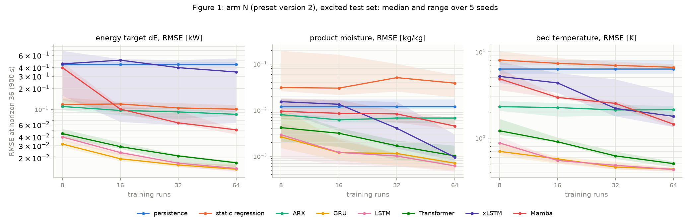
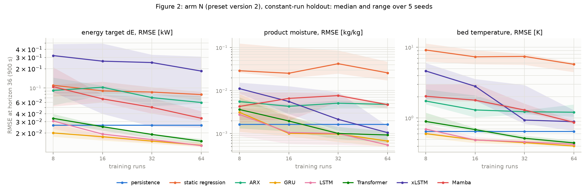

# Synthesis AP1 for M2: methodology of simulation and ML modelling

> Milestone M2 (TUHH-B, AP1): "Methodology of simulation and ML modelling documented
> (procedures, tools, templates; reduction of the training-data need)"
> (`docs/01_projektsteckbrief.md`). **Version 5b**, state 2026-10-19, draft for review by the
> project lead, revised after review 4 (`docs/reviews/2026-10-19/review4_synthesis_v5.md`).
> Every number in the summary, in sections 1 to 8 and in appendices A to E is traced to a finding
> in `docs/04_stand_ap1.md` and a committed artifact (appendix F) and is checked against that
> artifact or configuration by `scripts/check_m2_synthesis_consistency.py`, or listed there as not
> machine-checkable with the reason. Findings are cited as "Befund N" (lab-book entries, in German
> or English as written). Procedures are in sections 2 and 5, tools and templates in appendix A,
> the reduction of the training-data need in section 6 and appendix D.

## Summary

TwinLink builds a digital twin of fluidised-bed spray granulation; AP1 develops the method for a
soft sensor that infers the unmeasured product moisture and the energy target from the history of
the manipulated variables. **All results are statements about a grey-box simulator with placeholder
parameters, not about a plant.** The method: learning curves over the number of simulated training
runs, splits by run, two named test sets (excited and constant-run holdout), baselines before any
network, and paired comparisons over five seeds with Holm correction as the main form.

GRU and LSTM are the best of the eight methods tested; GRU is recommended as the default on
practical grounds (fewer parameters, lower latency), not as a performance rank: after Holm no
GRU-against-LSTM cell is resolved. In the tested, untuned configuration Mamba and the baselines are
resolved behind LSTM after Holm in part of the cells, and the deficit of the xLSTM (mLSTM-only
variant) is large and consistent across all seeds but not resolved under Holm with five seeds. The
networks differ in size by a factor of about seven; on the old data, capacity-matched variants with
recurrent memory mixing come close to LSTM on energy and bed temperature but not on the moisture, and
a larger Mamba stays behind.

Data need: with the fixed protocol the moisture error of GRU and LSTM at 8 training runs is 3.7 to
5.1 times the error at 64 runs, and the curves still fall at 64 runs, so the need beyond 64 runs is
not determined; every point also uses 32 validation runs. Pre-training on the simulator and
fine-tuning on few plant runs beats training from scratch at small numbers of runs on every plant
variant tested (study A); a hybrid with the simulator as an input channel is not recommended as the
default. A planned excitation was not established as better than a plain random-step design in the
primary test (study B), but models trained on constant operation alone stay far behind models trained
on excited data, and plant records contain little dynamics: an excitation experiment at the plant is
needed. Inference is far below the sample time of 25 s for every method. Open: a validation against
plant data (the moisture is not measured at the plant), the placeholder parameters, and more seeds
where the paired spread is large.

## Changes from version 5 (review 4, 2026-10-19)

- **Executive summary** and **appendices A to E** (tools and environment with a study template,
  hyperparameters, simulator interface, data need, glossary) added for the M2 items "tools,
  templates, reduction of the training-data need"; the traceability table is now appendix F, with
  the script that writes each artifact.
- **Capacity and protocol** paragraph in section 3: parameter counts of all networks, the xLSTM is
  the mLSTM-only variant, fixed protocol without tuning, the capacity-matched variants of SX3 with
  their result; every architecture statement holds for the tested, untuned configuration.
- **Rank statements** carry the Holm verdict, the effect size (ratio of medians) and the sign
  consistency over the seeds (addendum to Befund 98); large and consistent effects that do not
  survive Holm are no longer called a tendency.
- **Seed numbers** from arm N (addendum to Befund 94); the old data A0 only as a comparison.
- **Text fixes** (review findings 5-20): the xLSTM instability concerns the energy target; the
  Holm-resolved tests of N against A0 are all persistence; study A marked as uncorrected, the hybrid
  statement as in Befund 88 with the cost; study B leads with the hypothesis verdicts; the stability
  verdict of Befund 80; test set and caveat of Befund 55 (with its corrected GRU range); seed budget
  restricted to GRU; origin of the margin m; Befund 99 in the outlook; metric and targets of Befund
  39; Benjamini-Hochberg count; "dE" defined; figures numbered and labelled with units.
- There is no version 4 in the repository history: the revision list of `docs/12` (2026-10-09)
  was written for version 5 directly.

## Changes from version 3 (2026-09-25) to version 5 (2026-10-16)

- **Data basis.** The architecture comparison rests on the re-run on preset version 2
  (arm N, Befund 94); the old records (arm A0) are used only as a comparison. The old
  Linux/Windows confound between model families does not apply to the new records.
- **Statistics.** Paired resolution over seeds (t distribution) replaces the unpaired z threshold;
  **Holm correction is the main form**, uncorrected counts are given as an addition (Befund 83, 94
  and its addendum, Befund 98).
- **Cost.** Inference times only from the joint measurement on an idle machine (Befund 97).
- **Removed or restated (review of 2026-10-09, `docs/12`).** Persistence factors, model R^2
  and "factor 20", the solid-fraction range, the soft-sensor margin factors, early-stopping
  epoch counts, the ARX/NARX paragraph and the pinch statement are no longer taken over.
- **New in version 5.** Studies A and B (Befunde 88, 87), the outlook with the corrected figures of
  Befunde 80, 81, 93, 96, the partner model (Befunde 90, 95) and the storage of plant A
  (Befunde 91, 92).

## 1. Question and frame

TwinLink builds a digital twin for fluidised-bed spray granulation. The process loads a
particle bed with a suspension that dries on the hot surface; inlet temperature, gas
velocity, spray rate and nozzle pressure determine how much water evaporates, how fast the
bed grows and how moist the product stays. The simulator models continuous operation with a
controlled bed level (solids-mass set point, time constant 600 s), not a sequence of
batches; the operating mode of the target plant is an open question for AP2. The state that
matters for operation (bed mass, water content, particle number, bed temperature) is only
partly measurable at a real plant: the bed temperature is available inline, the product
moisture in general is not. A controller that acts on measured quantities only therefore
needs a model that infers the unobserved state from the history of the manipulated
variables, a soft sensor. AP1 builds and compares the candidate model classes and asks how
much training data each needs, not only how good it gets at best. The three predicted targets are
the product moisture (kg water per kg dry solid), the bed temperature and the **energy target
dE**, the instantaneous total power of heater, fan, pump and atomiser in kW (absolute, no
reference point; the definition for the plant is an open question of the consortium).

Until a full population-balance model is available (planned for month 21), a reduced
grey-box model with four states (solids mass, water mass, particle number, bed temperature)
carries the methodology work (`docs/02_prozess_setup.md`, appendix C). The ML architectures are
needed because the real state is not fully measurable, whatever process model stands behind them.
**All numbers in this document are statements about the grey-box simulator, not about a real
plant**; section 7 makes the limit explicit.

## 2. Method

**Learning curves as the primary result format.** For every method the error is reported
over the number of training runs ($n_{\mathrm{train}} \in \{8, 16, 32, 64\}$), as median and range over
five seeds (Figures 1 and 2). A model that leads at small $n_{\mathrm{train}}$ but stops improving has a
different data need from a model whose curve still falls at 64.

**Run-level splits.** Training, validation and test sets are separated by simulation runs,
never by windows or time points. A window-wise split, common in parts of the literature,
reports on the same data an error that is lower by 29 to 68 % depending on the target
(Befund 39: ExtraTrees, horizon 1, run-median NRMSE of the energy target, the product moisture
and the median particle diameter).

**Two test sets, always named.** The *excited* test set (steps, PRBS, ramps inside every
run) measures identification quality; the *constant-run holdout* (set points constant within
a run, different between runs) measures operational relevance; plant records resemble the
latter. Both are reported apart. A factor against persistence is quotable only with metric,
test set and budget named, because persistence is structurally weak on the excited set and
trivially strong on constant runs (Befund 51, K5). The excited set contains a small share of
constant runs (`docs/12`, D-W2).

**Baselines first.** Persistence, a static quadratic regression and a linear ARX run before
any neural model. The error metric is the run-median RMSE in physical units at horizon 36
(900 s) unless stated; horizon 1 is reported separately.

**Data basis.** The old records (arm A0, Befund 51/58) rest on the legacy data
configuration. The re-run (Befund 94) adds arm A1 (legacy trajectories, planned future
inputs) and **arm N, the preset version 2** (`DataSpec.new_study`: planned future inputs, own
disturbance process of the solid fraction, per-run cap of the gas velocity at the terminal
velocity of the initial diameter; Befund 82, 86). Arm N is the basis of this synthesis.
`process/fingerprint` covers the process configuration only; the data, excitation and split
digests are recorded next to it. The new records come from a single machine; arm A0 carries a
platform confound (GRU, LSTM and baselines on Linux, Transformer, xLSTM and Mamba on
Windows; Befund 83 b); at the cells re-run, Befund 84 and 85 found no platform effect for
GRU and LSTM beyond the last digits.

**Resolution: paired over seeds, Holm as the main form.** All methods run with the same
master seeds; per cell the differences `reference - candidate` are formed per seed and
tested with the t distribution on four degrees of freedom (`evaluation/paired_resolution.py`;
Befund 82). The test is on the mean of the differences; the tables report medians. The
verdict per cell is "candidate better", "candidate worse" or "unresolved". With many cells,
a family-wise correction is needed: **the main form counts a cell as resolved only if it
survives Holm (5 %) within the family of all rank cells of a single arm** (336 cells in A0 and N,
168 in A1; Befund 94); the uncorrected count is given as an addition, the sign convention is
"candidate against LSTM". Next to every verdict the effect size (ratio of the medians, candidate
over LSTM) and the number of seeds on the same side are given (addendum to Befund 98). The older z
thresholds of Befund 63 are superseded (Befund 67, 83). The re-analysis of the old records applied
632 uncorrected paired tests (Befund 83).

**Number of seeds (arm N).** At $n_{\mathrm{train}}$ = 64 and horizon 36 a paired difference of 12.5 % between
GRU and LSTM is resolved at 80 % power with 3 to 6 seeds on energy and bed temperature, with 5 seeds
on the product moisture on the excited test set and with 16 on the constant-run holdout; the
Transformer needs 4 to 7 seeds on energy and bed temperature but 210 (excited) and 69 (constant-run
holdout) on the moisture (addendum to Befund 94; planning figures estimated from five seeds, with
wide intervals). For comparison, the old data A0 gave 45 and 37 seeds for GRU and 193 and 33 for
the Transformer on the moisture (Befund 83, addendum b): for the GRU-LSTM pair the moisture problem
is smaller on the new data basis, not gone. Over all budgets and both horizons the moisture figure
varies strongly (GRU on the excited set 3 to 753 seeds), because the spread between seeds is large at
small budgets. The M2 definition of 10 to 15 % sits in a note of the project profile and the work
plan, not in the formal definition.

## 3. Architecture comparison (arm N)

Eight methods (persistence, static regression, ARX, GRU, LSTM, Transformer, xLSTM, Mamba),
three targets, two test sets, $n_{\mathrm{train}} \in \{8,16,32,64\}$, five seeds, horizons 1 and 36;
the trained networks are per-target composites (Befund 26, 28). Learning curves: Figure 1
(excited test set) and Figure 2 (constant-run holdout), generated by
`scripts/plot_synthesis_v5b_figures.py` from the records of Befund 94.

*Figure 1: error (RMSE at horizon 36 in physical units: energy target in kW, product moisture in
kg/kg, bed temperature in K) over the number of training runs, median and range over five seeds,
arm N, excited test set; logarithmic axes.*

*Figure 2: as Figure 1, constant-run holdout.*

**Capacity and protocol.** The networks are not of equal size: LSTM 57,027 parameters, GRU 42,819,
Transformer 23,523, xLSTM 8,649 and Mamba 8,139 (appendix B). The xLSTM of this comparison is the
**mLSTM-only variant**, without sLSTM cells and without hidden-to-hidden weights (Befund 67 SX0). All
networks were trained with the same fixed protocol without hyperparameter tuning (at most 200 epochs,
early stopping); the epoch cap of the Transformer binds at $n_{\mathrm{train}}$ = 64 (Befund 58). The
capacity-matched variants of SX3 (Befund 67, re-evaluated in Befund 83 d; old data A0 at
$n_{\mathrm{train}}$ = 64, same untuned protocol) answer part of the size question: the variants with
recurrent memory mixing (sLSTM only, and mixed mLSTM and sLSTM, 47,955 to 50,739 parameters) come
close to the LSTM on energy and bed temperature but stay 1.6 to 3.3 times behind it on the moisture;
the capacity-matched mLSTM-only variant (50,301) diverges on the energy target like the small
variant; a Mamba of 53,211 parameters is not better than the small one (resolved worse than LSTM in 6 of 6
cells, 3 of them after Holm in the family of 96 tests of Befund 83 addendum a); and a small LSTM of
8,517 parameters is not resolved worse than the large one in any cell, so the size of xLSTM and
Mamba alone does not explain their deficit. **All architecture statements below hold for the tested,
untuned configuration; they are statements about this protocol, not about the architectures in
general** (Befund 67).

**How rank statements are worded.** A cell is "resolved" if it survives Holm. A cell that does not
survive Holm but whose median is at least 1.5 times that of LSTM (or at most 1/1.5 of it) with all
five seeds on that side is called **large and consistent across all seeds, not resolved under Holm
with five seeds and a family of 336 tests**; only the remaining cells are called an uncorrected
tendency (addendum to Befund 98).

**GRU and LSTM.** On the product moisture GRU and LSTM are not distinguishable (15 of 16
cells unresolved, one cell with GRU worse, uncorrected). On energy and bed temperature GRU is
better than LSTM in 5 of 16 and 9 of 16 cells without correction and never worse (on bed temperature
mostly at horizon 1: 7 of the 9 cells); the effect is small (median ratio of the medians 0.94 on
energy and 0.98 on bed temperature). **After Holm correction, no GRU-versus-LSTM cell is resolved in
any channel** (also not when the family is restricted to the GRU cells, a post-hoc sensitivity;
Befund 98, addendum to Befund 94): an uncorrected tendency. GRU is recommended as the default on
practical grounds: never resolved worse, about 25 % fewer parameters (42,819 against 57,027, Befund
28), lower single-window latency (Befund 97; LSTM is faster in batch). **This is not a performance
ranking.**

**Transformer, xLSTM (mLSTM-only variant, 8.6k parameters), Mamba.** Against LSTM they are worse in
39 (Transformer), 38 (xLSTM) and 44 (Mamba) of 48 cells without correction, never better. After Holm
the deficit is resolved in 14 of 48 cells for Mamba, in 2 of 48 for the Transformer and in 2 of 48
for xLSTM. **The xLSTM deficit is large and consistent across all seeds, not resolved under Holm with
five seeds and a family of 336 tests:** every seed is worse in all 48 cells, the median ratio is 3.3;
on the energy target at horizon 36 the xLSTM median is 10.4 to 24.5 times the LSTM's in all 8 cells
(both test sets, all budgets) with every seed worse, and none of these cells survives Holm. At
$n_{\mathrm{train}}$ = 64 the xLSTM median on the energy target is also 3.4 (excited) and 2.3
(constant-run holdout) times that of the static regression, but with 4 and 3 of 5 seeds worse this is
not resolved. The optimisation of the xLSTM diverges on the energy target (Befund 58, 67 SX3); on the
moisture its seed spread is large and it stays unresolved in 7 of 16 cells (uncorrected). The
**Transformer** deficit is large and consistent on the moisture (11 of 16 cells, median ratio 1.67)
and small on energy and bed temperature (median ratio 1.26 and 1.16): there it is an uncorrected
tendency. **Mamba** is resolved behind LSTM in 14 of 48 cells after Holm (median ratio 3.2).
Baselines against LSTM, resolved worse after Holm: static regression in 21 of 48 cells, persistence
in 19, ARX in 12; persistence is better than LSTM in one cell (energy, uncorrected).

**Middle of the order.** Only the ends of the order are reproduced on the new data basis;
the middle (Transformer, xLSTM) changes between unresolved and worse from cell to cell
and is not supported by five seeds: after Holm, 70 of 336 rank cells remain in arm N (82 of
336 in A0). 85 rank verdicts differ between A0 and an arm of the re-run, 45 in A1 and 40 in
N (Befund 94 b).

**A1 against A0.** Planned future inputs on the legacy trajectories (arm A1) make the recurrent
models and ARX worse in the resolved cells, not better; after Holm 3 of 192 tests remain (GRU and
LSTM, all worse in A1; Befund 94 a). The data show no sign that the old results profited from missing
planned inputs. **N against A0.** Of 384 tests 24 survive Holm, and all of them are persistence,
whose error depends on the pool and not on a model (Befund 94 a): no method effect of the change of
data basis survives Holm. N against A0 mixes three changes (planned inputs, solid-fraction process,
per-run cap; Befund 94 d).

**Static explainability of dE.** The energy target is largely explained by a static
regression on the current set points (Befund 16, 59), which is why R^2 is a poor yardstick:
on the old data A0 the trained networks improve the physical RMSE over the static regression by
factors of 5.2 to 7.8 (GRU, LSTM, Transformer, $n_{\mathrm{train}}$ = 64, horizon 36, both test sets,
all five seeds better; Befund 83 e). Comparisons are therefore made in physical units.

## 4. Inference and compute cost

All timings are from the joint measurement on an idle machine (Befund 97): one thread,
warm-up excluded, one process; arm N pool, $n_{\mathrm{train}}$ = 64, 4352 excited-test windows.
Earlier measurements under load are not quoted as results. Latency of one window and cost
per window in a batch differ in order and are reported apart (microseconds):

| method | parameters | latency, one window | per window in a batch |
|---|---|---|---|
| persistence | 0 | 3 | 0.2 |
| static regression | 45 | 5 | 1.7 |
| ARX | 102 | 246 | 3.9 |
| GRU | 42,819 | 4,753 | 123.7 |
| LSTM | 57,027 | 6,502 | 57.2 |
| Mamba | 8,139 | 14,950 | 415.8 |
| xLSTM | 8,649 | 27,487 | 936.8 |
| Transformer | 23,523 | 31,567 | 2,691.8 |

*Figure 3: inference cost of the eight methods on an idle machine (Befund 97), latency of one window
and cost per window in a batch, microseconds, logarithmic axis.*

Per prediction every learned architecture is far below the sample time of 25 s. The batch
order is LSTM < GRU < Mamba < xLSTM < Transformer, the single-window order GRU < LSTM <
Mamba < xLSTM < Transformer: that LSTM is faster than GRU is a statement about the batch,
not about single-window latency. The Transformer is the most expensive in both columns
(no KV caching in this implementation, Befund 37). Fit times per epoch (2-epoch fit, setup
included, indicative only): GRU 4.3 s, LSTM 4.7 s, Mamba 14.8 s, xLSTM 27.8 s, Transformer
67.6 s.

**Hybrid of study A.** The hybrid (network plus open simulation as exogenous channels)
needs the simulator ahead of every prediction: one horizon of 36 steps costs 253,136 µs in
the simulator, of 256,123 µs in total, i.e. **98.8 % simulator share**; the network alone
(2,987 µs) is not the cost of the hybrid.

## 5. Methodological findings

- **Run-level splits** prevent an optimistic bias of 29 to 68 % (section 2; Befund 39).
- **Negative transfer.** A shared loss over targets of unequal difficulty degrades the energy
  target in soft-sensor operation; per-target networks (composite) avoid it (Befund 26).
- **Static explainability of dE** makes R^2 uninformative; compare in physical units (section 3).
- **t instead of z, paired instead of unpaired** at the resolution threshold: the z
  threshold of Befund 63 g was too small at few seeds, and pairing over seeds removes the
  shared seed effect (Befund 67, 82, 83).
- **Effect size next to the verdict.** With five seeds and a family of 336 tests, Holm leaves
  large effects unresolved; the ratio of the medians and the sign consistency over the seeds are
  reported with every verdict (addendum to Befund 98).
- **Seed budget.** Five seeds resolve large differences everywhere. They are of the order needed
  for a 10 to 12.5 % difference of GRU against LSTM on energy and bed temperature (3 to 8 seeds,
  arm N, $n_{\mathrm{train}}$ = 64), not for the Transformer (4 to 10 seeds), and on the moisture only
  for GRU on the excited test set (section 2; addendum to Befund 94).
- **Holm and Benjamini-Hochberg.** In arm N 260 of 336 rank cells are resolved without
  correction, 251 after Benjamini-Hochberg and 70 after Holm (Befund 94); the main form here is Holm.
- **Test sets.** A constant-run holdout hides what an excited set shows and conversely;
  every number is quoted with its test set (Befund 51).

## 6. Data need and plant link

**Data need from the learning curves (arm N; appendix D).** With the fixed protocol the error of GRU
and LSTM on the product moisture at 8 training runs is 3.7 to 5.1 times the error at 64 runs, and the
curves still fall between 32 and 64 runs, so the data need for a given error beyond 64 runs is not
determined by these data. GRU and LSTM beat the static regression in every seed from 8 runs; on
the constant-run holdout they beat persistence on the moisture in every seed only from 32 runs.

**Study A (Befund 88): the value of a simulator for a data-poor model.** Paired tests over five
seeds, 2640 tests without multiplicity correction; the statements rest on patterns that are
consistent over plants, budgets and channels, not on single cells (Befund 88 i). Pre-training on
the grey-box simulator plus fine-tuning on the plant data beats training from scratch at
small $N$ on every plant variant (the error ratio from-scratch over fine-tuned falls from 12.69
(identical plant) and 10.27 (parameter deviation) at $N$ = 2 to 1.32 and 1.27 at $N$ = 64);
the crossover is not reached on four of the five plants, and pre-training is never resolved
worse than training from scratch, for the deviations tested. The hybrid is not better than
pre-training plus fine-tuning in two of three channels at any $N$ (resolved better in 1 of 90
cells, worse in 34); it is better than training from scratch at the larger budgets and is
therefore not useless (Befund 88 g). With the simulator making up 98.8 % of its inference cost
(section 4), **the hybrid is not recommended as the default**. Five seeds, an LSTM, plants that
are variants of the same grey-box model.

**Study B (Befund 87): excitation and active learning.** Hypothesis tests (ten seeds, paired t;
LSTM, product moisture, horizon 24): a better designed excitation is **not established** as better
than the plain random-step design at small $N$ (HB1: not established); active learning is not better
than random selection from the same pool (HB2: not established on the deployment-like test set,
refuted on the neutral mix); a dependence of the ranking on the test set is not established (HB3).
Descriptively (Befund 87 addendum 5, intervals without multiplicity correction), a better designed
excitation is worth several additional runs of the plain design at small $N$, and constant operation
is far worse than any excited design. Reservations: the per-run gas-velocity limit shapes every plan
(the gas velocity sits on it in 20 to 24 % of the steps), and the rate limiter and the box bounds
shape the plans unequally (plan B2: 18 % of the inlet-temperature and 35 % of the spray-rate steps).

**Plant data (Befund 55, 56).** Operating records of the application partner (two 24-hour
exports, two products, one-minute sampling) show a coefficient of variation of the manipulated
variables inside a single operating point of only 0.12 to 2.01 % (air flow, inlet temperature, spray
rate) but large differences between the products: operating data cover different operating
points but little dynamics within a single operating point. This agrees with the synthetic experiment of Befund 55
(with its addendum): a model trained on constant runs only stays worse on the product moisture than
the same model trained on excited data by a factor of 2 to 3 over the whole budget range (GRU and
LSTM, run-median NRMSE at horizon 36 on the constant-run holdout, legacy data configuration of arm
A0). The gap is a statement about the medians: for the LSTM at the largest budget it is not
separable from the seed spread with five seeds, and the two training arms were not compared with a
paired test. The product moisture is not measured at the plant (Befund 56); a validation of the soft
sensor against plant data is still open.

## 7. Limits

- **Grey-box simulator, not the plant.** Four states, no agglomeration, no breakage; the
  GAB sorption isotherm uses placeholder parameters (Befund 34). All numbers are statements
  about the model.
- **No validation against plant data.** Plant exports lack gas consumption, heating power,
  intake humidity, product moisture, particle size and product mass flow (Befund 56); the
  energy target cannot be validated at all.
- **Placeholders that influence results:** the critical moisture of 0.20 kg/kg (kinetics
  parameter and quality limit at once), the bed-temperature limit, the steady-state
  particle diameter, the lower bound of the gas velocity (0.80 and 1.26 m/s), the box
  minimum of the inlet temperature, the soft-sensor margin and the penalty weight, the
  minimum approach temperature and the cold-side temperature of the heat network. The
  reference state of the gas velocity (mass flow) and the nozzle-pressure kink at 1 bar
  are unresolved questions of the register (`docs/12`, E-Q1, E-Q3).
- **Untuned, unequal models.** Fixed protocol without hyperparameter tuning, parameter counts that
  differ by a factor of about seven (section 3).
- **Five seeds.** Large differences are resolved; on the moisture of the constant-run holdout and for
  the Transformer more seeds are needed (section 2); the family-wise correction is conservative.
- **A single timing run** on a single machine (Befund 97); the networks used for the timing were
  fitted for two epochs only (the cost of `predict` does not depend on the weights).

## 8. Outlook (context for AP3, not a result of AP1)

- **Model-based optimisation (Befund 80).** Adapting the operating point to the ambient
  state saves a median of 9.0 % (lower gas-velocity bound 0.80 m/s) to 16.5 % (1.26 m/s)
  against a fixed point; a soft-sensor safety margin costs 1.30 to 1.46 % and leaves 94 % (1.26
  m/s) to 85 % (0.80 m/s) of that benefit. By the pre-registered stability rule (Befund 69) the
  saving itself is **not stable** between the two bounds (its figures change by 74 to 87 %); the
  cost of the margin and the remaining benefit are stable (Befund 80 c). The gas velocity sits on its
  lower bound at 22 (1.26 m/s) and 17 (0.80 m/s) of 25 test points: it is the main lever, but the
  bound itself is a placeholder, and the moisture limit binds at 13 (1.26 m/s) and 25 (0.80 m/s) of
  25 points. The margin m (0.006 kg/kg) is the median half-width of the calibrated band of an
  ensemble of soft-sensor networks, calibrated to 95 % coverage on validation runs (Befund 65 FA2,
  adopted in Befund 68): a convention for model accuracy, not a plant or norm requirement. As a
  procedure (not a finding), set points are optimised line by line before any interconnection.
  **A coupling gain of lines A and B is not demonstrated in the corrected model** (0 of 6 scenarios at
  20 K minimum approach, 1 of 6 at 10 K as a sensitivity; Befund 81).
- **Reinforcement learning (Befunde 62, 68, 93, 96).** The line is closed as a diagnostic
  finding: with a residual action and a separated moisture cost the policy is feasible in every
  seed at five times the base margin, the smallest tested factor that meets the gate (factors 1, 2,
  3 and 5 tested, 4 not), at 6.9 % extra energy over the optimiser with the base margin, of which
  6.5 points are the margin itself.
- **Partner model (Befunde 74, 75, 90, 95).** The ranking of the partner's scenarios is
  robust against every assumption switched (Befund 95); the model recovers 60 to 88 % of an
  independent counter-current calculation, and the flow arrangement is the assumption that
  matters (Befund 90 with its addendum).
- **Storage of plant A (Befunde 91, 92, 99).** The model bounds the storage volume only from
  above and is not a predictor. The saving read by the pre-registered rule is L1 (L2 only
  post hoc with a plain rule); it consists entirely of the added discarded compressor heat,
  pure shifting in time saves nothing, and no RL was built. A later time-slice study with an ideal
  storage reads L2 by its pre-registered gate: a rule without foresight reaches the ideal storage,
  and the potential depends on an assumed compressor load profile (Befund 99 with its addendum).

## Appendix A: tools, environment and study template

**Package.** `twinlink_ml` (`src/` layout, typed, configurations as frozen dataclasses):
`simulation` (grey-box simulator, excitation designs, steady-state solver, fluidisation limits),
`data` (windows, run-level splits), `models` (baselines, recurrent and attention networks, the
per-target composite, the hybrid, transfer), `evaluation` (`experiments.DataSpec.new_study`, the
paired resolution `paired_resolution.py`, rollout evaluation, the analyses of studies A and B),
`heatnetwork`, `flowsheet`, `rl`, `storage_a1`, `storage_timeslice` (outlook) and `utils` (run
records, seeds, code location). Process parameters live in YAML files under `conf/process/`.

**Environment of the re-run and the timing (from the records and Befund 97).** Python 3.14.2, NumPy
2.5.3, SciPy 1.18.1, PyTorch 2.14.0 (CPU build), Windows 11; one thread per process. Timing machine:
AMD Ryzen 7 9700X with 16 logical CPUs. The editable install of the package points at a single checkout;
in a git worktree every run is started with `tools/run_here.sh <python arguments>`, which runs the
interpreter of the main checkout on the worktree's own `src`.

**Provenance (every record and artifact).** `git/commit`, `git/dirty`, Python and package versions,
platform, `code/package_dir`, `code/interpreter`, `code/root_checked` (a run aborts if the loaded
package is not that of its checkout), the fingerprints of the process configuration, of the
excitation, of the split and of the measurement model, and the preset version of the data. Artifacts
are written under `artifacts/runs/` and never overwritten; config-fingerprint regression tests keep
the process configuration of old results reproducible.

**Study template (the procedure used for Befunde 82-99).** (1) Write the question, the design, the
readings and the gate into the docstring of the run and analysis scripts or a design document
(`docs/13` to `docs/19`) before any run (pre-registration); (2) commit the scripts; (3) start the run
from a clean tree (`git/dirty` is logged; an analysis refuses a dirty tree); (4) commit the records
and the analysis artifact; (5) enter the result in the lab book with script commit, artifact and
commit, test set and caveats, and readings that were added after the result as "post hoc"; (6) rank
statements with paired resolution and Holm, effect size and sign consistency; (7) a synthesis quotes
only numbers that are in a Befund and an artifact and is checked by
`scripts/check_m2_synthesis_consistency.py`.

**Reproducing a result.** (1) Clone the repository and check out the commit named in the artifact;
(2) create the environment (`pip install -e ".[torch,sklearn,plant-data,train,rl,dev]"`) and check
that `twinlink_ml.__file__` lies in this `src`; (3) run the script named in appendix F with
`tools/run_here.sh` and the arguments of its docstring, writing into a scratch directory or under a
new artifact name; (4) compare with the committed artifact; the figure scripts take an output
directory, so that figures can be regenerated beside the committed ones. Training runs (for example the re-run,
`scripts/run_arch_rerun_sweep.py`) need hours on several processes; analysis scripts and the
consistency check need seconds to minutes.

## Appendix B: models and hyperparameters (arm N, from the records)

| method | model | parameters | structure |
|---|---|---|---|
| persistence | `persistence` | 0 | last measured value held over the horizon |
| static regression | `static_quadratic` | 45 | quadratic in the current inputs, ridge 1e-06 |
| ARX | `arx_p4_q2` | 102 | 4 target lags, 2 input lags, ridge 0.0001 |
| GRU | `composite_gru_h64_l1` | 42,819 | hidden size 64, 1 layer |
| LSTM | `composite_lstm_h64_l1` | 57,027 | hidden size 64, 1 layer |
| Transformer | `composite_transformer_h16_l1` | 23,523 | width 16, 1 layer, 2 heads |
| xLSTM | `composite_xlstm_h64_l1` | 8,649 | mLSTM cells only, hidden size 64, 1 layer |
| Mamba | `composite_mamba_h16_l1` | 8,139 | hidden size 16, state size 16, 1 layer |

Common to the five networks: a composite of 3 independent heads, one per target; optimiser AdamW,
learning rate 0.001, weight decay 0.0001, batch size 256, at most 200 epochs, early stopping with
patience 20 on the validation runs, gradient clipping at 1.0, no dropout, no teacher forcing, equal
weight of all horizon steps; input windows of 32 past steps, prediction of 36 steps (900 s) ahead,
window stride 8. No hyperparameter was tuned for any architecture.

## Appendix C: simulator interface

- **Manipulated variables (4), box and rate limit:** inlet temperature 60 to 120 degC (0.5 K/s), gas
  velocity 0.8 to 2.5 m/s (0.05 m/s per s), spray rate 0.4 to 3.0 kg/h (0.02 kg/h per s), nozzle
  pressure 1.0 to 4.0 bar (0.05 bar/s).
- **Disturbances (3):** ambient temperature 5 to 35 degC, ambient relative humidity 0.25 to 0.85,
  solid fraction of the suspension 0.20 to 0.40 (preset version 2: own disturbance process).
- **States (4):** solids mass, water mass, particle number, bed temperature. **Outputs (4):** energy
  target dE (kW), bed temperature, product moisture (kg/kg) and median particle diameter; the first
  three are the targets of the comparison.
- **Time:** sample time 25 s, integration with a fourth-order Runge-Kutta scheme and 5 substeps per
  sample; a run lasts 28,800 s (8 h); the prediction horizon is 36 steps (900 s), the history 32 steps.
- **Excitation (excited pool):** per run and channel a step, PRBS or ramp signal (weights 0.40,
  0.30, 0.30), amplitudes 15, 35, 70 and 100 % of the span, Sobol sampling of the levels, randomised
  initial conditions, rate limits applied; 10 % of the runs are constant. **Constant-run holdout:** 32
  runs with constant set points, a fixed holdout seed. **Pools:** up to 64 training, 32 validation and
  32 test runs per seed.
- **Status:** every parameter of the process configuration is a placeholder (`provenance.status`
  `placeholder` in `conf/process/greybox_gab_placeholder.yaml`); the measurement model adds noise and
  a sensor lag.

## Appendix D: data need (arm N, horizon 36, median over five seeds)

Error at 8, 16 and 32 training runs relative to the error at 64 runs (addendum to Befund 94):

| target | GRU, excited | GRU, constant-run holdout | LSTM, excited | LSTM, constant-run holdout |
|---|---|---|---|---|
| energy target | 2.30 / 1.41 / 1.15 | 1.55 / 1.36 / 1.16 | 2.84 / 1.69 / 1.19 | 2.42 / 1.51 / 1.24 |
| product moisture | 3.73 / 1.69 / 1.62 | 4.66 / 1.50 / 1.45 | 4.75 / 1.96 / 1.64 | 5.13 / 1.95 / 1.85 |
| bed temperature | 1.61 / 1.32 / 1.06 | 1.49 / 1.22 / 1.11 | 2.03 / 1.28 / 1.12 | 1.64 / 1.15 / 1.08 |

- **Absolute errors at 64 runs (GRU / LSTM):** product moisture 7.08e-4 / 6.17e-4 kg/kg on the
  excited set and 6.71e-4 / 5.43e-4 kg/kg on the constant-run holdout (persistence 1.18e-2 and
  1.62e-3 kg/kg).
- **Still falling at 64 runs:** in a paired test of the error at 64 against 32 runs, GRU and LSTM
  are lower at 64 runs in all 12 cells uncorrected, in 2 of them after Holm (family of 48 tests); the
  data need for a given error beyond 64 runs is therefore not determined.
- **GRU and LSTM beating the baselines in every seed:** the static regression from 8 runs; persistence from 8
  runs on the excited set, and on the constant-run holdout from 32 runs on the moisture.
- **Runs behind each point:** $n_{\mathrm{train}}$ training runs plus 32 validation runs for early
  stopping (appendix C); each run is 8 h of simulated operation.
- **What the simulator saves (study A, section 6):** pre-training on the simulator reduces the error
  at 2 real runs by a factor of 12.69 (identical plant) and 10.27 (parameter deviation) against
  training from scratch. **What the excitation is worth (study B):** not established in the primary
  test; descriptively several runs of the plain design at small $N$.
- **Caveats:** simulator with placeholder parameters; fixed, untuned protocol; five seeds.

## Appendix E: glossary

- **Arm A0, A1, N.** Data bases of the architecture comparison: A0 the old records (legacy data
  configuration), A1 legacy trajectories with planned future inputs, N the preset version 2 (Befund
  94). This synthesis rests on N.
- **Preset version 2.** `DataSpec.new_study`: planned future inputs, own disturbance process of the
  solid fraction, per-run cap of the gas velocity at the terminal velocity of the initial particle
  diameter (Befund 86).
- **Excited test set / constant-run holdout.** Test runs with steps, PRBS and ramps / test runs with
  set points constant within a run (section 2).
- **Run-median RMSE.** The RMSE of a test run, median over the test runs; NRMSE is the same
  normalised per run.
- **Rank cell.** The comparison of a candidate against LSTM for a single target, test set, horizon and number of
  training runs.
- **Paired resolution, Holm, Benjamini-Hochberg.** Paired t test over seeds per cell; Holm controls
  the family-wise error, Benjamini-Hochberg the false discovery rate (section 2).
- **Large and consistent (not resolved under Holm).** Median ratio at least 1.5 (or at most 1/1.5)
  with all seeds on that side, but not resolved after Holm (section 3).
- **Composite.** A network with an independent head per target (Befund 26).
- **dE, energy target.** Instantaneous total power of the plant model in kW (section 1).
- **Soft sensor.** A model that infers an unmeasured quantity (here the product moisture) from
  measured inputs.
- **Margin m.** Safety distance to the moisture limit for the soft-sensor error (section 8).
- **Closed fraction.** Share of the gap between a fixed operating point and the oracle that a policy
  closes (Befund 93).
- **Gate, reading L1/L2/L3.** Decision rule fixed before a study; L1 = advanced control justified,
  L2 = a rule suffices, L3 = no saving (Befunde 92, 99).
- **Register items (E-Q1 and similar).** Open questions of the review register `docs/12`.
- **Pre-registration, post hoc.** Rules written and committed before a run; anything added after the
  result is labelled post hoc.

## Appendix F: traceability table

Columns: statement (section) · number(s) · Befund · artifact · commit that added the
artifact in the current history · script that writes it · checked by
`scripts/check_m2_synthesis_consistency.py` (`yes`, or `no: reason`).

| Statement (section) | Number(s) | Befund | Artifact | Commit | Script | Checked |
|---|---|---|---|---|---|---|
| GRU against LSTM, cells per channel (3) | 5/16, 9/16 better, 1 worse (moisture), 15/16 unresolved; Holm 0; 7 of 9 at h = 1 | 98 | `holm_rank_cells_rerun_full.json` | 405fc6b | `analyze_94_holm_rank_cells.py` | yes |
| Transformer, xLSTM, Mamba against LSTM (3) | 39 / 38 / 44 of 48; Holm 2 / 2 / 14 | 98 | `holm_rank_cells_rerun_full.json` | 405fc6b | `analyze_94_holm_rank_cells.py` | yes |
| Effect sizes, sign consistency (3) | ratios, classes, xLSTM energy 10.4-24.5, against static 3.4 / 2.3 | 98 addendum | `befund98_addendum_effect_sizes_rerun_full.json` | 9fd51df | `analyze_98_addendum_effect_sizes.py` | yes |
| Baselines against LSTM (3) | Holm 21 / 19 / 12 of 48 | 98 | `holm_rank_cells_rerun_full.json` | 405fc6b | `analyze_94_holm_rank_cells.py` | yes |
| Capacity and protocol (3) | parameter counts; SX3 ratios and verdicts | 67, 83 d, 83 addendum a | `sx3_capacity_matched.json`, `paired_reevaluation_83_addendum.json`, `rerun_full_N.jsonl` | 637a82f, 714d4ac, 3207baf | `analyze_sx3_capacity_matched.py`, `analyze_83_addendum.py` | yes |
| xLSTM moisture unresolved (3) | 7 of 16 | 94 c | `rerun_evaluation_rerun_full.json` | aac7b55 | `analyze_rerun.py` | yes |
| Middle of the order, Holm survivors (3) | 70 of 336 (N), 82 of 336 (A0) | 94 b, d | `rerun_evaluation_rerun_full.json` | aac7b55 | `analyze_rerun.py` | yes |
| Rank verdicts differing from A0 (3) | 85, 45, 40 | 94 b | `rerun_evaluation_rerun_full.json` | aac7b55 | `analyze_rerun.py` | yes |
| A1 / N against A0, Holm (3) | 3 of 192; 24 of 384 (all persistence) | 94 a | `rerun_evaluation_rerun_full.json` | aac7b55 | `analyze_rerun.py` | yes |
| Gain over static regression (3) | 5.2 to 7.8 (A0) | 83 e | `paired_reevaluation_58_63_67.json` | db3cc5d | `analyze_paired_reevaluation.py` | yes |
| Seed numbers (2, 5) | arm N 3-6, 5, 16, 4-7, 210, 69; A0 45, 37, 193, 33 | 94 addendum, 83 addendum b | `befund94_addendum_seeds_data_need_rerun_full.json`, `paired_reevaluation_83_addendum.json` | 198afc1, 714d4ac | `analyze_94_addendum_seeds_data_need.py`, `analyze_83_addendum.py` | yes |
| Number of paired tests, old data (2) | 632 | 83 b | `paired_reevaluation_58_63_67.json` | db3cc5d | `analyze_paired_reevaluation.py` | yes |
| Rank-cell families, BH count (2, 5) | 336, 336, 168; 251 | 94 | `rerun_evaluation_rerun_full.json` | aac7b55 | `analyze_rerun.py` | yes |
| Inference cost (4) | table of section 4 | 97 | `joint_timing_idle.json` | 3ce113a | `measure_joint_timing.py` | yes |
| Hybrid simulator share (4, 6) | 253,136 of 256,123 µs, 98.8 % | 97 | `a1_inference_time_v2_idle.json` | 3ce113a | `measure_joint_timing.py` | yes |
| Run-level against window-wise split (2, 5) | 29-68 % | 39 | `extra_trees_split_comparison.jsonl` | 7384455 | `run_extra_trees_split_comparison.py` | yes |
| Data need (6, D) | ratios to 64 runs, absolute errors, 12 of 12 / 2 after Holm, baselines | 94 addendum | `befund94_addendum_seeds_data_need_rerun_full.json` | 198afc1 | `analyze_94_addendum_seeds_data_need.py` | yes |
| Constant-trained model against excited (6) | factor 2 to 3 | 55 with addendum | `befund55_addendum_ratio_range.json` | 6ef5501 | `analyze_55_addendum_ratio_range.py` | yes |
| Plant data variation (6) | 0.12-2.01 % | 56a | raw plant data not in the repository | - | - | no: raw data are never in the repository |
| Study A ratios, tests, hybrid cells (6, D) | 12.69, 10.27, 1.32, 1.27; 2640; 1 and 34 of 90 | 88 d | `a1_main_analysis.json` | 93ef6aa | `analyze_a1_main.py` | yes |
| Study A crossover (6) | four of five plants | 88 d | `a1_main_analysis.json` | 93ef6aa | `analyze_a1_main.py` | yes |
| Study B verdicts (6) | HB1 not established; HB2 not established (T3), refuted (T1); HB3 not established | 87 add. 4 | `b1_main_analysis.json` | 2462ef7 | `analyze_b1_main.py` | yes |
| Study B limits (6) | 20 to 24 %; 18 %, 35 % | 87 add. 2, 3 | `b1_pool_limits.json` | 8add722 | `report_b1_pool_limits.py` | yes |
| Model-based optimisation (8) | 9.0 / 16.5 %; 1.30 / 1.46 %; 94 / 85 %; 22 / 17 of 25; 13 / 25 of 25 | 80 | `m1_k1_comparison.json` | 603cf69 | `analyze_m1_k1_comparison.py` | yes |
| Stability of S1-S3 (8) | changes 74 to 87 % | 80 c | `m1_gas_bound_sensitivity_k1.json` | bc681f3 | `analyze_m1_gas_bound_sensitivity.py` | yes |
| Margin m (8) | 0.006 kg/kg; 95 % | 65 FA2, 68 | `bres_margin.json`, `verify_fa2_spread_calibration.json` | 13eadb6, dff9cd0 | `analyze_bres_margin.py`, `verify/fa2_spread_calibration.py` | yes |
| Coupling test (8) | 0 of 6 (20 K), 1 of 6 (10 K) | 81 | `m4r_test_dt20_umin126.json`, `m4r_test_dt10_umin126.json` | 65dcb7e, 609a629 | `run_m4r_test.py` | yes |
| RL margin (8) | k = 5 (1, 2, 3, 5 tested); 6.9 %; 6.5 points | 96 | `bres_margin.json` | 13eadb6 | `analyze_bres_margin.py` | yes |
| Partner model recovery (8) | 60 to 88 % | 90 addendum | `heat_recovery_comparison_r4_consistent.json` | 0737e75 | `report_heat_recovery_comparison.py` | yes |
| Storage readings (8) | L1 pre-registered, L2 post hoc; time slice L2 | 92, 99 | `gate_storage_shift.json`, `gate_storage_shift_posthoc.json`, `gate_storage_timeslice.json` | 8019fe2, 3c99b40, f8ec7e6 | `gate_storage_shift.py`, `analyze_gate_storage_shift.py`, `gate_storage_timeslice.py` | yes |
| Environment, hyperparameters, simulator interface (A, B, C) | versions, parameter counts, settings | 94, 97 | `rerun_full_N.jsonl`, `joint_timing_idle.json`, `conf/process/greybox_gab_placeholder.yaml` | 3207baf, 3ce113a, - | `run_arch_rerun_worker.py`, `measure_joint_timing.py` | yes |

Older tables of statements, corrections and placeholders: `docs/08_synthese_m2_bestand.md`.
