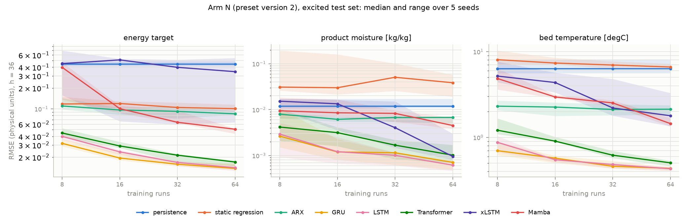
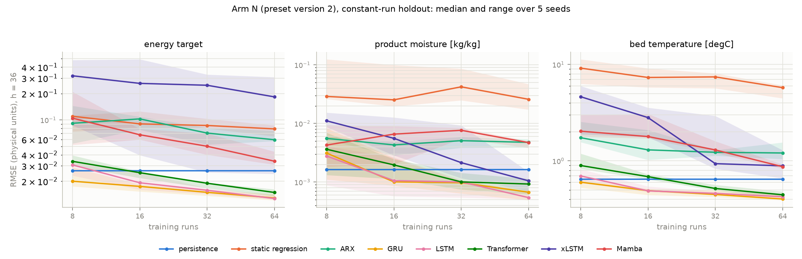
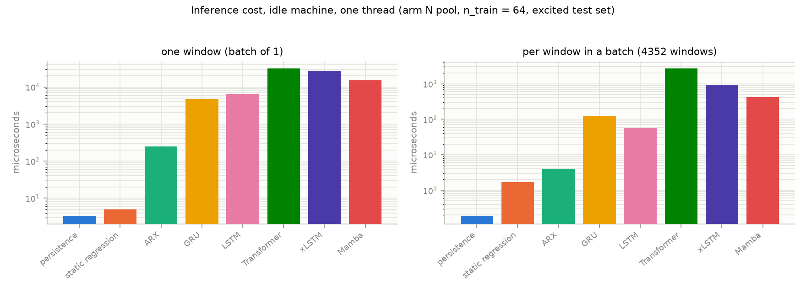

# Synthesis AP1 for M2: methodology of simulation and ML modelling

> Milestone M2 (TUHH-B, AP1): "Methodology of simulation and ML modelling documented
> (procedures, tools, templates; reduction of the training-data need)"
> (`docs/01_projektsteckbrief.md`). **Version 5**, state 2026-10-16, draft for review by the
> project lead. Every number in sections 2 to 8 is traced to a finding in
> `docs/04_stand_ap1.md` and a committed artifact (appendix) and is checked against that
> artifact by `scripts/check_m2_synthesis_consistency.py`, or listed there as not machine-checkable
> with the reason. Findings are cited as "Befund N" (lab-book entries, in German or English as written).

## Changes from the previous version (version 3, 2026-09-25)

- **Data basis.** The architecture comparison now rests on the re-run on preset version 2
  (arm N, Befund 94); the old records (arm A0) are used only as a comparison. The old
  Linux/Windows confound between model families does not apply to the new records.
- **Statistics.** Paired resolution over seeds (t distribution, four degrees of freedom)
  replaces the unpaired z threshold; **Holm correction is the main form**, uncorrected counts
  are given as an addition (Befund 83, 94 and the addendum to Befund 94).
- **Rank statements.** Cut back to what survives Holm: no GRU-against-LSTM cell is resolved;
  Mamba and the baselines are clearly behind LSTM; the deficits of Transformer and xLSTM and
  the middle of the order are uncorrected tendencies only.
- **Seeds.** The "40 to 41 seeds" estimate is replaced by paired seed numbers; on the
  quality variable (product moisture) the M2 target of 12.5 % is not reachable with five seeds.
- **Cost.** Inference times only from the joint measurement on an idle machine (Befund 97);
  Table 2, Figure 4 and the cost ratios of version 3 are removed.
- **Removed or restated (review of 2026-10-09, `docs/12`).** Persistence factors, model R^2
  and "factor 20", the solid-fraction range, the soft-sensor margin factors, early-stopping
  epoch counts, the ARX/NARX paragraph and the pinch statement are no longer taken over.
- **New.** Studies A and B (Befunde 88, 87), the outlook with the corrected figures of
  Befunde 80, 81, 93, 96, the partner model (Befunde 90, 95) and the storage of plant A
  (Befunde 91, 92).

## 1. Question and frame

TwinLink builds a digital twin for fluidised-bed spray granulation. The process loads a
particle bed with a suspension that dries on the hot surface; inlet temperature, gas
velocity, spray rate and nozzle pressure determine how much water evaporates, how fast the
bed grows and how moist the product stays. The simulator models continuous operation with a
controlled bed level (solids-mass set point, time constant 600 s), not a sequence of
batches; the operating mode of the target plant is an open question for AP2. The state that
matters for operation (bed mass, water content, particle number, bed temperature) is only
partly measurable at a real plant: the bed temperature is available inline, the product
moisture in general is not. A controller that acts on measured quantities only therefore
needs a model that infers the unobserved state from the history of the manipulated
variables, a soft sensor. AP1 builds and compares the candidate model classes and asks how
much training data each needs, not only how good it gets at best.

Until a full population-balance model is available (planned for month 21), a reduced
grey-box model with four states (solids mass, water mass, particle number, bed temperature)
carries the methodology work (`docs/02_prozess_setup.md`). The ML architectures are needed
because the real state is not fully measurable, whatever process model stands behind them.
**All numbers in this document are statements about the grey-box simulator, not about a real
plant**; section 7 makes the limit explicit.

## 2. Method

**Learning curves as the primary result format.** For every method the error is reported
over the number of training runs ($n_{\mathrm{train}} \in \{8, 16, 32, 64\}$), as median and range over
five seeds (Figure 1). A model that leads at small $n_{\mathrm{train}}$ but stops improving has a
different data need from one whose curve still falls at 64.

**Run-level splits.** Training, validation and test sets are separated by simulation runs,
never by windows or time points. A window-wise split, common in parts of the literature,
reports on the same data an error that is lower by 29 to 68 % depending on the target
(Befund 39: ExtraTrees, horizon 1, three targets).

**Two test sets, always named.** The *excited* test set (steps, PRBS, ramps inside every
run) measures identification quality; the *constant-run holdout* (set points constant within
a run, different between runs) measures operational relevance; plant records resemble the
latter. Both are reported apart. A factor against persistence is quotable only with metric,
test set and budget named, because persistence is structurally weak on the excited set and
trivially strong on constant runs (Befund 51, K5). The excited set contains a small share of
constant runs (`docs/12`, D-W2).

**Baselines first.** Persistence, a static quadratic regression and a linear ARX run before
any neural model. The error metric is the run-median RMSE in physical units at horizon 36
(900 s) unless stated; horizon 1 is reported separately.

**Data basis.** The old records (arm A0, Befund 51/58) rest on the legacy data
configuration. The re-run (Befund 94) adds arm A1 (legacy trajectories, planned future
inputs) and **arm N, the preset version 2** (`DataSpec.new_study`: planned future inputs, own
disturbance process of the solid fraction, per-run cap of the gas velocity at the terminal
velocity of the initial diameter; Befund 82, 86). Arm N is the basis of this synthesis.
`process/fingerprint` covers the process configuration only; the data, excitation and split
digests are recorded next to it. The new records come from one machine; arm A0 carries a
platform confound (GRU, LSTM and baselines on Linux, Transformer, xLSTM and Mamba on
Windows; Befund 83 b); at the cells re-run, Befund 84 and 85 found no platform effect for
GRU and LSTM beyond the last digits.

**Resolution: paired over seeds, Holm as the main form.** All methods run with the same
master seeds; per cell the differences `reference - candidate` are formed per seed and
tested with the t distribution on four degrees of freedom (`evaluation/paired_resolution.py`;
Befund 82). The test is on the mean of the differences; the tables report medians. The
verdict per cell is "candidate better", "candidate worse" or "unresolved". With many cells,
a family-wise correction is needed: **the main form counts a cell as resolved only if it
survives Holm (5 %) within the family of all rank cells of one arm** (336 cells in A0 and N,
168 in A1; Befund 94); the uncorrected count is given as an addition, the sign convention is
"candidate against LSTM". The older z thresholds of Befund 63 are superseded (Befund 67, 83).
The re-analysis of the old records applied 632 uncorrected paired tests (Befund 83).

**Number of seeds.** On energy and bed temperature, 3 to 11 seeds resolve a 10 to 12.5 %
difference of GRU or Transformer against LSTM at 80 % power; on the **product moisture the
paired standard deviation is 25 to 60 % of the mean**, so 37 and 45 seeds are needed for GRU
(constant / excited) and 33 and 193 for the Transformer at 12.5 % (Befund 83, addendum b;
old data A0; pairing does not remove the moisture problem). The M2 definition of 10 to 15 %
sits in a note of the project profile and the work plan, not in the formal definition.

## 3. Architecture comparison (arm N)

Eight methods (persistence, static regression, ARX, GRU, LSTM, Transformer, xLSTM, Mamba),
three targets, two test sets, $n_{\mathrm{train}} \in \{8,16,32,64\}$, five seeds, horizons 1 and 36;
the trained networks are per-target composites (Befund 26, 28). Learning curves: Figure 1
(excited test set) and Figure 2 (constant-run holdout), generated by
`scripts/plot_synthesis_v5_figures.py` from the records of Befund 94.

*Figures 1 and 2: error (RMSE in physical units, horizon 36) over the number of training
runs, median and range over five seeds, arm N; the second figure is the constant-run holdout.*

**GRU and LSTM.** On the product moisture GRU and LSTM are not distinguishable (15 of 16
cells unresolved, one cell with GRU worse, uncorrected). On energy and bed temperature GRU is
better than LSTM in 5 of 16 and 9 of 16 cells without correction and never worse; **after
Holm correction, no GRU-versus-LSTM cell is resolved in any channel** (also not when the
family is restricted to the GRU cells, a post-hoc sensitivity; addendum to Befund 94). GRU is
recommended as the default on practical grounds: never resolved worse, about 25 % fewer
parameters (42,819 against 57,027, Befund 28), lower single-window latency (Befund 97; LSTM
is faster in batch). **This is not a performance ranking.**

**Transformer, xLSTM, Mamba.** Against LSTM they are worse in 39 (Transformer), 38 (xLSTM)
and 44 (Mamba) of 48 cells without correction, never better. After Holm correction the
deficit is resolved in 14 of 48 cells for Mamba, in 2 of 48 for the Transformer and in 2 of
48 for xLSTM. **Only Mamba, and the baselines, are clearly behind LSTM; the deficits of
Transformer and xLSTM are an uncorrected tendency.** On the product moisture xLSTM stays
unresolved in 7 of 16 cells (uncorrected); its optimisation is unstable there (Befund 58,
63). Baselines: against LSTM the static regression is resolved worse in 21 of 48 cells after
Holm, persistence in 19, ARX in 12.

**Middle of the order.** Only the ends of the order are reproduced on the new data basis;
the middle (Transformer, xLSTM) changes between unresolved and worse from cell to cell
and is not supported by five seeds: after Holm, 70 of 336 rank cells remain in arm N (82 of
336 in A0). 85 rank verdicts differ between A0 and an arm of the re-run, 45 in A1 and 40 in
N (Befund 94 b).

**A1 against A0.** Planned future inputs on the legacy trajectories make the recurrent
models and ARX worse in the resolved cells, not better: the tendency is weaker than the old
data suggested, and after Holm hardly resolved (3 of 192 tests in A1 against A0; 24 of 384 in
N against A0; Befund 94 a). The data show no sign that the old results profited from
missing planned inputs.

**Static explainability of dE.** The energy target is largely explained by a static
regression on the current set points (Befund 16, 59), which is why R^2 is a poor yardstick:
the trained networks improve the physical RMSE over the static regression by factors of 5.2
to 7.8 (GRU, LSTM, Transformer, $n_{\mathrm{train}}$ = 64, horizon 36, both test sets, all
five seeds better; Befund 83 e). Comparisons are therefore made in physical units.

## 4. Inference and compute cost

All timings are from the joint measurement on an idle machine (Befund 97): one thread,
warm-up excluded, one process; arm N pool, $n_{\mathrm{train}}$ = 64, 4352 excited-test windows.
Earlier measurements under load are not quoted as results. Latency of one window and cost
per window in a batch differ in order and are reported apart (microseconds):

| method | parameters | latency, one window | per window in a batch |
|---|---|---|---|
| persistence | 0 | 3 | 0.2 |
| static regression | 45 | 5 | 1.7 |
| ARX | 102 | 246 | 3.9 |
| GRU | 42,819 | 4,753 | 123.7 |
| LSTM | 57,027 | 6,502 | 57.2 |
| Mamba | 8,139 | 14,950 | 415.8 |
| xLSTM | 8,649 | 27,487 | 936.8 |
| Transformer | 23,523 | 31,567 | 2,691.8 |

Per prediction every learned architecture is far below the sample time of 25 s. The batch
order is LSTM < GRU < Mamba < xLSTM < Transformer, the single-window order GRU < LSTM <
Mamba < xLSTM < Transformer: that LSTM is faster than GRU is a statement about the batch,
not about single-window latency. The Transformer is the most expensive in both columns
(no KV caching in this implementation, Befund 37). Fit times per epoch (2-epoch fit, setup
included, indicative only): GRU 4.3 s, LSTM 4.7 s, Mamba 14.8 s, xLSTM 27.8 s, Transformer
67.6 s.

**Hybrid of study A.** The hybrid (network plus open simulation as exogenous channels)
needs the simulator ahead of every prediction: one horizon of 36 steps costs 253,136 µs in
the simulator, of 256,123 µs in total, i.e. **98.8 % simulator share**; the network alone
(2,987 µs) is not the cost of the hybrid.

## 5. Methodological findings

- **Run-level splits** prevent an optimistic bias of 29 to 68 % (section 2; Befund 39).
- **Negative transfer.** A shared loss over targets of unequal difficulty degrades the energy
  target in soft-sensor operation; per-target networks (composite) avoid it (Befund 26).
- **Static explainability of dE** makes R^2 uninformative; compare in physical units (section 3).
- **t instead of z, paired instead of unpaired** at the resolution threshold: the z
  threshold of Befund 63 g was too small at few seeds, and pairing over seeds removes the
  shared seed effect (Befund 67, 82, 83).
- **Seed budget.** Five seeds resolve large differences everywhere and 10 to 12.5 % on
  energy and bed temperature; on the product moisture they resolve only large differences
  (section 2; Befund 83 addendum b).
- **Holm and Benjamini-Hochberg.** In arm N 260 of 336 rank cells are resolved without
  correction and 70 after Holm (Befund 94); the main form here is Holm.
- **Test sets.** A constant-run holdout hides what an excited set shows and conversely;
  every number is quoted with its test set (Befund 51).

## 6. Data need and plant link

**Study A (Befund 88): the value of a simulator for a data-poor model.** Pre-training on
the grey-box simulator plus fine-tuning on the plant data beats training from scratch at
small $N$ on every plant variant (the error ratio from-scratch over fine-tuned falls from 12.69
(identical plant) and 10.27 (parameter deviation) at $N$ = 2 to 1.32 and 1.27 at $N$ = 64);
the crossover is not reached on four of the five plants, and pre-training is never resolved
worse than training from scratch, for the deviations tested. **The hybrid is never better
than pre-training plus fine-tuning**, so it does not pay (cost: section 4). Five seeds, one
LSTM, plants that are variants of the same grey-box model.

**Study B (Befund 87): excitation and active learning.** At equal cost per run, a better
designed excitation is worth several additional runs of the plain random-step design at
small $N$, but with ten seeds the advantage is not established in the primary test (HB1:
not established); active learning is not better than random selection from the same pool
(HB2: not established on the deployment-like test set, refuted on the neutral mix), and a
dependence of the ranking on the test set is not established (HB3). Constant operation is far worse
than any excited design. Reservation: the per-run gas-velocity limit shapes every plan.

**Plant data (Befund 55, 56).** Operating records of the application partner (two 24-hour
exports, two products, one-minute sampling) show a coefficient of variation of the manipulated
variables inside one operating point of only 0.12 to 2.01 % (air flow, inlet temperature, spray
rate) but large differences between the products: operating data cover different operating
points but little dynamics within one. This agrees with the synthetic experiment of Befund 55,
where a model trained on constant runs only stays worse on the product moisture than the same
model trained on excited data by a factor of 2 to 3 over the whole budget range (NRMSE, no
catching up). The product moisture is not measured at the plant (Befund 56); a validation of
the soft sensor against plant data is still open.

## 7. Limits

- **Grey-box simulator, not the plant.** Four states, no agglomeration, no breakage; the
  GAB sorption isotherm uses placeholder parameters (Befund 34). All numbers are statements
  about the model.
- **No validation against plant data.** Plant exports lack gas consumption, heating power,
  intake humidity, product moisture, particle size and product mass flow (Befund 56); the
  energy target cannot be validated at all.
- **Placeholders that influence results:** the critical moisture of 0.20 kg/kg (kinetics
  parameter and quality limit at once), the bed-temperature limit, the steady-state
  particle diameter, the lower bound of the gas velocity (0.80 and 1.26 m/s), the box
  minimum of the inlet temperature, the soft-sensor margin and the penalty weight, the
  minimum approach temperature and the cold-side temperature of the heat network. The
  reference state of the gas velocity (mass flow) and the nozzle-pressure kink at 1 bar
  are unresolved questions of the register (`docs/12`, E-Q1, E-Q3).
- **Five seeds.** Only large differences are resolved on the product moisture; verdicts are
  per cell and their family-wise correction is conservative.
- **One timing run** on one machine (Befund 97); the networks were fitted for two epochs only.

## 8. Outlook (context for AP3, not a result of AP1)

- **Model-based optimisation (Befund 80).** Adapting the operating point to the ambient
  state saves a median of 9.0 % (lower gas-velocity bound 0.80 m/s) to 16.5 % (1.26 m/s)
  against a fixed point; a soft-sensor safety margin costs 1.30 to 1.46 % and leaves 94 % (1.26
  m/s) to 85 % (0.80 m/s) of that benefit. The gas velocity sits on its lower bound at 22 (1.26
  m/s) and 17 (0.80 m/s) of 25 test points: it is the main lever, but the bound itself is a
  placeholder, and the moisture limit binds at 13 (1.26 m/s) and 25 (0.80 m/s) of 25 points.
  Set points are optimised line by line before any interconnection. **A coupling gain of
  two lines is not demonstrated in the corrected model** (0 of 6 scenarios at 20 K minimum
  approach, 1 of 6 at 10 K as a sensitivity; Befund 81).
- **Reinforcement learning (Befunde 62, 68, 93, 96).** The line is closed as a diagnostic
  finding: with a residual action and a separated moisture cost the policy needs a margin of
  five times the base margin to be feasible in every seed, at 6.9 % extra energy over the
  optimiser with the base margin, of which 6.5 points are the margin itself.
- **Partner model (Befunde 74, 75, 90, 95).** The ranking of the partner's scenarios is
  robust against every assumption switched (Befund 95); the model recovers 60 to 88 % of an
  independent counter-current calculation, and the flow arrangement is the assumption that
  matters (Befund 90 with its addendum).
- **Storage of plant A (Befunde 91, 92).** The model bounds the storage volume only from
  above and is not a predictor. The saving read by the pre-registered rule is L1 (L2 only
  post hoc with a plain rule); it consists entirely of the added discarded compressor heat,
  pure shifting in time saves nothing, and no RL was built.

## Appendix: traceability table

Columns: statement (section) · number(s) · Befund · artifact · commit that added the
artifact in the current history · checked by `scripts/check_m2_synthesis_consistency.py`
(`yes`, or `no: reason`).

| Statement (section) | Number(s) | Befund | Artifact | Commit | Checked |
|---|---|---|---|---|---|
| GRU against LSTM, cells per channel (3) | 5/16, 9/16 better, 1 worse (moisture), 15/16 unresolved; Holm 0 | 94 c, addendum | `holm_rank_cells_rerun_full.json` | 405fc6b | yes |
| Transformer, xLSTM, Mamba against LSTM (3) | 39 / 38 / 44 of 48; Holm 2 / 2 / 14 | addendum to 94 | `holm_rank_cells_rerun_full.json` | 405fc6b | yes |
| Baselines against LSTM (3) | Holm 21 / 19 / 12 of 48 | addendum to 94 | `holm_rank_cells_rerun_full.json` | 405fc6b | yes |
| xLSTM moisture unresolved (3) | 7 of 16 | 94 c | `rerun_evaluation_rerun_full.json` | aac7b55 | yes |
| Middle of the order, Holm survivors (3) | 70 of 336 (N), 82 of 336 (A0) | 94 b, d | `rerun_evaluation_rerun_full.json` | aac7b55 | yes |
| Rank verdicts differing from A0 (3) | 85, 45, 40 | 94 b | `rerun_evaluation_rerun_full.json` | aac7b55 | yes |
| A1 / N against A0, Holm (3) | 3 of 192; 24 of 384 | 94 a | `rerun_evaluation_rerun_full.json` | aac7b55 | yes |
| Gain over static regression (3) | 5.2 to 7.8 | 83 e | `paired_reevaluation_58_63_67.json` | db3cc5d | yes |
| Seed numbers (2) | 3-11; 37, 45; 33, 193 | 83 addendum b | `paired_reevaluation_83_addendum.json` | 714d4ac | yes |
| Number of paired tests, old data (2) | 632 | 83 b | `paired_reevaluation_58_63_67.json` | db3cc5d | yes |
| Rank-cell families (2) | 336, 336, 168 | 94 | `rerun_evaluation_rerun_full.json` | aac7b55 | yes |
| Inference cost (4) | table of section 4 | 97 | `joint_timing_idle.json` | 3ce113a | yes |
| Hybrid simulator share (4) | 253,136 of 256,123 µs, 98.8 % | 97 | `a1_inference_time_v2_idle.json` | 3ce113a | yes |
| Run-level against window-wise split (2, 5) | 29-68 % | 39 | `extra_trees_split_comparison.jsonl` | 7384455 | yes |
| Constant-trained model against excited (6) | factor 2 to 3 | 55 | `arch_learning_curve_constant_trained.jsonl` | 7384455 | yes |
| Plant data variation (6) | 0.12-2.01 % | 56a | raw plant data not in the repository | - | no: raw data are never in the repository |
| Study A ratios (6) | 12.69, 10.27, 1.32, 1.27 | 88 d | `a1_main_analysis.json` | 93ef6aa | yes |
| Study A crossover (6) | four of five plants | 88 d | `a1_main_analysis.json` | 93ef6aa | yes |
| Study B verdicts (6) | HB1 not established; HB2 not established (T3), refuted (T1); HB3 not established | 87 add. 4 | `b1_main_analysis.json` | 2462ef7 | yes |
| Model-based optimisation (8) | 9.0 / 16.5 %; 1.30 / 1.46 %; 94 / 85 %; 22 / 17 of 25; 13 / 25 of 25 | 80 | `m1_k1_comparison.json` | 603cf69 | yes |
| Coupling test (8) | 0 of 6 (20 K), 1 of 6 (10 K) | 81 | `m4r_test_dt20_umin126.json`, `m4r_test_dt10_umin126.json` | 65dcb7e, 609a629 | yes |
| RL margin (8) | k = 5; 6.9 %; 6.5 points | 96 | `bres_margin.json` | 13eadb6 | yes |
| Partner model recovery (8) | 60 to 88 % | 90 addendum | `heat_recovery_comparison_r4_consistent.json` | 0737e75 | yes |
| Storage readings (8) | L1 pre-registered, L2 post hoc | 92 | `gate_storage_shift.json`, `gate_storage_shift_posthoc.json` | 8019fe2, 3c99b40 | yes |

Older tables of statements, corrections and placeholders: `docs/08_synthese_m2_bestand.md`.
