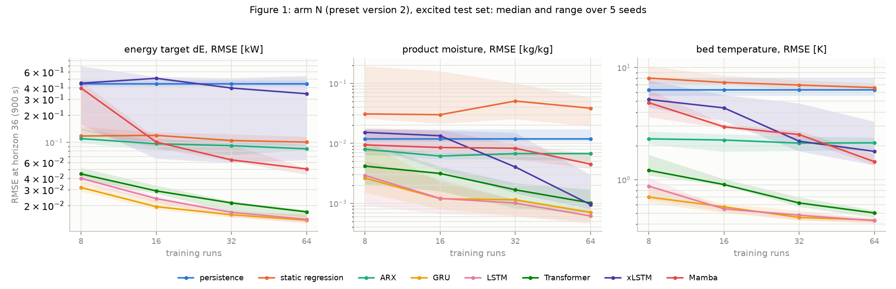
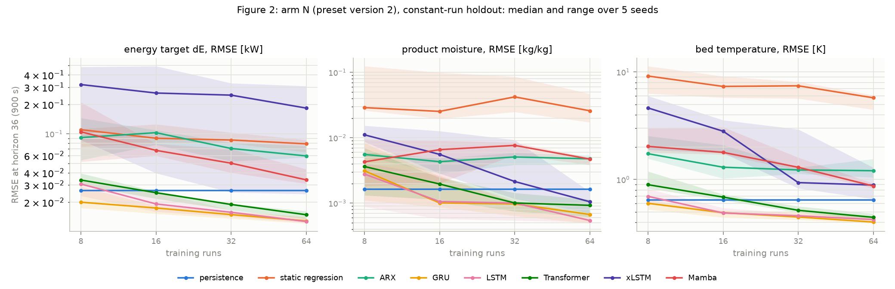
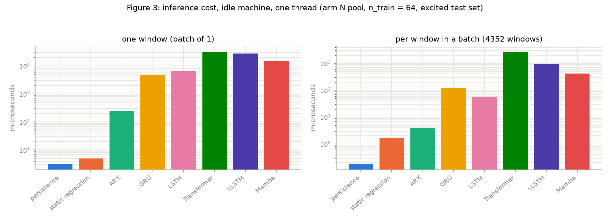

# Synthesis AP1 for M2: methodology of simulation and ML modelling

> Milestone M2 (TUHH-B, AP1): "Methodology of simulation and ML modelling documented
> (procedures, tools, templates; reduction of the training-data need)"
> (`docs/01_projektsteckbrief.md`). **Version 6**, state 2026-11-23, draft for review by the
> project lead. It takes in the findings after version 5f (Befunde 100 to 129: the control studies,
> the learned models in the control, the moisture feedback, the plant-near model) and describes the
> method as rules and templates that a third party can apply. Version 5f (2026-10-20, revised after
> review 4, `docs/reviews/2026-10-19/review4_synthesis_v5.md`, and its follow-up check 4b,
> `docs/reviews/2026-10-19/review4b_followup.md`) is retrievable under the git tag `docs08-v5f`.
> The selection of methods that follows from the results, and the reasoned deviation from the
> proposal on reinforcement learning, are in `docs/48_ap1_conclusion.md` (accepted by the project
> lead on 2026-11-23); this document does not repeat the selection, it documents the method and the
> evidence.
> Every number in the summary, in sections 1 to 13 and in appendices A to F is traced to a finding
> in `docs/04_stand_ap1.md` and, where one exists, a committed artifact (appendix G) and is checked
> by `scripts/check_m2_synthesis_consistency.py`: against that artifact or configuration, or, for
> part of the findings after version 5f, against the lab-book entry or study document it is quoted
> from (appendix G says which), or it is listed there as not machine-checkable with the reason.
> Numbers of findings that carry a dated addendum
> are quoted as recorded, and the addendum is named next to them. Findings are cited as "Befund N"
> (lab-book entries, in German or English as written); readings are given as they were fixed before
> the run and accepted by the project lead. Procedures are in section 2 (rules) and appendix E
> (templates), tools in appendix A, the reduction of the training-data need in section 5 and
> appendix D, and what the studies do not show in section 12.

## Summary

TwinLink builds a digital twin of fluidised-bed spray granulation; AP1 compares methods that
forecast the product moisture, the bed temperature and the energy target from the history of the
manipulated variables, and asks what such models are worth in the control of the process. **All
results are statements about a grey-box simulator with placeholder
parameters, not about a plant.** The method: learning curves over the number of simulated training
runs, splits by run, two named test sets (excited and constant-run holdout), baselines before any
network, and paired comparisons over five seeds with Holm correction as the main form.

In the tested, untuned configuration GRU and LSTM have the lowest errors of the eight methods
tested; against the Transformer this is large and consistent on the moisture and only an uncorrected
tendency on energy and bed temperature. GRU is recommended as the default on practical grounds
(fewer parameters, lower latency), not as a performance rank: after Holm no GRU-against-LSTM cell
is resolved. Mamba and the baselines are
resolved behind LSTM after Holm in part of the cells, and the deficit of the xLSTM (mLSTM-only
variant) is large and consistent across all seeds but not resolved under Holm with five seeds (median
ratio 3.3; 40 of 48 cells individually at least 1.5; all seeds worse in all 48 cells). The
networks differ in size by a factor of about seven; on the old data, at equal capacity the sLSTM and the
mixed variant largely close the gap to the LSTM on energy and bed temperature but not on the moisture,
and no capacity-matched variant is better than GRU or LSTM; a larger Mamba stays behind.

Data need: with the fixed protocol the moisture error of GRU and LSTM at 8 training runs is 3.7 to
5.1 times the error at 64 runs, and the curves still fall at 64 runs in the medians (an uncorrected statement, see section 6), so the
need beyond 64 runs is not determined; every point also uses 32 validation runs. Pre-training on the simulator and
fine-tuning on few plant runs beats training from scratch at small numbers of runs on every plant
variant tested (study A); a hybrid with the simulator as an input channel is not recommended as the
default. A planned excitation was not established as better than a plain random-step design in the
primary test (study B), but in the simulator models trained on constant operation alone stay far behind models trained
on excited data (old data, Befund 55), and plant records contain little dynamics; we recommend an
excitation experiment at the plant. Inference is far below the sample time of 25 s for every method. Open: a validation against
plant data (the moisture is not measured at the plant), the placeholder parameters, and more seeds
where the paired spread is large.

**Control with the known model.** The energy lies in tracking the operating point, not in the
dynamics: against a fixed operating point the quasi-stationary set-point optimisation saves 8.93 % of
the energy in the median, an MPC adds 0.55 %, and the upper bound with perfect preview is 1.51 %
(Befund 105; with the cold multi-start of the steady optimiser 9.10 % instead of 8.93 %, dated
addendum). With the throughput as a command under an hourly electricity price a two-level price rule
lowers the cost per kg of product by 2.07 % and an MPC by 2.88 %, with an electric heater only (Befund
126). In both studies the MPC differs from the simple method by the smaller safety margin it needs,
not by its trajectory. On these bounds, with thresholds fixed before the runs, no sequential
reinforcement-learning agent was trained for the granulator; where reinforcement learning was trained
it did not reach the direct optimisation (section 9).

**Learned models in the control.** Replacing the known model by a learned one costs more than load
following gains: the GRU in the loop is 2.98 % more expensive per kg than the same control law with
the known model, the learned steady-state map 3.87 % with an inline moisture feedback and 7.07 %
without, and no learned arm is within the 2 % fixed beforehand (Befund 127). The gap is the margin
that the learned model needs at the moisture limit. A model for the control is therefore chosen by
whether it holds the limit and by its cost at the held limit, not by its mean prediction error
(Befunde 113, 122, 125, 127). Where a physical model exists the order is: calibrate, then a bias,
only then learn; this order is resolved where the model errs to the safe side and only descriptive
on the unsafe side (Befunde 120, 122, 124, 125).

**Moisture information.** Under a model mismatch a feedback of the product moisture is worth 13.40 %
of the energy in the median against no feedback, relative to the placeholder band of the drying
kinetics (Befund 111); a laboratory sample every 4 h captures 0.934 of the value of an inline sensor
(Befund 112); a learned soft sensor did not replace the measurement in any tested form (Befunde 111,
112, 116). The drying kinetics, not the sorption isotherm, decide the operating point (Befund 108).

**Method, templates, and what is not shown.** The method is stated as rules with their reasons, the
findings that triggered them and their pitfalls (section 2), and as templates for the study design,
the reading, the lab-book entry and the merge (appendix E). Not shown (section 12): anything about a
plant; product quality beyond the moisture, the particle size being constant in the model; a
calibration of the model to plant A, whose structure does not carry between the two measured days
(Befunde 117, 123); training on dynamic Dyssol data; partial observability; batch operation.

## Changes since version 5f

Version 5f (2026-10-20) and its change history back to version 3 are retrievable under the git tag
`docs08-v5f`; its consistency check gave 455 confirmed claims and still does at the tag
(`scripts/check_m2_synthesis_consistency.py --version 5f`, tested). The check of version 6 confirms
1229 claims and 19 verified exemptions, with no numeric token left without a check: 453 of the 455
claims of version 5f, whose sentences are still in the text, 158 new values recomputed from the
analysis artifacts of Befunde 105, 111, 126, 127 and 129, and 618 numbers checked against the text
of the lab-book entry or study document they are quoted from (appendix G).

**Structure.** Sections 3 and 4 and appendices B, C and D are those of 5f with additions; sections 2
and 5 of 5f are section 2 (rules), section 6 of 5f is section 5 with the plant paragraph moved to
section 10, section 7 is section 13, and section 8 (outlook) is dissolved into sections 6, 9 and 11.
New: sections 6 to 12 and appendix E; the glossary is appendix F and the traceability table
appendix G. The six older change sections are dropped.

**Statements that changed, and why** (one line per contradiction or tension found between 5f and
the findings after it):

1. **Status of control and reinforcement learning.** 5f listed both as an outlook for AP3; they are
   results of AP1 (sections 6, 7 and 9), because they answer the tasks of AP1 on dynamic control and
   on reinforcement learning (`docs/48_ap1_conclusion.md`, section 2).
2. **"Soft sensor".** The networks are called forecast models; "soft sensor" is used only where a
   model replaces a moisture measurement in a loop, because that use was tested and failed in the
   tested forms (Befunde 111, 112, 116).
3. **Cost of a "soft-sensor margin".** The 1.30 to 1.46 % of Befund 80 stay as the cost of a margin of
   the size m for an optimiser that knows the true model; the reading as the cost of using a learned
   model is replaced, because a margin calibrated on the prediction error does not hold once an
   optimiser chooses the operating points (Befunde 113, 127).
4. **Pre-training as the route for a data-poor model.** The statement of study A stays with its
   comparison set named; where a physical model is available, its calibration and a bias come first
   (Befunde 120, 122, 125), and they were not in the comparison set of study A.
5. **Data need.** The learning curves give the data need of the prediction error; for a controller
   the gap did not shrink from 16 runs on and no data need could be determined (Befund 127).
6. **Criterion for comparing models.** 5f compared on the prediction error only; for use under a
   constraint the comparison is admissibility first and cost at the held limit (Befunde 124, 125,
   127; rules 6 and 7).
7. **Savings of a tracked operating point.** The figures of Befunde 80, 105 and 108 are kept apart as
   three frames; they are not one series.
8. **Quality limit.** The sentence of 5f on the critical moisture as "kinetics parameter and quality
   limit at once" is left unchanged in section 13 for now: from Befund 64 on the quality limit is a
   separate placeholder, and the correction waits for the release by the project lead.
9. **Ranking of the partner's scenarios.** "Robust against every assumption switched" holds at the
   workbook point of one delivery, not over the operating range (Befunde 110, 121).
10. **Recovery of the partner model.** The 60 to 88 % belong to the earlier delivery; the later one
    is in Befund 106.
11. **Storage and reinforcement learning.** "No RL was built" holds for the storage of plant A;
    reinforcement learning was trained on a storage problem under a price and ended behind a constant
    rule (Befund 115).
12. **Coupling of lines.** No coupling gain in continuous operation; with campaigns and standstills
    a network pays (Befunde 118, 119).
13. **What limits the simulator.** The placeholder isotherm hardly matters for the operating point,
    the drying kinetics decide (Befund 108); and the structure of the model does not represent
    plant A (Befunde 117, 123).
14. **Two meanings of "margin", and the reading labels.** Defined in section 1 and in the glossary.
15. **Tools and procedure.** Appendix A lists the packages and extras of the later studies; the study
    template of 5f is replaced by the templates of appendix E and the rules on long runs.
16. **Seeds.** "Five seeds" is not the limit of every study: three in Befunde 113 and 122, two in
    part of Befund 112 (section 13).

## 1. Question and frame

TwinLink builds a digital twin for fluidised-bed spray granulation. The process loads a
particle bed with a suspension that dries on the hot surface; inlet temperature, gas
velocity, spray rate and nozzle pressure determine how much water evaporates, how fast the
bed grows and how moist the product stays. The simulator models continuous operation with a
controlled bed level (solids-mass set point, time constant 600 s), not a sequence of
batches; the operating mode of the target plant is an open question for AP2. The state that
matters for operation (bed mass, water content, particle number, bed temperature) is only
partly measurable at a real plant: the bed temperature is available inline, the product
moisture in general is not. AP1 therefore builds and compares model classes that predict the
targets from the history of the manipulated variables and the disturbances, called **forecast
models** in this document, and asks how much training data each needs, not only how good it gets
at best. It then asks what such a model is worth in the control of the process: where the energy
is with a known model (section 6), what it costs to replace the known model by a learned model
(section 7), and what a measurement of the moisture is worth (section 8). The term "soft sensor" is
used only where a model estimates the moisture in place of a measurement inside a control loop;
that use was tested and has the limits of section 8. The three predicted targets are
the product moisture (kg water per kg dry solid), the bed temperature and the **energy target
dE**, the instantaneous total power of heater, fan, pump and atomiser in kW (absolute, no
reference point; the definition for the plant is an open question of the consortium).

Until a full population-balance model is available (planned for month 21), a reduced
grey-box model with four states (solids mass, water mass, particle number, bed temperature)
carries the methodology work (`docs/02_prozess_setup.md`, appendix C).
**All numbers in this document are statements about the grey-box simulator or about synthetic
data, not about a real plant**; sections 12 and 13 make the limits explicit.

**The tasks of AP1.** The proposal asks for a comparison of machine-learning methods for the
dynamic control of a single process, with an emphasis on reinforcement learning in combination
with time-based models, a selection by accuracy, generalisability and real-time ability, a low
data need, a contribution to a lower energy demand, synthetic data from Dyssol models, and a
pipeline that can be used as a module. Where each task stands is in `docs/48_ap1_conclusion.md`,
section 2; this document carries the evidence in sections 3 to 11.

**Two words that change their meaning between the studies.** The *margin m* of the studies up to
Befund 96, used again in Befund 113, is the half-width of a calibrated prediction band; from Befund
105 on the margin of a controller is the smallest distance to the moisture limit, found by a search,
with which that controller holds the limit on a whole family of cases (appendix F). The *reading labels* (L0, T1,
U3 and so on) are fixed per study before its run and have no meaning across studies; each is spelled
out where it is used.

## 2. Method: rules that can be reused

This section states the method as rules that a third party can apply. Each rule has the same four
parts: the rule, the reason, the finding that triggered it, and the typical pitfall. They are the
working rules of the project (`CLAUDE.md`, sections Methodology, Long runs and Provenance) together
with their evidence; the templates that implement them are in appendix E. Rules 1 to 4 concern the
comparison of forecast models, rules 5 to 10 every study that ends in a decision, rules 11 to 13 the
computing practice. Where a rule is illustrated by a number, the number is in the section named.

### Rule 1: split by run, never by window

**Rule.** Training, validation and test sets are separated by simulation runs,
never by windows or time points.

**Reason.** Windows of one run share its trajectory, its disturbances and its initial state. A split
by windows puts near-copies of the test windows into the training set and measures interpolation
inside known runs, not the prediction of a new run, which is what a plant asks for.

**Finding.** A window-wise split, common in parts of the literature,
reports on the same data an error that is lower by 29 to 68 % depending on the target
(Befund 39: ExtraTrees, horizon 1, run-median NRMSE of the energy target, the product moisture
and the median particle diameter).

**Pitfall.** A window-wise split is the default of many data loaders and of part of the literature;
it does not announce itself. The split has to be checked at the level of run identifiers.

### Rule 2: learning curves as the primary result, on two test sets that are always named

**Rule.** For every method the error is reported
over the number of training runs ($n_{\mathrm{train}} \in \{8, 16, 32, 64\}$), as median and range over
five seeds (Figures 1 and 2). A model that leads at small $n_{\mathrm{train}}$ but stops improving has a
different data need from a model whose curve still falls at 64.

**Two test sets, always named.** The *excited* test set (steps, PRBS, ramps inside every
run) measures identification quality; the *constant-run holdout* (set points constant within
a run, different between runs) measures operational relevance; plant records resemble the
latter. Both are reported apart. A factor against persistence is quotable only with metric,
test set and budget named, because persistence is structurally weak on the excited set and
trivially strong on constant runs (Befund 51, K5). The excited set contains a small share of
constant runs (`docs/12`, D-W2).

**Reason.** The question of the milestone is the data need, and a single budget cannot answer it.
**Test sets.** A constant-run holdout hides what an excited set shows and conversely;
every number is quoted with its test set (Befund 51).

**Finding.** Befunde 51 and 94 (the learning curves of section 3 and appendix D).

**Pitfall.** A factor against persistence without its test set; one budget read as "the" accuracy
of a method; and a learning curve of the prediction error read as the data need of a controller
(section 5; Befund 127).

### Rule 3: the same seeds for every method, paired statistics, Holm as the main form

**Rule.** All methods run with the same
master seeds; per cell the differences `reference - candidate` are formed per seed and
tested with the t distribution on four degrees of freedom (`evaluation/paired_resolution.py`;
Befund 82). The test is on the mean of the differences; the tables report medians. The
verdict per cell is "candidate better", "candidate worse" or "unresolved". With many cells,
a family-wise correction is needed: **the main form counts a cell as resolved only if it
survives Holm (5 %) within the family of all rank cells of a single arm** (336 cells in A0 and N,
168 in A1; Befund 94); the uncorrected count is given as an addition, the sign convention is
"candidate against LSTM". Next to every verdict the effect size (ratio of the medians, candidate
over LSTM) and the number of seeds on the same side are given (addendum to Befund 98). The older z
thresholds of Befund 63 are superseded (Befund 67, 83). The re-analysis of the old records applied
632 uncorrected paired tests (Befund 83).

**Number of seeds (arm N).** At $n_{\mathrm{train}}$ = 64 and horizon 36 a paired difference of 12.5 % between
GRU and LSTM is resolved at 80 % power with 3 to 6 seeds on energy and bed temperature, with 5 seeds
on the product moisture on the excited test set and with 16 on the constant-run holdout; the
Transformer needs 4 to 7 seeds on energy and bed temperature but 210 (excited) and 69 (constant-run
holdout) on the moisture (addendum to Befund 94; planning figures estimated from five seeds, with
wide intervals). For comparison, the old data A0 gave 45 and 37 seeds for GRU and 193 and 33 for
the Transformer on the moisture (Befund 83, addendum b): for the GRU-LSTM pair the moisture problem
is smaller on the new data basis, not gone. Over all budgets and both horizons the moisture figure
varies strongly (GRU on the excited set 3 to 753 seeds), because the spread between seeds is large at
small budgets. The M2 definition of 10 to 15 % sits in a note of the project profile and the work
plan, not in the formal definition.

**Reason.** Four observations from the comparison of section 3:

- **t instead of z, paired instead of unpaired** at the resolution threshold: the z
  threshold of Befund 63 g was too small at few seeds, and pairing over seeds removes the
  shared seed effect (Befund 67, 82, 83).
- **Effect size next to the verdict.** With five seeds and a family of 336 tests, Holm leaves
  large effects unresolved; the ratio of the medians and the sign consistency over the seeds are
  reported with every verdict (addendum to Befund 98).
- **Holm and Benjamini-Hochberg.** In arm N 260 of 336 rank cells are resolved without
  correction, 251 after Benjamini-Hochberg and 70 after Holm (Befund 94); the main form here is Holm.
- **Seed budget.** Five seeds resolve large differences everywhere. They are of the order needed
  for a 10 to 12.5 % difference of GRU against LSTM on energy and bed temperature (3 to 8 seeds,
  arm N, $n_{\mathrm{train}}$ = 64), not for the Transformer (4 to 10 seeds), and on the moisture only
  for GRU on the excited test set (section 2; addendum to Befund 94).

**Finding.** Befunde 67, 82, 83, 94 and 98 with their addenda. Later studies added three practices:
a difference counts as resolved only if it survives Holm within a family fixed beforehand **and** has
the same sign in at least 4 of 5 seeds (Befunde 120, 124, 125); a new resolution in the direction a
cell already had is counted apart from a reversal or a reordering (decision on Befund 109, section
3); and the family is fixed per study and per question, not over all cells of a study (Befund 127).

**Pitfall.** Calling a large effect that Holm leaves unresolved "a tendency", or an unresolved
difference "equal". With three seeds the resolution thresholds can be of the size of the effect
itself: such a study is under-powered, and its verdict means "not resolvably better" (Befund 122,
section 7.3).

### Rule 4: baselines before any architecture comparison

**Rule.** Persistence, a static quadratic regression and a linear ARX run before
any neural model. The error metric is the run-median RMSE in physical units at horizon 36
(900 s) unless stated; horizon 1 is reported separately. Where a physical model exists, its calibration and
a constant bias on top of it are baselines of every learned model (Befunde 120 and 123).

**Reason.** A learned model is worth what it adds over the simplest alternative, and the simplest
alternative differs from target to target. **Static explainability of dE** makes R^2 uninformative; compare in physical units (section 3).
**Negative transfer.** A shared loss over targets of unequal difficulty degrades the energy
target in soft-sensor operation; per-target networks (composite) avoid it (Befund 26).

**Finding.** Befunde 16, 26 and 59 for the forecast models; Befunde 120 and 123 for the calibration
and the bias (sections 7.4 and 10): a constant bias was as good on the other day as a calibration of
the plant-near model, and with few points a hard baseline for every learned model of a static balance.

**Pitfall.** A coefficient of determination on a target that a static regression already explains;
a learned model compared only with other learned models (study A had neither a calibration nor a bias
in its comparison set, section 7.4).

### Rule 5: fix the reading before the first run

**Rule.** Question, design, metric, the classes of the reading with their thresholds, the validity
conditions, the budget and the order of cuts are written and committed before the first run that
could show a result: the design in a study document, the reading verbatim in the docstring of the
analysis script (appendix E). What was seen before that commit (probes, smoke runs) is disclosed.
Decisions the session takes without asking are listed for confirmation, each with the most
conservative reading. Anything added after a result is labelled post hoc and never replaces the
reading. The project lead accepts or rejects the reading as fixed and adds a dated decision
paragraph; a class is not reinterpreted afterwards.

**Reason.** A study with several outputs, several controllers and several plausible thresholds can be
read in favour of almost any conclusion after the fact. The fixed reading is what makes "a price rule
suffices" or "no arm is within the threshold" a finding and not an impression.

**Finding.** The stability rule of Befund 69 and the gates of Befunde 92 and 99 were the first
readings fixed beforehand; from Befund 105 on every study of sections 5 to 11 has one. Cases in which
the fixed reading was kept although its content was uncomfortable: the class R2 that hinges on one
sharpening cell (Befund 109), the class "mixed" (Befund 124), the class O2 reached only through one
variant fixed beforehand (Befund 116), the class U3 "by the letter" (Befund 127).

**Pitfall.** A reading formulated after a dry run had shown the numbers (Befund 110, disclosed, both
readings kept in the artifact); test figures visible in a smoke test before the main run (Befunde 115
and 126, disclosed, reading committed before and unchanged); a rule that fixes a study parameter
amended after first values were visible (Befund 125, disclosed, the selection identical under both
versions). None of these is forbidden; each has to be written down where the result is.

### Rule 6: admissibility first, then the cost at the held limit

**Rule.** When models or controllers are compared for use under a constraint, every one gets the
smallest margin with which the constraint holds on the whole family of cases, and the comparison is
made on the cost at that held limit. When a margin can fail to be reached, the reading starts with
the admissibility: the share of admissible cells per model is compared first; costs are compared
second, on cells that are admissible for both. A cell that is not admissible is counted and gets no
substitute value.

**Reason.** A margin measures only the additional safety a model needs. A model that errs to the safe
side needs none and looks best, while it pays in cost; and a comparison of costs on admissible cells
alone cannot say that a model fails to hold the limit at all.

**Finding.** Two design weaknesses that the project lead names as such (section 7.3): the reading of
Befund 124 was defined on the margin and favoured the models that overestimate the moisture; the
reading of Befund 125 compared only pairs of admissible cells, so that 11 of its 12 tests could not be
resolved and the largest difference between the models did not enter. Befund 127 was then designed
with the admissibility as the first step of the reading.

**Pitfall.** Ranking by the margin; averaging costs over cells in which some models violate the
limit; replacing a margin that was not reached by the upper end of the search.

### Rule 7: do not choose a model for control by its mean prediction error

**Rule.** A model that is to stand inside an optimiser or a controller is assessed at the points the
optimiser chooses and at the tails, with rule 6, not by its error on a test set.

**Reason.** An optimiser places its optimum on the constraint, where a small error of the model in
its favour decides; it finds the errors of the model. The margin is set by the least favourable cases.

**Finding.** Sections 7.1 to 7.3: an error statistic over the whole action box understates what the
optimiser finds by an order of magnitude or more (Befund 113); the hybrid has a much smaller rollout
error than the GRU without a resolvably smaller margin (Befund 122), and with a structural error to
the unsafe side it has the smallest rollout error and is admissible least often (Befund 125); under
load following the gap of the learned map is its margin (Befund 127).

**Pitfall.** Selecting the model for the control from the learning curves of section 3; trusting
the spread of an ensemble to cover a systematic error that its members share (Befunde 113 and 122).

### Rule 8: calibrate, then a bias, only then learn

**Rule.** Where a physical model exists, the order of attempts is: calibrate its parameters after
checking which of them the data can determine; add a constant bias; use a learned model for what is
left. The status of this order is part of the rule: it is resolved where the structural error lies on
the safe side and only descriptive where it lies on the unsafe side (decision on Befund 125).

**Reason.** A calibration needs the fewest data wherever the structure of the model fits, and it
extrapolates; a bias is the cheapest correction of what the structure does not contain.

**Finding.** Befunde 107, 120, 122, 124 and 125 (sections 5 and 7), and for real plant data Befund 123
(section 10), where the identifiability analysis came before the fit.

**Pitfall.** Fitted parameters that compensate a hidden error are physically wrong and must not be
reported as measured values (Befund 107); a refit can end at its bounds without representing the
error (Befund 124); and "calibrate first" is not shown for a plant whose structural deviation is
unknown (section 10).

### Rule 9: a margin is valid only where it was found

**Rule.** A margin is reported with the family of cases, the range of inputs and the signal it was
searched on. Whether it holds outside is tested and reported separately.

**Reason.** A margin is an empirical quantile of a family of cases, not a property of a model.

**Finding.** Outside the training range the margin found inside held for one model only (Befund 122);
the margins searched under the price signal did not hold for two controllers under a constant price
(Befund 126); a margin searched on other days held on the test days in every seed for no learned arm
(Befund 127). Sections 6 and 7.

**Pitfall.** Margins found on the test days are optimistic; they are comparable between controllers
searched in the same way and are not the margins a deployed controller would need.

### Rule 10: measure the headroom with the known model before every learning study

**Rule.** Before a learned controller or a reinforcement-learning agent is trained for a task, the
gain it could reach at most is measured with controllers that know the true model: a fixed point, a
simple rule, an optimiser without preview, and an upper bound with perfect preview. The thresholds
that would justify the learning study are fixed beforehand.

**Reason.** These reference controllers are cheap compared with a learning study, they bound its
result from above, and they show where the gain comes from (in sections 6 and 7 it came from the
margin, not from the trajectory).

**Finding.** Befund 105 closed the line of reinforcement learning for the granulator in continuous
operation with such a bound, Befund 126 did the same for load following, and Befund 127 measured
against the same references what a learned model costs. Before these, reinforcement learning had been
trained on a one-step problem in which the direct optimisation was better (section 9).

**Pitfall.** Training an agent where the upper bound is below the threshold; reading the upper bound
as an achievable gain; forgetting that the bound was measured with the true state known (section 12).

### Rule 11: a steady optimiser with a cold multi-start, and bit-equality controls of re-runs

**Rule.** New studies that use the steady-state optimiser set `steady_cold_starts = 8`: every solve
starts from fixed start points and remembers nothing between solves. The defaults stay at the old
behaviour and exist only to reproduce old results. Every study re-runs at least one reference of an
earlier finding and compares it with the records bit for bit.

**Reason.** A warm start makes the result of a query depend on the queries solved before it, so that
two runs of the same code with another division of the work differ; and it returns a worse local
optimum in a measurable share of the queries.

**Finding.** The bit-equality control of Befund 127 found the dependence; Befund 129 measured it
(section 6).

**Pitfall.** "Below the threshold of the reading" does not mean that no printed number moves: two
did, and they are recorded as dated addenda. A single cold start removes the dependence on the order
and keeps most of the worse local optima.

### Rule 12: long runs

**Rule.** A stage that runs for hours saves its results per unit at once, can be resumed, and logs
every finished unit; a failing unit is recorded and does not discard the others. Before a main run a
dry run covers all units at minimal cost. A probe with batches of full size gives the peak memory
per worker; the number of workers is at most the number of physical cores, and workers times peak
memory stays below 80 % of the memory of the machine. Budgets are wall-clock time; the cuts and their
order are fixed before the main run, and a main run that exceeds its budget and demonstrably
progresses continues, documented as a decision. Main runs are started detached from the session.
Stage outputs are written packed, so that the working tree is clean between stages. Checkpoints and
other content that cannot be reproduced in seconds are copied out of a working tree before it is
removed.

**Reason.** Each sentence of the rule answers a loss that occurred.

**Finding.** A first attempt lost to exhausted memory (Befund 105); checkpoints lost with a removed
working tree and retrained, reproducing their records exactly (addendum to Befund 111; Befund 113); a
margins run lost after more than a day because one case set was empty and the driver discarded the
results of the other units, followed by a standstill at a clean-tree check (decision on Befund 122); a probe on small batches that underestimated the peak memory of the main run by a factor of about
6 (Befund 127).

**Pitfall.** A probe on a single unit or on shortened units as the basis of a time or memory
estimate; a budget counted in processor hours where wall-clock time was meant (Befund 113).

### Rule 13: provenance

**Rule.** Scripts are committed before they run, on a clean working tree; every artifact records the
commit, the dirty flag, the versions, the fingerprints of its configurations, the version of the data
preset, and the location of the code that was loaded, and a run aborts if that is not the code of its
own checkout. Artifacts are never overwritten. New studies generate their data with one preset
(`DataSpec.new_study`); an exception is approved and recorded (`docs/12`, section L). Lab-book entries
are append-only, corrections are dated addenda. A synthesis quotes only numbers that are in a finding
and an artifact, and every placeholder is labelled as one.

**Reason.** Every number of this document can be traced to a commit and recomputed (appendices A and
G), and the old results stay reproducible while the defaults for new studies change.

**Finding.** The platform confound of the old records (Befund 83 b), the data preset (Befund 86), and
two figures that entered decision paragraphs from a conversation and from an unversioned report and
had to be corrected by dated addenda (Befunde 127 and 128).

**Pitfall.** A number from a conversation in a decision paragraph; an editable installation that
points at another checkout than the one whose commit the artifact names; a fitted or assumed value
quoted without its label "placeholder".

## 3. Architecture comparison (arm N)

**Data basis.** The old records (arm A0, Befund 51/58) rest on the legacy data
configuration. The re-run (Befund 94) adds arm A1 (legacy trajectories, planned future
inputs) and **arm N, the preset version 2** (`DataSpec.new_study`: planned future inputs, own
disturbance process of the solid fraction, per-run cap of the gas velocity at the terminal
velocity of the initial diameter; Befund 82, 86). Arm N is the basis of this synthesis.
`process/fingerprint` covers the process configuration only; the data, excitation and split
digests are recorded next to it. The new records come from a single machine; arm A0 carries a
platform confound (GRU, LSTM and baselines on Linux, Transformer, xLSTM and Mamba on
Windows; Befund 83 b); at the cells re-run, Befund 84 and 85 found no platform effect for
GRU and LSTM beyond the last digits.

Eight methods (persistence, static regression, ARX, GRU, LSTM, Transformer, xLSTM, Mamba),
three targets, two test sets, $n_{\mathrm{train}} \in \{8,16,32,64\}$, five seeds, horizons 1 and 36;
the trained networks are per-target composites (Befund 26, 28). Learning curves: Figure 1
(excited test set) and Figure 2 (constant-run holdout), generated by
`scripts/plot_synthesis_v5b_figures.py` from the records of Befund 94.



*Figure 1: error (RMSE at horizon 36 in physical units: energy target in kW, product moisture in
kg/kg, bed temperature in K) over the number of training runs, median and range over five seeds,
arm N, excited test set; logarithmic axes.*



*Figure 2: as Figure 1, constant-run holdout.*

**Capacity and protocol.** The networks are not of equal size: LSTM 57,027 parameters, GRU 42,819,
Transformer 23,523, xLSTM 8,649 and Mamba 8,139 (appendix B). The xLSTM of this comparison is the
**mLSTM-only variant**, without sLSTM cells and without hidden-to-hidden weights (Befund 67 SX0). All
networks were trained with the same fixed protocol without hyperparameter tuning (at most 200 epochs,
early stopping); the epoch cap binds for part of the heads of all five networks at $n_{\mathrm{train}}$ = 64 (section 7, appendix B). The
capacity-matched variants of SX3 (Befund 67, re-evaluated in Befund 83 d; old data A0 at
$n_{\mathrm{train}}$ = 64, same untuned protocol) answer part of the size question: the variants with
recurrent memory mixing (sLSTM only, and mixed mLSTM and sLSTM, 47,955 to 50,739 parameters) come
close to the LSTM on energy and bed temperature but stay 1.6 to 3.3 times behind it on the moisture;
the capacity-matched mLSTM-only variant (50,301) diverges on the energy target like the small
variant; a Mamba of 53,211 parameters is not better than the small one (resolved worse than LSTM in 6 of 6
cells, 3 of them after Holm in the family of 96 tests of Befund 83 addendum a); and a small LSTM of
8,517 parameters is not resolved worse than the large one in any cell, so the size of xLSTM and
Mamba alone does not explain their deficit. **All architecture statements below hold for the tested,
untuned configuration; they are statements about this protocol, not about the architectures in
general** (Befund 67).

**How rank statements are worded.** A cell is "resolved" if it survives Holm. A cell that does not
survive Holm but whose median is at least 1.5 times that of LSTM (or at most 1/1.5 of it) with all
five seeds on that side is called **large and consistent across all seeds, not resolved under Holm
with five seeds and a family of 336 tests**; only the remaining cells are called an uncorrected
tendency (addendum to Befund 98).

**GRU and LSTM.** On the product moisture GRU and LSTM are not distinguishable (15 of 16
cells unresolved, one cell with GRU worse, uncorrected). On energy and bed temperature GRU is
better than LSTM in 5 of 16 and 9 of 16 cells without correction and never worse (on bed temperature
mostly at horizon 1: 7 of the 9 cells); the effect is small (median ratio of the medians 0.94 on
energy and 0.98 on bed temperature). **After Holm correction, no GRU-versus-LSTM cell is resolved in
any channel** (also not when the family is restricted to the GRU cells, a post-hoc sensitivity;
Befund 98, addendum to Befund 94): an uncorrected tendency. In the convergence check (Befund 104; 16 and 64 runs, energy and bed
temperature, 16 cells) GRU is better in 5 cells without correction at the budget of Befund 94 and in 3
with longer training, never resolved worse, and in no cell resolved under Holm. GRU is recommended as the default on
practical grounds: never resolved worse, about 25 % fewer parameters (42,819 against 57,027, Befund
28), lower single-window latency (Befund 97; LSTM is faster in batch). **This is not a performance
ranking.**

**Transformer, xLSTM (mLSTM-only variant, 8.6k parameters), Mamba.** Against LSTM they are worse in
39 (Transformer), 38 (xLSTM) and 44 (Mamba) of 48 cells without correction, never better. After Holm
the deficit is resolved in 14 of 48 cells for Mamba, in 2 of 48 for the Transformer and in 2 of 48
for xLSTM. **The xLSTM deficit is large and consistent across all seeds, not resolved under Holm with
five seeds and a family of 336 tests:** every seed is worse in all 48 cells, the median ratio is 3.3 and 40 of the 48 cells individually have a ratio of at least 1.5 (the other 8 lie
between 1.05 and 1.5);
on the energy target at horizon 36 the xLSTM median is 10.4 to 24.5 times the LSTM's in all 8 cells
(both test sets, all budgets) with every seed worse, and none of these cells survives Holm. At
$n_{\mathrm{train}}$ = 64 the xLSTM median on the energy target is also 3.4 (excited) and 2.3
(constant-run holdout) times that of the static regression, but with 4 and 3 of 5 seeds worse this is
not resolved. The optimisation of the xLSTM diverges on the energy target (Befund 58, 67 SX3); on the
moisture its seed spread is large and it stays unresolved in 7 of 16 cells (uncorrected). The
**Transformer** deficit is large and consistent on the moisture (11 of 16 cells, median ratio 1.67)
and small on energy and bed temperature (median ratio 1.26 and 1.16): there it is an uncorrected
tendency. At 16 runs, two cells of the Transformer against the LSTM (excited test set, energy and bed
temperature) are consistent across all seeds and at the Holm threshold: large at the budget of Befund 94
(ratios 1.72 and 1.65, resolved after Holm); in the convergence check of Befund 104 the bed-temperature
cell remains large (1.55) and the energy cell is below the threshold for large (1.43), and neither is
resolved after Holm; all five seeds are worse in all four cases. **Mamba** is resolved behind LSTM in 14 of 48 cells after Holm (median ratio 3.2).
Baselines against LSTM, resolved worse after Holm: static regression in 21 of 48 cells, persistence
in 19, ARX in 12; persistence is better than LSTM in one cell (energy, uncorrected).

**Middle of the order.** Only the ends of the order are reproduced on the new data basis;
the middle (Transformer, xLSTM) changes between unresolved and worse from cell to cell
and is not supported by five seeds: after Holm, 70 of 336 rank cells remain in arm N (82 of
336 in A0). 85 rank verdicts differ between A0 and an arm of the re-run, 45 in A1 and 40 in
N (Befund 94 b).

**A1 against A0.** Planned future inputs on the legacy trajectories (arm A1) make the recurrent
models and ARX worse in the resolved cells, not better; after Holm 3 of 192 tests remain (GRU and
LSTM, all worse in A1; Befund 94 a). The data show no sign that the old results profited from missing
planned inputs. **N against A0.** Of 384 tests 24 survive Holm, and all of them are persistence,
whose error depends on the pool and not on a model (Befund 94 a): no method effect of the change of
data basis survives Holm. N against A0 mixes three changes (planned inputs, solid-fraction process,
per-run cap; Befund 94 d).

**Static explainability of dE.** The energy target is largely explained by a static
regression on the current set points (Befund 16, 59), which is why R^2 is a poor yardstick:
on the old data A0 the trained networks improve the physical RMSE over the static regression by
factors of 5.2 to 7.8 (GRU, LSTM, Transformer, $n_{\mathrm{train}}$ = 64, horizon 36, both test sets,
all five seeds better; Befund 83 e). Comparisons are therefore made in physical units.

**Robustness of the ranking against outliers in the moisture signal (Befund 109).** The ranking had
been tested against the level of Gaussian sensor noise only. Here an outlier process is added to the
moisture signal, in the input history and in the training target: independent outliers (heavy-tailed
errors) or bursts, with and without a causal Hampel filter; persistence, ARX, GRU, LSTM and
Transformer, 16 and 64 training runs, five seeds, protocol of arm N; the main metric is the error
against the noise-free simulator output. The laboratory data of the predecessor project lost 17 to
34 % of the raw points per batch as outliers; this share is the only outlier parameter with a
source, all others are placeholders. Result at an outlier rate of 0.25: **in no condition is a
baseline ahead of a network after Holm** (family: the 72 rank cells of a condition), **and no Holm
verdict is reversed** against the condition without outliers. The pre-registered readings are R1 for
independent outliers (ranking unchanged without and with the filter) and R2 for bursts (changed
without the filter, unchanged with it). The R2 hinges on a single cell: the Transformer against the
GRU at 16 runs on the excited test set at horizon 1 becomes resolved after Holm as "Transformer
worse" (ratio of the medians 1.093, worse in 5 of 5 seeds), the direction it already had without
outliers. The criterion fixed beforehand counts any new resolution in the order of the networks as a
change; the project lead accepted R2 formally and reads it as "R1 in substance" (a sharpening, not a
reordering), and derived a rule for later pre-registrations from it (section 2). The order of the
networks on the moisture is not resolved after Holm in this family even without outliers (0 of 24
cells). The Hampel filter keeps the ranking but does not restore the error level: on clean data it
raises the error of the GRU at 16 runs on the excited test set at horizon 1 from 3.22e-4 to
1.08e-3 kg/kg. It is not made a mandatory part of the pipeline; the treatment of outliers is decided
with real sensor data in AP2. Not covered: xLSTM, Mamba, static regression, energy target and bed
temperature.

## 4. Inference and compute cost

All timings are from the joint measurement on an idle machine (Befund 97): one thread,
warm-up excluded, one process; arm N pool, $n_{\mathrm{train}}$ = 64, 4352 excited-test windows.
Earlier measurements under load are not quoted as results. Latency of one window and cost
per window in a batch differ in order and are reported apart (microseconds):

| method | parameters | latency, one window | per window in a batch |
|---|---|---|---|
| persistence | 0 | 3 | 0.2 |
| static regression | 45 | 5 | 1.7 |
| ARX | 102 | 246 | 3.9 |
| GRU | 42,819 | 4,753 | 123.7 |
| LSTM | 57,027 | 6,502 | 57.2 |
| Mamba | 8,139 | 14,950 | 415.8 |
| xLSTM | 8,649 | 27,487 | 936.8 |
| Transformer | 23,523 | 31,567 | 2,691.8 |



*Figure 3: inference cost of the eight methods on an idle machine (Befund 97), latency of one window
and cost per window in a batch, microseconds, logarithmic axis.*

Per prediction every learned architecture is far below the sample time of 25 s. The batch
order is LSTM < GRU < Mamba < xLSTM < Transformer, the single-window order GRU < LSTM <
Mamba < xLSTM < Transformer: that LSTM is faster than GRU is a statement about the batch,
not about single-window latency. The Transformer is the most expensive in both columns
(no KV caching in this implementation, Befund 37). Fit times per epoch (2-epoch fit, setup
included, indicative only): GRU 4.3 s, LSTM 4.7 s, Mamba 14.8 s, xLSTM 27.8 s, Transformer
67.6 s.

**Hybrid of study A.** The hybrid (network plus open simulation as exogenous channels)
needs the simulator ahead of every prediction: one horizon of 36 steps costs 253,136 µs in
the simulator, of 256,123 µs in total, i.e. **98.8 % simulator share**; the network alone
(2,987 µs) is not the cost of the hybrid.

**Time per decision of the controllers.** The controllers of sections 6 and 7 decide on a grid of
5 min. Under load following (Befund 127) the learned policies need less than 0.1 ms per decision, the
arms with a tabulated map about 6 ms, the GRU in the loop 84 ms and an MPC on the true model with the
same short horizon, 119 ms; the MPC without preview of Befund 105 needs about 1 s per solve. Computing
time is no obstacle for any of them; it does not separate the methods.

## 5. Data need and how it was reduced

**Data need from the learning curves (arm N; appendix D).** With the fixed protocol the error of GRU
and LSTM on the product moisture at 8 training runs is 3.7 to 5.1 times the error at 64 runs, and the
curves still fall between 32 and 64 runs, so the data need for a given error beyond 64 runs is not
determined by these data. GRU and LSTM beat the static regression in every seed from 8 runs; on
the constant-run holdout they beat persistence on the moisture in every seed only from 32 runs.

**Study A (Befund 88): the value of a simulator for a data-poor model.** Paired tests over five
seeds, 2640 tests without multiplicity correction; the statements rest on patterns that are
consistent over plants, budgets and channels, not on single cells (Befund 88 i). Pre-training on
the grey-box simulator plus fine-tuning on the plant data beats training from scratch at
small $N$ on every plant variant (the error ratio from-scratch over fine-tuned falls from 12.69
(identical plant) and 10.27 (parameter deviation) at $N$ = 2 to 1.32 and 1.27 at $N$ = 64);
the crossover is not reached on four of the five plants, and pre-training is never resolved
worse than training from scratch, for the deviations tested. The hybrid is not better than
pre-training plus fine-tuning in two of three channels at any $N$ (resolved better in 1 of 90
cells, worse in 34); it is better than training from scratch at the larger budgets and is
therefore not useless (Befund 88 g). With the simulator making up 98.8 % of its inference cost
(section 4), **the hybrid is not recommended as the default**. Five seeds, an LSTM, plants that
are variants of the same grey-box model.

**Study B (Befund 87): excitation and active learning.** Hypothesis tests (ten seeds, paired t;
LSTM, product moisture, horizon 24): a better designed excitation is **not established** as better
than the plain random-step design at small $N$ (HB1: not established); active learning is not better
than random selection from the same pool (HB2: not established on the deployment-like test set,
refuted on the neutral mix); a dependence of the ranking on the test set is not established (HB3).
Descriptively (Befund 87 addendum 5, intervals without multiplicity correction), a better designed
excitation is worth several additional runs of the plain design at small $N$, and constant operation
is far worse than any excited design. Reservations: the per-run gas-velocity limit shapes every plan
(the gas velocity sits on it in 20 to 24 % of the steps), and the rate limiter and the box bounds
shape the plans unequally (plan B2: 18 % of the inlet-temperature and 35 % of the spray-rate steps).

**The data need depends on the metric (Befund 127).** The statements above are about the prediction
error. In the control the picture differs: the cost gap of the learned steady-state map to the
controller with the known model does not shrink from 16 training runs on, although the prediction
error of the same networks still falls, and no data need could be determined there because no learned
arm came within the threshold (section 7.2). A learning curve of the prediction error does not give
the data need of a controller.

**How many evaluations of the true model a set-point optimisation on a surrogate needs (Befund 107).**
Learning curves over 8 to 256 evaluations of the true steady model, five seeds, 50 test states per
problem; the metric is the regret at the true model with the feasibility counted, not the prediction
error. Two problems: P1, a line of heater, dryer and heat recovery; P2, the steady grey-box model of
the laboratory line with the moisture limit. Surrogates: a quadratic surface, a Gaussian process, an
ensemble of networks, a grey-box fit of two parameters while a third, hidden parameter is shifted, and
the Gaussian process with an adaptive design that places its points at its own predicted optima. The
reading fixed beforehand: S1 if some variant passes the gate from at most 32 evaluations (data
efficient), S2 if the smallest such number is 64 to 256 (feasible, but costly with an expensive
model), S3 if none passes at 256. **The reading is S2 on both problems, and the adaptive design is
decisive:** only the Gaussian process with the adaptive design passes, from 64 evaluations on P1 and
only at 256 on P2; no space-filling design passes at any number. The grey-box fit gives a usable
operating point from 8 evaluations and then stops at an error floor set by the hidden parameter: on
P1 it compensates the hidden parameter with wrong values of the fitted ones (a heater efficiency of
0.72 to 0.74 for a true 0.85), on P2 it recovers the fitted parameters and leaves the product 0.0011
to 0.0013 kg/kg above the limit, which makes it infeasible. A variant declared post hoc, the same fit
with a back-off from its training residuals, is feasible on P2 from 8 evaluations and only costs
energy on P1, because a symmetric back-off is blind to the sign of the error. The core statement of
the project lead: the kind of model error decides between a physical model with a margin, which is
economical in data, and adaptive sampling of a black-box model; and fitted parameters that compensate
a hidden error are physically wrong and must not be reported as measured values.

**Pre-training on a physical model, static case (Befund 120).** With the balance available at run
time, calibrating a few physical parameters needs the fewest plant points wherever the structure
fits, and pre-training a network on the balance helps only against a network from scratch with 2
points (section 7.4).

**Stationary Dyssol flowsheets as the data source (Befund 128).** The proposal asks for training with
synthetic data from Dyssol models. The sub-project TUHH-A delivered stationary Dyssol units (dryer,
heater, heat recovery) and flowsheets; the dynamic granulation model is not available yet. The study
therefore rehearses the chain on the stationary case: how many Dyssol runs does a surrogate of a
flowsheet need when no rebuild exists? Two flowsheets, one line with 5 varied inputs and two lines
with 10; per case a pool of 1024 and an independent test set of 256 points inside the same box;
learning curves over 8 to 512 runs, five seeds; linear and quadratic regression against an MLP.
Reading numbers: the 95th percentile over the test set of the error of the exhaust temperature and of
the fuel, with the thresholds 1 K and 1 % in the median over the seeds. Control before any fit: Dyssol
and a Python rebuild of the units agree at all 1280 points of each case (at most 1.7e-13 K). The
reading fixed beforehand: D1 an MLP is needed, D2 a regression suffices, D3 the need exceeds 512 runs.
**The reading is D2 in both cases:** the quadratic regression meets the thresholds from 32 Dyssol runs
with one line and from 128 with two, the MLP from 64 and 256, the linear regression never. The need
follows the number of coefficients of the quadratic regression (21 and 66), and the grid of the study
does not resolve it more finely. Scope, as the project lead fixed it with the acceptance: the units
are closed formulas, so the verdict says nothing about dynamic Dyssol models; what carries over is the
chain of design, Dyssol run, control, fit and reading. With two lines 378 of the 1024 pool points give
an over-saturated dryer exhaust, because the delivered dryer unit has no saturation limit; the points
are flagged and counted, and the verdict is the same on the admissible test points. The MLP setting
lies at the edge of its pilot grid. A "factor 2.31" named in the merge supplement of the lab-book
entry is unsubstantiated within the repository (addendum of 2026-11-23 to Befund 128) and is not used
here.

**What was established about reducing the data need, and what was not.** Established on the
simulator: splits by run and excited instead of constant data (Befunde 39, 55); pre-training of a
sequence model on the simulator against training from scratch (study A, uncorrected, consistent
pattern); an adaptive design for a surrogate-based optimisation (Befund 107, resolved in paired
tests); calibrating a physical model before learning one (Befunde 120 and 122; section 7). Not
established: that a planned excitation is better than random steps, and that active learning is
better than random selection (study B); the need of the forecast model beyond 64 runs; the data need
of a controller with a learned model (Befund 127); a saving of margin by the hybrid model with few
runs (Befund 122).

## 6. Control with the known model: where the energy is

Truth in every study of this section: the grey-box model of the laboratory line. The controllers
carry this model as their internal model and see the true state. From Befund 105 on the quality limit
is a product moisture of 0.15 kg/kg (placeholder) that has to hold as a path condition at every sample
of the truth; each controller gets the smallest family-wide margin with which the limit holds in every
case of its family (bisection, tolerance 2.5e-4 kg/kg), and costs are compared at that held limit.
What it costs to replace the known model by a learned one is the subject of section 7.

**The predecessor: the single-step operating point (Befund 80).** Adapting the operating point to the
ambient state saves a median of 9.0 % (lower gas-velocity bound 0.80 m/s) to 16.5 % (1.26 m/s)
against a fixed point; a safety margin of the size m costs 1.30 to 1.46 % and leaves 94 % (1.26
m/s) to 85 % (0.80 m/s) of that benefit. By the pre-registered stability rule (Befund 69) the
saving itself is **not stable** between the two bounds (its figures change by 74 to 87 %); the
cost of the margin and the remaining benefit are stable (Befund 80 c). The gas velocity sits on its
lower bound at 22 (1.26 m/s) and 17 (0.80 m/s) of 25 test points: it is the main lever, but the
bound itself is a placeholder, and the moisture limit binds at 13 (1.26 m/s) and 25 (0.80 m/s) of
25 points. The margin m (0.006 kg/kg) is the median half-width of the calibrated band of an
ensemble of networks that estimate the moisture, calibrated to 95 % coverage on validation runs
(Befund 65 FA2, adopted in Befund 68): a convention for model accuracy, not a plant or norm
requirement. **Version 5f called this the cost of a soft-sensor margin. That reading is
replaced.** The number stands as the cost of a margin of the size m for an optimiser that knows the
true model. It is not the cost of using a learned model: a margin calibrated on the prediction error
does not hold once an optimiser chooses the operating points on the learned model (section 7;
Befunde 113, 127).

**Continuous operation: the headroom of dynamic control (Befund 105).** Question, asked before any
further work on reinforcement learning: when disturbances are ridden out in continuous operation, is
there an energy gain from dynamic control over a quasi-stationary set-point optimisation? The
controllers command inlet temperature and gas velocity every 5 min: R0 a fixed operating point, R1 the
quasi-stationary set-point optimisation (the steady optimum at the current disturbance), R3 an MPC
without disturbance preview (a horizon of 2 h), R2 the optimum with perfect preview of the disturbances
(an upper bound). Family "observed": 105 scenarios of 24 h (day profiles of the ambient air,
throughput, solid fraction, slow and fast offsets of the inlet temperature; all amplitudes are
placeholders, those derived from plant data are relative only).

| Step | Energy saved, median | Range over the scenarios | Margin of the better controller (kg/kg) |
|---|---|---|---|
| R0 -> R1, fixed point to quasi-stationary optimisation | 8.93 % | 0.69 .. 25.23 % | 0.00664 (R0: 0.04355) |
| R1 -> R3, MPC without preview | 0.55 % | 0.05 .. 1.50 % | 0.00270 |
| R1 -> R2, perfect preview (upper bound) | 1.51 % | 1.02 .. 2.44 % | 0.00021 |

The pre-registered reading has three classes on the median of the step R1 -> R3: L0 below 2 %
(dynamic control does not pay in continuous operation; the line of reinforcement learning for the
granulator is closed), L1 2 to 5 % (an MPC suffices), L2 above 5 % (a study of reinforcement learning
against the MPC is justified). **The reading is L0**, in every scenario type, and it was accepted by
the project lead. The step R1 -> R3 is margin, not trajectory: its margin share is 0.92 % and its
trajectory share -0.35 % (at equal margin the MPC costs more than the quasi-stationary schedule), and
of the 1.51 % of the perfect preview 1.49 % are margin. With 20 draws of the sorption isotherm inside
its placeholder band R1 holds the limit at its nominal margin in 19 of 20 draws and R3 in 20 of 20;
the statement is restricted to this: with full knowledge of the state the scatter of the isotherm
needs no margin beyond the nominal one. *Addendum of 2026-11-23 to Befund 105:* with the cold
multi-start of the steady optimiser (below) R1 holds the limit with the margin 0.005859 instead of
0.006641, and the median saving against R0 is 9.10 % instead of 8.93 %; no statement of the entry is
withdrawn. R3 and R2 were not recomputed.

**Product change (Befund 105, no reading).** When the moisture target is tightened from 0.15 to
0.12 kg/kg, R1 needs 37 to 55 min to reach the new specification and R3 0.9 to 1.8 min. The value of
an MPC lies in the time outside the specification, not in energy; it depends on how often the product
is changed, which is not known, so the result is reported per changeover and not extrapolated.

**Load following under an hourly price (Befund 126).** The proposal motivates dynamic control with
running the plant up and down after the supply of renewable electricity. This is the first study in
which the throughput (spray rate) is a command. Day-ahead prices of 2024 with a constant adder
(placeholder), a production target per day, a main band of the spray rate of 1.2 to 1.8 kg/h, an
electric heater; 40 test days stratified by the daily price spread, from four test months that are
not used for tuning. Controllers: C0 constant throughput with the steady optimum (R1 of Befund 105),
C1 a price rule with two throughput levels, C2 the exact schedule on the steady-state map, C3 an
economic MPC, C4 the optimum with perfect preview (upper bound). Metric: cost per kg of dry product
at the held moisture limit.

| Controller | Margin (kg/kg) | Cost (EUR per kg) | Gain against C0 | Margin share | Schedule share |
|---|---|---|---|---|---|
| C0 constant throughput | 0.00547 | 0.40633 | - | - | - |
| C1 price rule | 0.00742 | 0.39792 | 2.07 % | -0.48 % | 2.55 % |
| C2 schedule on the map | 0.00742 | 0.39795 | 2.06 % | -0.48 % | 2.54 % |
| C3 economic MPC | 0.00379 | 0.39463 | 2.88 % | +0.40 % | 2.48 % |
| C4 perfect preview | 0.00023 | 0.39053 | 3.89 % | +1.24 % | 2.65 % |

The pre-registered reading takes the first class that applies: T0 if the gain of C4 against C0 is
below 2 % (load following does not pay), T1 if the price rule is within 2 % of the MPC (a price rule
suffices), T2 if the schedule is within 2 % of the MPC, T3 otherwise (the dynamics pay; reinforcement
learning only above 5 %). **The reading is T1** and valid: the gap between C1 and C3 is 0.83 %, in each
of the four test months and in each tercile of the price spread; the gap between C3 and C4, the value
of perfect information, is 1.05 %. The schedule share is about 2.5 % for every controller; what the
MPC adds over the rule is its smaller margin, the mechanism of Befund 105. C1 and C2 use slightly
more energy than C0 (1135.3 against 1132.9 kWh over the 40 days): load following shifts consumption in
time and saves cost, not energy. Restrictions named in the decision of the project lead: the gain
exists only with an electric heater (with a gas heater C1 and C2 are 0.04 % and 0.08 % more expensive
than C0); the gain of the rule is below 2 % in February (1.14 %), in November (1.61 %) and in the low
tercile of the price spread (1.27 %); the negative control at a constant price is not clean (C3 gains
0.49 % and C4 1.81 % without a price signal, and C2 and C3 each violate the limit on one day there).
In the whole throughput box of 0.4 to 3.0 kg/h, which carries no reading, the perfect preview gains
8.96 % and the schedule 1.98 % at a margin of 0.03047 kg/kg; this hangs on a particle size that does
not depend on the throughput in the model (section 12). *Addendum of 2026-11-23 to Befund 126:* with
set points from the cold multi-start C2 does not hold the limit at its recorded margin; at the newly
searched margin 0.007812 instead of 0.007422 its gain in the main band is 1.98 % instead of 2.06 %,
and that of C1 is 2.08 % instead of 2.07 % at an unchanged margin. The reading T1 is untouched. C3 and
C4 were not recomputed.

**The steady optimiser depends on the order of its queries (Befund 129).** A control of Befund 127
found that a re-run of C2 does not reproduce the records of Befund 126 bit for bit (0.397944 against
0.397950 EUR per kg in the sum). Cause: the steady optimiser starts every solve from the previous
solution, and the caches in front of it use rounded keys. Measured on 94211 queries: the warm start
returns a worse local optimum than a cold multi-start with eight starts in 1.82 % of the queries, by up
to 2.58 % of the power; a single cold start is worse in 1.58 %, so the memory is not the only cause; a
reference with 64 starts improves on eight starts by more than 1e-4 in no query. The pre-registered
reading O0 (no key number of Befunde 105, 126 and 127 that rests on the optimiser changes by more than
10 % relative when the dependence is removed) holds: the largest change is 3.78 %. Below that
threshold two printed numbers move, and they are recorded in the two addenda above. With the switch
the records are bit-equal for another order of the units, another chunk size and workers with another
history. New studies set `steady_cold_starts = 8`; the default stays at 0 to reproduce old results.
The controllers with a dynamic optimiser (R2, R3, C3, C4) were not recomputed (`docs/12`, item 38).

**What the studies of this section say together.** (1) The energetic lever is tracking the operating
point, not the dynamics. (2) An MPC differs from the simple methods by the smaller margin it needs,
not by its trajectory or its schedule. (3) The value of an MPC lies in the product change, as time
outside the specification. (4) Load following saves cost, with an electric heater only, and a
two-level price rule captures most of it. The savings of a tracked operating point come from three
frames (the test points of Befund 80, the 8.93 % over the scenarios of Befund 105, and the value of
section 8.1 from the sensitivity study); they agree in size and are not one series,
because the limits, the disturbances and the fixed point differ.

## 7. Learned models in the control

The controllers of section 6 carry the true model. This section replaces it by a learned one, in
three settings: a one-step operating-point problem in which the learned sequence model is the
environment of the controller (Befund 113), load following with learned maps, a GRU in the loop and
learned policies (Befund 127), and the comparison of a learned model, a hybrid and a calibrated
physical model when the plant deviates from the prior knowledge in its parameters or in its structure
(Befunde 120, 122, 124, 125). All of it is simulation with placeholder parameters.

### 7.1 The learned model as the environment: the optimiser seeks the model errors (Befund 113)

The one-step operating-point problem of Befund 96: the context is the ambient temperature and
humidity, the action is the inlet temperature and the gas velocity, the product moisture must stay
below 0.15 kg/kg (placeholder); test set: the 25 grid points of Befund 52; the truth is the steady
state of the grey-box model. Environments: U0 the grey-box model itself; U1 and U2 the composite GRU
of arm N trained on 16 and on 64 runs; U3 an ensemble of 5 GRU whose constraint moisture is the mean
plus two standard deviations. A learned model is mapped to an operating point by the fixed point of
its 36-step prediction under constant inputs (decision of the project lead: the slowest moisture mode
is longer than the prediction horizon, so a plain rollout would let a controller exploit the inertia
instead of the learning error). Controllers: reinforcement learning (SAC and TD3) and a multistart
optimiser (called RTO here), each against the limit tightened by five times the margin m of section
6, the margin that Befund 96 had found necessary for the SAC policy on the grey-box model; three
replicates.

The pre-registered reading: G0 (learned models are usable as an environment) if on U2 the pooled
feasibility on the true model is at least 0.95 and the median energy is at most 2 % above that of the
same controller on U0; G1 if only the ensemble U3 meets this; G2 if neither does. **The reading is G0
for SAC, TD3 and the optimiser** (feasible share on U2 1.000, 0.987 and 0.973 of 75 cases), accepted
formally by the project lead with the qualification that **in substance G0 holds only because of the
fivefold margin**:

- The GRU underestimates the moisture at the actions the controllers choose, by 0.0049 to
  0.0080 kg/kg on U2 (median over the replicates). The fivefold margin is larger than this bias.
- With the margin m itself (a sensitivity without a reading) the optimiser violates the true limit in
  39 of 75 cases on U2, in 60 of 75 on U1 and in 9 of 75 on the ensemble U3, and in none of 25 on U0.
- Over the whole action box only 0.3 to 2.9 % of the grid points that U2 calls feasible at the margin
  m are truly infeasible, but 7 to 19 of the 25 optima are. The optimum lies on the constraint, where
  a small error of the model decides; an error statistic over the box understates what the optimiser
  finds by an order of magnitude or more. This evaluation of the error map was added after the runs
  and is descriptive.
- The ensemble reduces the violations and does not replace the margin. Reinforcement learning does
  not exploit the model more than the optimiser does: none of the 12 tests on the moisture error and
  on the share of violations is resolved (three replicates).
- The energy cost of the learned environment, from the decision of the project lead: the optimiser
  on U2 with the fivefold margin uses about 4.6 % more true energy than the optimiser on U0 with the
  margin m.

### 7.2 Load following with learned models: the gap is the margin (Befund 127)

This is the question the proposal names, the prediction of optimised transient manipulated
variables. The headroom studies of section 6 ask whether advanced control pays given the true model;
this study asks what it costs to replace that model by a learned one, as a function of the data, and
in which form. The frame of Befund 126 is unchanged (truth, main band, prices, the 40 test days, cost
per kg of dry product at the held moisture limit; the margin search ends at 0.12 kg/kg). Every learned
arm is compared with its **twin**, the controller with the same control law and the true model; by a
rule fixed before the reading of Befund 126 was known, the twin is the schedule C2. Three families:

- **M, a learned steady-state map inside the unchanged law of C2:** M-quad (static quadratic
  regression, the baseline) and M-gru (fixed point of the composite GRU, the mapping of section 7.1);
  each without feedback and with an inline moisture measurement used as a slow bias correction (the
  scheme of Befund 111); for M-gru also a laboratory sample every 4 h, descriptive only.
- **D, the sequence model in the loop:** D-gru optimises inlet temperature and gas velocity every
  5 min through the GRU rollout over 900 s, from the measured history.
- **P, policies that output the three commands directly,** trained by imitation of the twin on 5 to
  40 solved days: P-lin (ridge regression, the baseline), P-mlp, P-gru.

Training data of the families M and D: the data specification of arm N, 8 to 64 runs, five seeds.
**Admissibility comes first:** a cell (arm, feedback level, budget, seed) that reaches no margin within
0.12 kg/kg with which the limit holds on all test days is not admissible, is counted as such and gets
no number. 27 of the 170 learned cells are not admissible.

Results at the largest budget (64 training runs, or 40 solved days for family P); gap = cost of the
arm over the cost of the twin, each at the margin it needs; median over the admissible seeds; the
medians of the two shares need not add up to the median gap. The margin of the twin is 0.00742 kg/kg.

| Arm | Admissible seeds | Gap to the twin | Margin (kg/kg) | Margin share | Set-point share |
|---|---|---|---|---|---|
| M-quad, no feedback | 4 of 5 | +22.36 % | 0.0934 | +33.90 % | +0.46 % |
| M-quad, inline feedback | 5 of 5 | +8.51 % | 0.0203 | +3.34 % | +1.94 % |
| M-gru, no feedback | 5 of 5 | +7.07 % | 0.0357 | +7.83 % | -1.17 % |
| M-gru, inline feedback | 5 of 5 | +3.87 % | 0.0221 | +3.82 % | +0.05 % |
| M-gru, laboratory sample (descriptive) | 5 of 5 | +7.62 % | 0.0348 | +7.52 % | +0.31 % |
| D-gru | 5 of 5 | +2.98 % | 0.0088 | +0.34 % | +2.54 % |
| P-lin | 5 of 5 | +14.15 % | 0.0344 | +7.40 % | +6.74 % |
| P-gru | 5 of 5 | +10.47 % | 0.0338 | +7.22 % | +3.31 % |
| P-mlp | 1 of 5 | not admissible for the reading | - | - | - |

The margins of the rows M-quad, P-lin, P-gru and M-gru with the laboratory sample, the admissible
seeds of M-gru with feedback and with the laboratory sample, and the two shares of the rows M-quad,
P-lin and M-gru with the laboratory sample are taken from the tables of
`docs/44_learned_setpoints.md` (sections 16.1 and 16.3); the other entries are in the lab-book entry
as well.

The pre-registered reading starts with the admissibility (an arm with fewer than 4 of 5 admissible
seeds at the largest budget enters no class) and then takes the first class that applies, per family:
U0 no admissible arm is cheaper than fixed set points; U1 the baseline arm is within 2 % of its twin;
U2 the baseline is not, a named other arm is; U3 otherwise (better than a fixed point, but the gap to
the known model remains). **The reading is U3 in every family** (M without and with feedback, D, P),
valid and accepted by the project lead: no arm is within 2 % of its twin, so no arm is named and **no
data need is determined**. The expectation declared beforehand (U1 with feedback) is not met. Family P
is U3 by the letter only: the median cost of P-gru is 0.015 % below that of the fixed set points and
3 of 5 seeds are cheaper; in substance the policies do not beat a fixed set point at 40 solved days.

What the numbers say beyond the class:

- **The gap is the margin.** With feedback the learned map chooses the set points of the twin
  (set-point share +0.05 %) and pays for the distance it has to keep from the limit (margin share
  +3.82 %). Without feedback the set-point share is negative: the map underestimates the moisture at
  its own optimum (by 0.0077 kg/kg at 64 runs, median of the seed means), the arm runs closer to the
  limit than it plans to, and the larger margin pays for exactly that. This is the mechanism of
  section 7.1.
- **What a margin costs.** On the curve of the twin a margin of 0.015 kg/kg costs 1.92 % and a margin
  of 0.02 kg/kg 3.26 %: the 2 % of the reading corresponds to a margin of about 0.015 kg/kg.
- **Learning the model costs more than load following gains.** The twin gains 2.07 % against constant
  throughput with the true steady optimum (C0); no learned arm is cheaper than C0 in the median at
  any budget. The closest, D-gru at 64 runs, is 0.85 % above C0.
- **More data do not close the gap of the map.** Gap of M-gru at 8, 16, 32 and 64 runs: +11.28, +7.44,
  +7.04 and +7.07 % without feedback and +6.06, +3.98, +3.23 and +3.87 % with it. D-gru: +5.44 % at 16
  and +2.98 % at 64 runs. P-gru: +21.18, +12.05 and +10.47 % at 10, 20 and 40 solved days.
- **Feedback.** The inline measurement about halves margin and gap of M-gru at every budget and does
  not bring it within 2 %. The laboratory sample every 4 h does not help. Why this differs from
  section 8 is an interpretation of the project lead that the study did not test: the error of the
  learned map depends on the operating point, and the throughput changes hourly under load following.
- **Rank statements.** Of 27 tested comparisons between learned arms one is resolved after Holm (P-gru
  cheaper than P-lin at 40 days, where P-lin has no variation over the seeds). M-gru is cheaper than
  M-quad in every comparison that could be tested, in every common seed, and none of these passes Holm
  with five seeds; D-gru against M-gru is not resolved.
- **The reported margins are optimistic.** The margin of every cell is found on the test days, as for
  the reference controllers. A margin searched on 40 days of the training months holds on all test
  days in 2 of 5 seeds for M-gru without feedback, in 4 of 5 for M-gru with feedback and for D-gru, in
  3 of 5 for P-gru: for no learned arm in every seed (descriptive; the reading names no arm).

Fixed beforehand as caveats: the truth is the simulator without a parameter or a structural
deviation, so the twin is a perfectly calibrated physical model, the most favourable case for the
physics; the training runs are excitation experiments of 8 h each, not operating records; the inline
feedback assumes a moisture measurement that the plant does not have (Befund 56); a policy needs an
expert that knows the model, so it saves computing time and not modelling effort; every model is the
tested, untuned configuration.

### 7.3 Learned model, hybrid or calibrated physical model, with few runs (Befunde 122, 124, 125)

Section 7.2 gives the physics its most favourable case. These three studies take that away step by
step. Common design: the one-step operating-point problem of section 7.1; the truth is the grey-box
model with the material parameters of one of 20 draws (the two kinetic parameters, critical moisture
and `nu_max`, and the five parameters of the isotherm), the prior knowledge is the model with the
nominal parameters; data from the pool of arm N generated with the truth, 4 to 32 training runs in
Befund 122 and 4 to 16 in the other two. Models: M0 the prior knowledge
alone; M1 the GRU; M2 a refit of the two kinetic parameters of the prior model; M2b the refit plus a
constant bias of the moisture from the training runs (from Befund 124 on); M3 the hybrid, prior
knowledge plus a GRU on the residual. The margin of a model is the one with which the limit holds in
95 % of the cases that lie inside its training range; the search ends at 0.12 kg/kg ("not reached").

| | Befund 122 | Befund 124 | Befund 125 |
|---|---|---|---|
| Truth against the prior knowledge | same structure, other parameters | in addition a share of 0.30 of the spray water evaporates above the bed: the bed is drier than the prior expects (error to the safe side) | in addition exhaust recirculation with the fraction 0.35: the bed is wetter than the prior expects (error to the unsafe side) |
| Seeds | 3 | 5 | 5 |
| The reading is defined on | the margin | the margin | the energy at the held limit, on admissible cells |
| Pre-registered reading | Y2 | "mixed" (none of Z0, Z1, Z2) | E3 |

**Same structure, other parameters (Befund 122).** Margins in kg/kg at 4, 8, 16 and 32 runs (median
over the seeds): GRU 0.1173, 0.12, 0.0456 and 0.0318; hybrid 0.0375, 0.1089, 0.0374 and 0.0195; refit
0.0019, 0.0032, 0.0039 and 0.0032. Reading Y2: at no budget up to 16 runs does the hybrid need a
resolvably smaller margin than the GRU; Y1 (the refit is equivalent to the hybrid) is not met. The
project lead accepted Y2 with two qualifications. First, with three seeds the resolution thresholds
(0.049 to 0.134 kg/kg) are of the order of the margins themselves: Y2 means "not resolvably better",
not "equally good", and the study is under-powered for the question. Second, the core finding is not
the class: **the rollout error of the moisture of the hybrid is 8 to 12 times smaller than that of
the GRU at 4 and 8 runs (0.0037 and 0.0033 against 0.0451 and 0.0259 kg/kg) without a resolvably
smaller margin. The margin is set by the least favourable cases, not by the mean error.** The refit
is favoured by construction, because the truth has the structure of the prior model. An ensemble of
residual networks with the constraint "mean plus k standard deviations" does not reach the 95 % with
k up to 10 in 6 of 12 cells: the spread of an ensemble does not capture a systematic error that its
members share. Outside the training range the margin found inside holds only for the refit, at 16 and
32 runs.

**Structural error to the safe side (Befund 124).** Margins at 16 runs: prior knowledge 0, hybrid 0,
GRU 0.0406, refit 0.0061, refit with bias 0.0072 kg/kg. The hybrid needs a resolved smaller margin
than the refit with bias (difference 0.0095 kg/kg, 5 of 5 seeds, Holm 0.0329), and against the plain
refit the difference misses Holm (0.0701): none of the three classes fixed beforehand applies, and
the reading "mixed" was accepted without reinterpreting a class. **The project lead names a design
weakness of the reading:** the zero margin of the hybrid and of the prior knowledge is caution, not
accuracy. Both overestimate the moisture at their own operating point (by 0.031 and 0.070 kg/kg) and
pay in energy. A margin measures only the additional safety a model needs and therefore favours
models that err to the safe side; a reading on the margin was unsuitable. Without a reading, the
energy above the oracle at 16 runs: refit with bias 8.1 %, GRU 8.2 %, refit 9.1 %, hybrid 16.2 %,
prior knowledge 29.5 %. The refit cannot represent the structural error: 62, 61 and 66 of 100 fits
(at 4, 8 and 16 runs) end at the bounds of both parameters; the bias compensates for the moisture.

**Structural error to the unsafe side (Befund 125).** The prior knowledge now underestimates the
moisture at its own operating point by 0.0523 kg/kg in the median. The reading is on the energy of the
truth at the operating point of the model, relative to the oracle, at the held limit; a cell whose
margin is not reached within 0.12 kg/kg is not admissible, is counted and gets no substitute value.
Reading E3, nothing resolved: 11 of the 12 tests have fewer than 4 pairs of admissible cells and
cannot be resolved, and the one that can (GRU against refit with bias at 16 runs) is not. **The
project lead names a second design weakness:** the reading compared only pairs of admissible cells,
so the largest difference between the models, whether they hold the limit at all, did not enter it.
That difference, counted as fixed beforehand but without a test:

| Model | Admissible cells of 15 | Energy relative to the oracle at 4 / 8 / 16 runs (median over the admissible seeds) |
|---|---|---|
| M2, refit | 13 | 1.017 / 1.016 / 1.014 |
| M2b, refit with bias | 13 | 1.015 / 1.016 / 1.014 |
| M0, prior knowledge | 11 | 1.421 / 1.385 / 1.385 |
| M1, GRU | 6 | - / 1.197 / 1.368 |
| M3, hybrid | 6 | 1.194 / 1.254 / 1.434 |

Even the calibrations need a margin of about 0.11 kg/kg in single cells, at 37 to 41 % more energy.
The hybrid has the smallest rollout error of the moisture at 4 and 8 runs (0.0054 and 0.0046 against
0.0377 and 0.0279 kg/kg for the GRU) and is admissible least often. Post hoc and labelled as such: the
same cost measure applied to the records of Befund 124 gives the class E0 there (the refit with bias
is resolved cheaper than the hybrid at 16 runs, 5 of 5 seeds, Holm 0.0093); the reading "mixed" of
Befund 124 is unchanged by this. Disclosed: the rule that fixed the strength of the error was amended
once after the medians of the prior knowledge had become visible; the selection is the same under
both versions.

**The order that follows, and its status.** From the decision of the project lead on Befund 125:
over Befunde 120, 122, 124 and 125 the order "calibrate, then a bias, only then learn" holds in all
four studies; it is **resolved on the safe side and only descriptive on the unsafe side**. The line
is closed until the real structural deviation of the plant is known from data (section 10).

### 7.4 The static counterpart: pre-training against calibration, a bias and a residual model (Befund 120)

Study A (section 5) found pre-training on the simulator plus fine-tuning ahead of training from
scratch at small numbers of runs, for a sequence model on dynamic synthetic plants. Its comparison set
contained no calibrated physical model and no bias correction. Befund 120 puts these competitors in,
for a static source that is a closed formula (the dryer balance of the partner model): the balance
alone; the balance with four calibrated physical parameters; the balance plus a residual network; a
network pre-trained on the balance and fine-tuned; the same network from scratch; and as a baseline
the balance plus a constant bias. Six synthetic static plants (a control, deviations inside the
structure of the calibration, partly inside and outside it), 2 to 64 plant points, five seeds, four
named test sets (interpolation, extrapolation, plant-like, product change). A difference counts as
resolved only if it survives Holm and has the same sign in at least 4 of 5 seeds.

The pre-registered reading asks where the pre-trained network wins: R1 against all five alternatives
in some cell; R2 against the balance, the calibration and the network from scratch; R3 against the
network from scratch only. **The reading is R3** on the interpolation set: the pre-trained network
beats the network from scratch with 2 plant points on every deviating plant and at no larger number,
and it never beats the balance, the calibration and the network from scratch jointly. On the
plant-like test set it does not beat the network from scratch in any cell. A sensitivity with a
stronger fine-tuning, declared post hoc, leaves the reading at R3 (78 better, 0 worse, 192 unresolved
of 270 tests). The practical consequences drawn by the project lead for a static balance: calibrate
the physical parameters, which is the best method wherever the structure fits, at every number of
points; with up to 4 points a constant bias is a hard baseline; a residual network only from about 16
to 64 stationary points and only for deviations outside the calibrated structure; pre-training a
network on the balance is unnecessary as long as the balance is available at run time; outside the
trained range no learning method is reliable. Under unknown input offsets of the size found in
section 8, 163 of 168 changed pairwise verdicts lose their resolution: at a plant, the knowledge of
the inputs determines the quality more strongly than the choice of the model.

Study A and Befund 120 do not contradict each other; they differ in the comparison set. Where a
physical model is available at run time, its calibration and a bias are the competitors of a learned
model, and they were not part of study A.

## 8. Moisture information: what decides, feedback, laboratory samples, observability

Every reference controller of section 6 knows the true model and sees the true state. This section
asks which unknown parameters decide the result, what a measurement of the product moisture is worth
when the model of the controller is wrong, and whether the moisture can be obtained without measuring
it. Truth throughout: the grey-box model of the laboratory line with placeholder parameters.

### 8.1 Which parameters decide: global sensitivity of the steady model (Befund 108)

Total Sobol indices of the steady model of the laboratory line, with the unknown model parameters
varied independently over placeholder ranges at the nominal operating point; outputs: the energy at
the steady optimum, the optimal inlet temperature, and the saving of the optimum against a fixed
operating point.

| Input | Total index, energy at the optimum | Total index, optimal inlet temperature |
|---|---|---|
| critical moisture | 0.518 | 0.614 |
| `nu_max` (kinetics) | 0.388 | 0.446 |
| heat loss | 0.097 | 0.107 |
| the five parameters of the sorption isotherm together | at most 0.001 | at most 0.029 |

**The drying kinetics decide, the isotherm hardly matters**: the two kinetic parameters together
carry at least 0.90 of the variance of the energy at the optimum. Version 5f named the placeholder
isotherm first among the limits of the simulator; for the operating point at the moisture limit it
is the least valuable of the open measurements, and one series of drying experiments on the
laboratory line is the most valuable. The order of the two kinetic parameters swaps when their ranges
are doubled; that the two of them decide does not change. The saving of the steady optimum against
the fixed point is 9.67 % at the nominal parameters and 6.7 % in the mean over the parameter samples;
the fixed point exceeds the moisture limit in 13.1 % of the samples, through combinations of
parameters and through no parameter alone. The convergence criterion fixed beforehand was not met at
the first sample size (base sample 2^12); a precision extension to 2^14, declared before its run as
the same test, meets it for 19 of 20 outputs and not for the optimal gas velocity, which sits at its
bound in most samples.

### 8.2 The value of a moisture feedback under a model mismatch (Befund 111)

The truth now differs from the model of the controller: 20 draws of the two kinetic parameters and
the five isotherm parameters from the bands of section 8.1. The controller is the quasi-stationary
set-point optimisation on the nominal model with a slow bias correction from a moisture feedback; 20
scenarios of the family "observed" of Befund 105, so 400 pairs of draw and scenario. Each variant
gets the margin with which the limit holds in at least 95 % of the pairs. The laboratory samples and
the second soft sensor are those of Befund 112 (section 8.3), with everything else unchanged.

| Feedback | Margin (kg/kg) | Energy relative to the ideal measurement (median over the pairs) |
|---|---|---|
| none | 0.0594 | +13.36 % |
| ideal inline measurement | 0.0047 | reference |
| inline sensor with noise and outliers at a rate of 0.25, no filter | 0.0045 | -0.05 % |
| laboratory sample every 4 h | 0.0086 | +0.88 % |
| laboratory sample every 8 h | 0.0166 | +2.64 % |
| GRU soft sensor from commands and disturbances (three seeds) | 0.0758 to 0.0826 | +12.07 to +17.62 % |
| GRU soft sensor with measured bed temperature, exhaust temperature and exhaust humidity (three training variants, two seeds each) | 0.0637 to 0.0729 | +10.51 to +21.27 % |

The value of the measurement, the energy without feedback minus the energy with the inline sensor
relative to the ideal case, is **13.40 % in the median**. Classes fixed beforehand: V0 below 1 %, V1
1 to 5 %, V2 above 5 % (clear value; check a sensor investment and a control with state estimation).
**The reading is V2**; at the first candidate margin of the variant without feedback the value would
be 9.47 %, also V2. How the project lead classified it:

- What is measured is the value of a feedback against no feedback, **relative to the placeholder band
  of the drying kinetics**: the two kinetic parameters explain 0.91 of the variance of the margin
  that the variant without feedback needs. Narrowing the kinetics by drying experiments lowers the
  value directly.
- The sensor with outliers is as good as the ideal one: a bias correction with a filter of 30 min
  makes outliers harmless. The value lies in the information, not in the controller.
- The GRU soft sensor of the existing pipeline captures at most an eighth of the value (0.12 in two
  seeds, worse than no feedback in the third). It sees only commands and disturbances and is
  **structurally blind to a mismatch of the model**; this is no verdict on soft sensors that see
  measured process responses, which section 8.3 tests.
- The 13.40 % and the 8.93 % of section 6 come from different frames (here a model mismatch, against
  the bias-corrected optimisation without feedback; there the true model, against a fixed operating
  point) and are not steps of one ladder.

### 8.3 Laboratory samples, and soft sensors with measured responses (Befund 112)

Measure: the share A of the value of the inline sensor that a variant captures, per pair; reading on
the median with the threshold 0.8. **Reading La holds:** a laboratory sample every 4 h (analysis
delay 30 min, placeholder error) captures A = 0.934; every 8 h it captures 0.805, narrowly, and 0.775
under the stricter margin criterion. An inline sensor has little added value over such samples for
this line. The project lead restricts this to a model mismatch that is constant per draw and to the
placeholder laboratory settings; with a kinetics that varies in time the value of frequent
measurement rises, and under load following the same laboratory sample did not help (section 7.2).
**Reading Lb does not hold:** the soft sensor trained with domain randomisation of the uncertain
parameters reaches A = -0.183 (median over its two seeds); every soft sensor with measured responses
needs a larger margin than no feedback at all. The effects of the randomisation and of the exhaust
humidity are not resolved (two seeds per variant after a budget cut). The explanation the project
lead offered, that the gas-side signal of the bed moisture is "far below the measurement noise", was
tested in Befund 116 and corrected by a dated addendum to Befund 112: the signal is 0.3 to 0.6
standard deviations of the noise per 0.01 kg/kg for a single sensor.

### 8.4 Is the bed moisture observable from gas-side measurements? (Befund 116)

Signal-to-noise ratio of a moisture difference of 0.01 kg/kg in one sample of each gas-side
measurement, at seven steady operating points of the laboratory line, over the 20 parameter draws:
0.28 to 0.60 for every single sensor (exhaust humidity, exhaust temperature, bed temperature); 1.07
to 1.26 at five of the seven points, and 0.68 and 0.74 at the other two, for the bed temperature
averaged over six redundant sensors. The reading fixed beforehand is O1 if every variant stays below 1
at every point (the hypothesis explains the failure of the soft sensor) and O2 otherwise
(observability is given; the failure lies in training or architecture). **The reading is O2, with the
qualifier fixed beforehand "only through the six-sensor redundancy"**, accepted formally. In substance,
from the decision of the project lead: the moisture is observable in principle (at fixed inputs the
measurements are deterministic functions of it) and limited in practice, because unknown offsets of
the inputs of the size of the scenarios shift the measurements by up to 3.9 times the signal, and in
the steady state water feed and bed moisture can hardly be separated; transients carry information
(the kinetic extremes differ by up to 5.8 standard deviations, over hours). The failure of the soft
sensor of Befund 112 is not fully explained by this. The analytic expression of the hypothesis has
the right sign and order and overstates the signal by 5 to 10 %. At a plant-like ratio of solid to air
(placeholder, no reading) the signal is larger. In the model the exhaust temperature equals the bed
temperature; at plant A it does not (section 10).

**What follows for the moisture information.** A feedback of a moisture measurement is the most
effective lever in continuous operation, and there a laboratory sample every 4 h comes close to an
inline sensor (accepted with `docs/48_ap1_conclusion.md`, section 7). A learned soft sensor did not
replace the measurement in any tested form. The step not taken is a model-based observer that
estimates the moisture and the unknown input offsets jointly and uses the transients (`docs/12`,
section I, item 19).

## 9. Reinforcement learning: what was done, and the reasoned deviation

The proposal puts an emphasis on reinforcement learning in combination with time-based models.
Version 5f listed it as an outlook. It is a result of AP1: reinforcement learning was trained on
three problems, and for the granulator in sequential operation it was not trained, for a reason that
was fixed before the runs. The wording of this deviation was accepted by the project lead with
`docs/48_ap1_conclusion.md`, section 6; this section gives the evidence in the order of the studies.

- **One-step operating-point problem on the grey-box model (Befunde 62, 68, 93, 96).** The line is
  closed as a diagnostic finding: with a residual action and a separated moisture cost the policy is
  feasible in every seed at five times the base margin, the smallest tested factor that meets the gate
  (factors 1, 2, 3 and 5 tested, 4 not), at 6.9 % extra energy over the optimiser with the base
  margin, of which 6.5 points are the margin itself.
- **Reinforcement learning on the learned sequence model (Befund 113, section 7.1).** SAC and TD3
  trained on the composite GRU as their environment stay feasible on the grey-box model only with the
  fivefold margin, and they are no better than the optimiser on the same learned model.
- **Sequential reinforcement learning on a storage problem (Befund 115, section 11).** SAC and TD3
  (three seeds, 400 000 steps each, untuned) for a heat pump with a storage under an hourly price end
  behind the constant rule, by 3.13 % and 2.98 % of the cost. The reading of that study does not
  depend on their quality: the whole headroom above a simple price rule is 0.65 %.
- **The headroom was measured before a sequential agent for the granulator would have been trained
  (Befunde 105 and 126, section 6).** In continuous operation the upper bound with the true model and
  perfect preview is 1.51 % above the quasi-stationary set-point optimisation; the reading is L0, and
  by the rule fixed beforehand the line for the granulator in continuous operation was closed. With
  the throughput as a command the gap between the price rule and the MPC is 0.83 % and the value of
  perfect information 1.05 %, against a threshold of 5 % for a study of reinforcement learning; the
  reading is T1.

Where reinforcement learning was trained it did not reach the direct optimisation, and its cost is
the margin it needs, which the optimiser pays too. **What the deviation does not cover:** (a) both
headroom studies use controllers that see the true state; partial observability (a state estimator,
measurement noise, soft-sensor operation) was not tested and is expressly open; (b) the whole
throughput box, where the perfect preview gains 8.96 % without a reading (section 6); (c) frequent
product changes, whose frequency is not known. In each of these cases the headroom would have to be
measured again before a study of reinforcement learning.

## 10. Plant link

Everything above is simulation. This section collects what the plant data that were available say
about the transfer: what operating records contain, whether the grey-box model can be calibrated to
plant A, and which data would decide. Raw plant data are not in the repository; the numbers below are
differences, model errors and relative values from committed artifacts or from the lab book.

**Plant data (Befund 55, 56).** Operating records of the application partner (two 24-hour
exports, two products, one-minute sampling) show a coefficient of variation of the manipulated
variables inside a single operating point of only 0.12 to 2.01 % (air flow, inlet temperature, spray
rate) but large differences between the products: operating data cover different operating
points but little dynamics within a single operating point. This agrees with the synthetic experiment of Befund 55
(with its addendum): a model trained on constant runs only stays worse on the product moisture than
the same model trained on excited data by a factor of 2 to 3 over the whole budget range (GRU and
LSTM, run-median NRMSE at horizon 36 on the constant-run holdout, legacy data configuration of arm
A0). The gap is a statement about the medians: for the LSTM at the largest budget it is not
separable from the seed spread with five seeds, and the two training arms were not compared with a
paired test. The product moisture is not measured at the plant (Befund 56); a validation of the
forecast model against plant data is still open.

**A plant-near model of plant A: the structure does not carry from one day to the other
(Befund 117).** Question: does the picture of the laboratory studies hold at the scale of plant A?
Two exported days, one per product, with four stationary segments of 60 minutes each; the grey-box
model of the laboratory line at plant geometry, driven by the measured inputs, its kinetics not
calibrated because there is no moisture measurement. At most two parameters are calibrated on one day
and checked on the other, in both directions, with four candidate terms for the gap between the bed
temperature and the exhaust temperature (none, a constant offset, a heat loss, evaporation above the
bed). The reading fixed beforehand: P1 if some candidate reproduces bed and exhaust temperature of the
other day within 2 K (the model is usable for energy questions), P2 otherwise (a structural finding).
**The reading is P2.** The largest error on the other day is 13.84 K without a term, 5.51 K with the
offset, 13.63 K with the heat loss and 11.10 K with the evaporation. With the offset the bed
temperature transfers between the days within 1.27 to 2.14 K, the exhaust temperature does not: the
fitted offset is 5.03 K on one day and 10.12 K on the other. The assumption of the model that the gas
leaves at the bed temperature cannot represent the data; the measured energy balance closes only with
the measured exhaust temperature as the gas outlet. From the decision of the project lead: the two
days are two products, so "specific to the day" cannot be separated from "specific to the product";
the most plausible cause, not shown, is a partial evaporation of the spray in the free space above the
bed with a share that depends on the product, and the candidate with one common share failed. The
consequences drawn: energy questions at the plant are computed with the measured exhaust temperature
as the outlet; questions about moisture and kinetics need a model with two zones; the laboratory
results stay untouched within their frame, and their transfer to the plant needs this term. The steady
saving of a tracked operating point computed at plant scale in the same study was declared not
citable by the project lead (it rests on the bounds of the command box and on placeholders) and is
not quoted here.

**Identifiability before calibration (Befund 123).** Before any fit, the sensitivities of the
stationary bed and exhaust temperatures to the candidate parameters were analysed (collinearity
after Brun et al.). Per day only two quantities can be determined, the temperature level of the bed
and the gap between bed and exhaust; a fixed gap and a heat transfer above the bed cannot be told
apart on one day; the effective heat capacity has no effect in the steady state; the two kinetic
parameters are never separable from each other, and a moisture measurement remains necessary for
them. The stationary calibration was then compared with the simplest alternative, a constant bias
(the uncalibrated model plus the mean residual of the calibration day). The reading fixed beforehand:
K0 if the calibrated model is within 2 K on the other day and better than the bias, K1 if its largest
error is not smaller than that of the bias. **The reading is K1:** the largest error on the other day
is 7.66 K for the calibrated model and 5.51 K for the constant bias; the data do not suffice for a
physical calibration, and a bias suffices until transient data exist. The check across the two days
is a check across two products. The data that would decide, as questions to the application partner
(`docs/12`, section I, items 31 and 32): several days per product, days with transitions (start-up,
load change, product change), and laboratory moisture values with their clock time.

**What this means for the simulator studies.** The structural studies of section 7.3 take their
motive from here: Befund 124 emulates the candidate "evaporation above the bed" at a gap of the size
found at plant A, Befund 125 a deviation of the opposite sign with another form. Neither is the real
deviation, which is not identified. The second stage of the static transfer study (Befund 120), a
test on plant A, was halted: the main heater has no independent meter in the exports and the exhaust
humidity is not measured; and the input sets of the partner model lie at laboratory scale with supply
air of 150 to 300 degC, while plant A is about 300 times larger with supply air of 83 to 85 degC.

**Dyssol.** The training data of the sequence models come from the project's own grey-box simulator.
Stationary Dyssol flowsheets were used as a data source in Befund 128 (section 5); data of dynamic
Dyssol models depend on the granulation model of the sub-project TUHH-A and are open (section 12).

## 11. Other optimisation tasks: waste heat, heat pump, storage, heat network, partner model

The proposal wants the pipeline to be usable for other optimisation tasks such as the distribution of
waste heat. The studies of this section are those tasks. They are scenario bands on placeholders or
comparisons of model against model; **none of them is a statement about a plant**, and every number
carries its scenario. The table gives one row per finding; the text after it gives the picture they
form together.

| Befund | Question | Result | Reading or decision |
|---|---|---|---|
| Befund 81 | Coupling of lines A and B in the corrected model of the heat network. | **A coupling gain of lines A and B is not demonstrated in the corrected model** (0 of 6 scenarios at 20 K minimum approach, 1 of 6 at 10 K as a sensitivity; Befund 81). | As a procedure (not a finding), set points are optimised line by line before any interconnection. |
| Befunde 74, 75, 90, 95 | Partner model, the earlier delivery: which assumption moves which scenario? | At the workbook point of that delivery the ranking of the partner's scenarios is robust against every assumption switched (Befund 95); the model recovers 60 to 88 % of an independent counter-current calculation, and the flow arrangement is the assumption that matters (Befund 90 with its addendum). | For the later delivery and over the operating range see Befunde 106, 110 and 121 below. |
| Befunde 91, 92, 99 | Storage of plant A. | The model bounds the storage volume only from above and is not a predictor. The saving consists entirely of the added discarded compressor heat; pure shifting in time saves nothing. A later time-slice study with an ideal storage: a rule without foresight reaches the ideal storage, and the potential depends on an assumed compressor load profile (Befund 99 with its addendum). | The saving read by the pre-registered rule is L1 (L2 only post hoc with a plain rule); the time-slice study with an ideal storage reads L2 by its pre-registered gate. No reinforcement learning was built for this storage. |
| Befund 100 | Site pinch: how much waste heat can the site use at most, where is the pinch, at which temperature should a heat network run? | In the reference scenario 436 kW less fossil heat than today (655 against 1092 kW); over the grid of 2232 scenarios 62 to 3564 kW. The compressor heat saturates without further sinks: 800 and 1200 kW of it give the same result. A network with a supply of 70 to 75 degC and a return of 40 to 45 degC reaches at least 90 % of the possible saving in 96 % of the scenarios. | Exploration without a gate. What limits the site is the number of heat consumers, not the waste heat. |
| Befund 101 | Heat pump on low-temperature waste heat: does it pay, and does a heat pump with a storage under a time-varying signal need foresight? | It saves in every one of the 528 scenarios of the grid under every central criterion, as a booster across the pinch on top of the direct recovery. Gate on the storage: in 114 of 4480 realistic cells a programme with foresight is at least 2 points better than the best of three rules; declared post hoc, a tuned constant rule leaves 18 of them, all in an assumed shift mode. | L1 formally, by the rule fixed beforehand; reading of the project lead: a constant rule closes most of the gap, a learning control is not justified. |
| Befund 102 | Exhaust recirculation of one line (laboratory line): how much exhaust can be recirculated before the moisture limit is violated, and what does it save? | At unchanged set points almost nothing: the moisture limit already binds at 17 of 25 ambient states. With re-optimised set points every tested fraction up to 0.8 is feasible and the CO2 of the line falls by 17.0 % in the median (envelope over the arms, declared post hoc), most in cold weather. Recirculation makes the line's own heat recovery possible instead of competing with it. | No gate. A model optimum, not a recommendation: the inlet humidity leaves the range the kinetics were set for, and the kinetics placeholders lead the sensitivity. |
| Befund 103 | Operating point of plant A: what would another air flow and supply-air temperature save in CO2, counting steam and fans? | Stationary balance on the day means of the two measured days: at the reference placeholders at most 758 kg CO2 per day (14.6 %) on one product and 90 kg per day (2.8 %) on the other. Three unknowns decide: the minimum air flow, the fan law and how the waste-heat side reacts. | An upper bound under placeholders and proxy constraints, no operating recommendation. Side result: the solid fraction assumed in Befund 99 is inadmissible by the energy balance of the same days (taken up by an addendum to Befund 99). |
| Befund 106 | Partner model, a later delivery: does the reproduction carry over, do the partner's own Excel and Dyssol figures agree with an independent rebuild, and are they plausible? | The workbook is reproduced completely with one switch changed (230 cells). 53 of 60 reported values of five data sets agree with Excel within rounding; in one data set Excel is not consistent with itself. Reusable plausibility checks find the expected violations and one more. With counter-current exchangers the recovery is 10 to 52 % above the partner model with an unpressurised circuit and 44 to 121 % above it with a pressurised one. | No gate; model against model, written as feedback to the partner. |
| Befund 110 | Partner model, six cases of connecting two exhausts with two sinks, new inputs: Excel, Dyssol, counter-current exchangers, and the distance to the best network. | Workbook reproduced exactly; Excel within rounding in 72 of 72 values, Dyssol in 42 of 72 (its case 2 uses swapped medium flows). Case 1, each process with its own recovery, is first in every mode. Its saving rises from 17.9 % in the partner model to 28.4 % (unpressurised) and 33.1 % (pressurised) with counter-current exchangers, and it reaches 92.5 % and 83.6 % of what any network of circuits could save. With an unpressurised circuit two pairs of the cascade cases become equal. | Core statement of the project lead: the physics of the exchangers acts more strongly than the interconnection (the span between the six cases in the partner model is about 6 %). Valid for the inputs of the workbook, not plant-near. |
| Befund 114 | Operating point and heat recovery of one line: optimise them jointly, or one after the other? | On the line model the joint optimum equals "first the dryer, then the recovery" in every one of the 50 test states. The minimum approach of the exchanger decides how much the recovery gives: 13.75 % of the energy at 5 K, 0.48 % at 10 K, nothing at 20 K (medians). | J0 at every approach and in both variants of the medium: one after the other suffices. The value of the recovery is a question of the exchanger design, not of the control. |
| Befund 115 | Heat pump and storage with power limits under an hourly electricity price: a rule, an MPC or reinforcement learning? | Real hourly day-ahead prices of 2024, test on four months. A schedule-aware price rule is 0.65 % above the MPC with perfect prices (0.31 to 0.88 % per test month), and the MPC 0.010 % above the optimum in hindsight. SAC and TD3 end behind the constant rule (section 9). A first run was aborted because test prices leaked into the training; it was fixed and every job re-run. | H0: a simple price rule suffices; neither an MPC nor reinforcement learning is justified. |
| Befund 118 | Campaign network: does a heat network pay when the consumers run in campaigns and stand still in between? | One waste-heat source, three plants with campaigns, one year in hourly steps. Additional share of the source that the network uses, at the source power of today (400 kW) and an availability of 0.57: 42.08 % with independent standstills, 27.60 % with joint ones; in continuous operation 1.60 %. Simple rules stay up to 7.30 % below the bound with full foresight. | N1: with consumers that stand still a network pays clearly. Restriction by the project lead: this baseline gives the source to one plant alone; the citable network benefit is the one against the fair baseline of Befund 119. |
| Befund 119 | Campaign network 2: does a better simple rule, or a rolling planning on the production plan, close the gap to the bound? | Against a fair baseline (the source in fixed shares to the three plants) the network benefit at 400 kW is 0.00 % in continuous operation and 4.0 to 39.6 % at an availability of 0.57. A rolling planning with an exactly known standstill plan stays within 0.98 % of the bound in every cell; with plan deviations of up to 24 h and a naive correction the gap is up to 3.29 %. A dynamic order of the cascade does not help. | Q2 formally. The picture drawn by the project lead: a simple rule is mostly sufficient, planning with the production plan pays up to about 3 %, reinforcement learning is not justified. |
| Befund 121 | Partner model: is the case that the workbook finds best (case 1) best over the operating range? | No case is best everywhere, in any mode. In the main mode (physical, unpressurised circuit) case 1 is strictly best on 0.471 of the admissible box and best or practically equal on 0.666; near the workbook point on 0.950 and 0.993. The partner mode overstates it (0.740 strictly best). The choice is between two cases and follows the order of the two exhaust temperatures; always choosing case 1 costs nothing in the median and at most 10.1 % of the fuel. | Readings as fixed: "not robust" (strictly best) and "conditional" (best or practically equal) over the box, "robust" near the workbook point. The shares depend on the placeholder box; the rule and the distribution of the extra consumption are what is reliable. |

**The picture these studies form.**

1. **A heat network falls apart in continuous operation and pays with standstills.** In the corrected
   model two lines in continuous operation show no coupling gain (Befund 81). Against a fair baseline
   the network benefit at the source power of today is nothing in continuous operation and comes
   entirely from the standstills when the plants run in campaigns; what decides is whether the
   standstills coincide (Befunde 118, 119). At the level of the site, what is missing is heat
   consumers, not waste heat (Befund 100).
2. **The design of the exchangers matters more than the interconnection.** Counter-current exchangers
   and the admissible temperature of the medium move the saving of the best case by more than the
   choice among the six cases (Befunde 106, 110); the value of a recovery falls from 13.75 % to nothing
   between a minimum approach of 5 and of 20 K (Befund 114); and the circuit flows weigh more than the
   choice of the case (Befund 121).
3. **Simple rules suffice.** A tuned constant rule for the heat pump (Befund 101), a price rule for
   the heat pump with storage (Befund 115), a rule without foresight for the storage (Befund 99) and a
   simple cascade rule or a planning on the production plan for the campaign network (Befund 119) come
   close to their bounds with foresight. Reinforcement learning was not justified by any of these
   studies; where it was trained (Befund 115) it ended behind the constant rule.

**What changed against version 5f.** Version 5f said that the ranking of the partner's scenarios is
"robust against every assumption switched". That holds at the workbook point of the earlier delivery;
over the operating range no case is best everywhere, and the partner mode overstates the robustness
of the case it ranks first (Befund 121). The recovery figures of Befund 90 belong to the earlier
delivery and are not comparable with those of Befund 106. Version 5f said of storage that "no RL was
built"; that is true of the storage of plant A and no longer of storage problems in general (Befund
115). And the sentence that a coupling gain is not demonstrated holds for continuous operation; with
campaigns a network pays (Befunde 118, 119).

## 12. What is not shown

The statements of sections 3 to 11 end where this list begins. Each item names what a reader might
take the results to cover and where they stop.

- **A plant.** Every result is a statement about the grey-box simulator of the laboratory line with
  placeholder parameters, or about synthetic data. The forecast models are not validated against
  plant data; the product moisture is not measured at the plant (Befund 56). The drying kinetics, the
  parameters that decide the operating point (section 8.1), have not been measured.
- **Product quality beyond the moisture.** The particle size is constant in the model: the median
  particle diameter does not depend on the operating point. Changes of the throughput therefore carry
  no cost in product quality, which is why the reading of the load-following study is restricted to
  a narrow band and the result in the wide band has no reading (Befund 126, section 6).
- **A calibrated model of plant A.** The structure of the grey-box model does not carry from one
  measured day to the other, and the two days do not allow a physical calibration (Befunde 117 and
  123, section 10). No result of sections 6 to 8 is transferred to plant A. Whether the moisture limit
  binds at the plant at all is an open question to the application partner (Befund 105).
- **Dynamic Dyssol data.** The sequence models were trained on the project's own simulator. Dyssol
  was used as a data source for stationary flowsheets only (Befund 128); training on data of dynamic
  Dyssol models depends on a granulation model that was not available.
- **Partial observability.** Every reference controller of sections 6 and 7 sees the true state and,
  in section 6, knows the true model. No state estimator, no measurement noise in the loop and no
  soft-sensor operation was tested with them, and the headroom bounds of rule 10 were measured under
  this assumption. The inline feedback of Befund 127 assumes a moisture measurement that the plant
  does not have. The observer that Befund 116 points to was not built.
- **Batch operation.** The simulator and every control study model continuous operation with a
  controlled bed level. A headroom study for batch operation was not made (`docs/12`, section I,
  item 8), and nothing is said about soft sensors in transient or batch operation, where the gas-side
  signal of the moisture is larger (Befunde 112 and 116).
- **A sequential reinforcement-learning agent for the granulator.** It was not trained; the reason
  and the three cases that the reason does not cover are in section 9.
- **Frequent product changes and a wide throughput band.** The time an MPC saves at a product change
  is reported per changeover and not extrapolated; the wide band has numbers and no reading (`docs/12`,
  section I, item 36).
- **Controllers with a dynamic optimiser under the cold multi-start.** The MPC and the preview
  optima of Befunde 105 and 126 and the learned arms of Befund 127 were not recomputed after
  Befund 129; the gaps to them are as recorded (`docs/12`, section I, item 38).
- **The real structural deviation.** The studies with a structural error use two synthetic
  deviations, one to each side (Befunde 124 and 125). Which deviation a plant has is not known, and
  the order of rule 8 is only descriptive on the unsafe side.
- **Tuned models and agents.** Every network, every learned controller and every
  reinforcement-learning agent is one untuned configuration (section 13).
- **The module in a framework.** The interface of the pipeline is built (`docs/47_module_api.md`, no
  finding); its integration into the framework of the consortium coordinator is open.

## 13. Limits of the numbers that are shown

- **Grey-box simulator, not the plant.** Four states, no agglomeration, no breakage; the
  GAB sorption isotherm uses placeholder parameters (Befund 34). All numbers are statements
  about the model.
- **No validation against plant data.** Plant exports lack gas consumption, heating power,
  intake humidity, product moisture, particle size and product mass flow (Befund 56); the
  energy target cannot be validated at all.
- **Placeholders that influence results:** the critical moisture of 0.20 kg/kg (kinetics
  parameter and quality limit at once), the bed-temperature limit, the steady-state
  particle diameter, the lower bound of the gas velocity (0.80 and 1.26 m/s), the box
  minimum of the inlet temperature, the soft-sensor margin and the penalty weight, the
  minimum approach temperature and the cold-side temperature of the heat network. The
  reference state of the gas velocity (mass flow) and the nozzle-pressure kink at 1 bar
  are unresolved questions of the register (`docs/12`, E-Q1, E-Q3).
- **Untuned, unequal models.** Fixed protocol without hyperparameter tuning, parameter counts that
  differ by a factor of about seven (section 3).
- **Fixed training budget.** All networks stop at the cap of 200 epochs at the latest. Heads that reach
  it at 64 runs: Transformer 10 of 15, Mamba 9 of 15, LSTM 5 of 15, GRU 4 of 15, xLSTM 2 of 15 (addendum
  to Befund 94); their best epoch lies in the last 20 epochs, so those curves had not flattened. The
  comparison is made at this budget and every rank statement holds for it, not for networks trained to
  convergence; Befund 94 is the main result at this budget. The convergence check of Befund 104
  (600 epochs, same data and seeds; GRU, LSTM and Transformer at 16 and 64 runs) lets every head stop
  regularly (none of 90 head-trainings reaches 600 epochs) and leaves the order and the effect sizes
  unchanged; two Holm verdicts at the threshold change (Transformer against LSTM at 16 runs, section 3).
  The xLSTM, Mamba and the baselines were not retrained.
- **Five seeds.** Large differences are resolved; on the moisture of the constant-run holdout and for
  the Transformer more seeds are needed (section 2); the family-wise correction is conservative.
- **A single timing run** on a single machine (Befund 97); the networks used for the timing were
  fitted for two epochs only (the cost of `predict` does not depend on the weights).
- **Fewer seeds in three studies.** Three replicates in Befunde 113 and 122 and two seeds per variant
  in the soft-sensor part of Befund 112 (after a budget cut). With three seeds the resolution
  thresholds of Befund 122 are of the size of the margins themselves.
- **Margins found on the test cases.** The margins of sections 6 and 7 are searched on the cases on
  which the costs are reported. They are comparable between controllers and optimistic as margins of a
  deployed controller (rule 9; Befund 127).
- **Stratified test days.** The load-following studies use 40 test days stratified by the daily price
  spread, chosen by a rule fixed beforehand, not the whole test months (Befunde 126 and 127); one year
  of prices.
- **Readings accepted formally.** Four readings were accepted as fixed with a qualification in
  substance by the project lead (Befunde 109, 113, 116 and 127), and two with a named weakness of the
  reading itself (Befunde 124 and 125); each is given with its qualification where it is used.
- **Numbers with a dated addendum.** The numbers of Befunde 105 and 126 are quoted as recorded and
  the addenda of 2026-11-23 next to them (section 6); two figures of the merge supplements of
  Befunde 127 and 128 were withdrawn by addenda and are not quoted.

## Appendix A: tools and environment

**Package.** `twinlink_ml` (`src/` layout, typed, configurations as frozen dataclasses). Core:
`simulation` (grey-box simulator, excitation designs, steady-state solver, fluidisation limits),
`data` (windows, run-level splits), `models` (baselines, recurrent and attention networks, the
per-target composite, the hybrid, transfer), `evaluation` (`experiments.DataSpec.new_study`, the
paired resolution `paired_resolution.py`, rollout evaluation, the analyses of studies A and B) and
`utils` (run records, seeds, code location). One package per study line, each importing the core
and the earlier packages unchanged: control (`rl`, `headroom`, `load_following`,
`learned_setpoints`, `order_dependence`), learned models in the control (`surrogate_env`,
`surrogate_opt`, `hybrid_model`, `hybrid_structural`, `hybrid_structural_2`, `static_transfer`),
moisture information (`sensitivity`, `outliers`, `sensor_value`, `observability`), plant
(`plant_data`, `plant_a_op`, `plant_scale`, `plant_calibration`), Dyssol and the partner model
(`dyssol_steady`, `partner_v4`, `partner_v4_1`, `flowsheet`, `case_ranking`), heat and storage
(`heatnetwork`, `site`, `heatpump`, `storage_a1`, `storage_timeslice`, `storage_price`,
`joint_recovery`, `campaign_network`), and the module interface `api` (services for forecast, set
point, calibration, heat distribution and the choice of a recovery case, versioned JSON schemas in
`docs/api/`, a transferable model bundle; `docs/47_module_api.md`, infrastructure without a finding).
Process parameters live in YAML files under `conf/process/`, the settings of a study under
`conf/<study>/`. The optimisers of the control studies use CasADi with IPOPT (extra
`optimal-control`), the sensitivity study SALib (extra `sensitivity`), the interface pydantic (extra
`api`).

**Environment of the re-run and the timing (from the records and Befund 97).** Python 3.14.2, NumPy
2.5.3, SciPy 1.18.1, PyTorch 2.14.0 (CPU build), Windows 11; one thread per process. Timing machine:
AMD Ryzen 7 9700X with 16 logical CPUs. The editable install of the package points at a single checkout;
in a git worktree every run is started with `tools/run_here.sh <python arguments>`, which runs the
interpreter of the main checkout on the worktree's own `src`.

**Provenance (every record and artifact).** `git/commit`, `git/dirty`, Python and package versions,
platform, `code/package_dir`, `code/interpreter`, `code/root_checked` (a run aborts if the loaded
package is not that of its checkout), the fingerprints of the process configuration, of the
excitation, of the split and of the measurement model, and the preset version of the data. Artifacts
are written under `artifacts/runs/` and never overwritten; config-fingerprint regression tests keep
the process configuration of old results reproducible.

A model bundle leaves the machine, so its manifest holds no absolute path and no user name; it
records the commit, the dirty flag, the fingerprints and the preset version, and building a bundle still
aborts when the loaded package is not that of the checkout (decision of the project lead,
`docs/47_module_api.md`, section 5).

**Procedure of a study.** The steps of a study, from the design to the merge, are the templates of
appendix E; the rules behind them are in section 2.

**Reproducing a result.** (1) Clone the repository and check out the commit named in the artifact;
(2) create the environment
(`pip install -e ".[torch,sklearn,plant-data,train,rl,optimal-control,surrogate,sensitivity,api,dev]"`)
and check that `twinlink_ml.__file__` lies in this `src`; (3) run the script named in appendix G with
`tools/run_here.sh` and the arguments of its docstring, writing into a scratch directory or under a
new artifact name; (4) compare with the committed artifact; the figure scripts take an output
directory, so that figures can be regenerated beside the committed ones. Training runs (for example the re-run,
`scripts/run_arch_rerun_sweep.py`) need hours on several processes; analysis scripts and the
consistency check need seconds to minutes.

## Appendix B: models and hyperparameters (arm N, from the records)

| method | model | parameters | structure |
|---|---|---|---|
| persistence | `persistence` | 0 | last measured value held over the horizon |
| static regression | `static_quadratic` | 45 | quadratic in the current inputs, ridge 1e-06 |
| ARX | `arx_p4_q2` | 102 | 4 target lags, 2 input lags, ridge 0.0001 |
| GRU | `composite_gru_h64_l1` | 42,819 | hidden size 64, 1 layer |
| LSTM | `composite_lstm_h64_l1` | 57,027 | hidden size 64, 1 layer |
| Transformer | `composite_transformer_h16_l1` | 23,523 | width 16, 1 layer, 2 heads |
| xLSTM | `composite_xlstm_h64_l1` | 8,649 | mLSTM cells only, hidden size 64, 1 layer |
| Mamba | `composite_mamba_h16_l1` | 8,139 | hidden size 16, state size 16, 1 layer |

Common to the five networks: a composite of 3 independent heads, one per target; optimiser AdamW,
learning rate 0.001, weight decay 0.0001, batch size 256, at most 200 epochs, early stopping with
patience 20 on the validation runs, gradient clipping at 1.0, no dropout, no teacher forcing, equal
weight of all horizon steps; input windows of 32 past steps, prediction of 36 steps (900 s) ahead,
window stride 8. No hyperparameter was tuned for any architecture. Over all four budgets the cap of
200 epochs is reached by 44 of 60 head-trainings of the Transformer, 33 of the GRU, 32 of the LSTM, 22 of
Mamba and 4 of the xLSTM (addendum to Befund 94, section 7).

## Appendix C: simulator interface

- **Manipulated variables (4), box and rate limit:** inlet temperature 60 to 120 degC (0.5 K/s), gas
  velocity 0.8 to 2.5 m/s (0.05 m/s per s), spray rate 0.4 to 3.0 kg/h (0.02 kg/h per s), nozzle
  pressure 1.0 to 4.0 bar (0.05 bar/s).
- **Disturbances (3):** ambient temperature 5 to 35 degC, ambient relative humidity 0.25 to 0.85,
  solid fraction of the suspension 0.20 to 0.40 (preset version 2: own disturbance process).
- **States (4):** solids mass, water mass, particle number, bed temperature. **Outputs (4):** energy
  target dE (kW), bed temperature, product moisture (kg/kg) and median particle diameter; the first
  three are the targets of the comparison.
- **Time:** sample time 25 s (set by the data specification `DataSpec`, overriding the 5 s of the YAML
  configuration), integration with a fourth-order Runge-Kutta scheme and 5 substeps per
  sample; a run lasts 28,800 s (8 h); the prediction horizon is 36 steps (900 s), the history 32 steps.
- **Excitation (excited pool):** per run and channel a step, PRBS or ramp signal (weights 0.40,
  0.30, 0.30), amplitudes 15, 35, 70 and 100 % of the span, Sobol sampling of the levels, randomised
  initial conditions, rate limits applied; 10 % of the runs are constant. **Constant-run holdout:** 32
  runs with constant set points, a fixed holdout seed. **Pools:** up to 64 training, 32 validation and
  32 test runs per seed.
- **Status:** every parameter of the process configuration is a placeholder (`provenance.status`
  `placeholder` in `conf/process/greybox_gab_placeholder.yaml`); the measurement model adds noise and
  a sensor lag.

- **Settings of the control studies (Befunde 105, 126, 127).** The truth is the same model at the
  sample time of the YAML configuration, 5 s, and the moisture limit of 0.15 kg/kg (placeholder) has
  to hold as a path condition at every such sample, with a tolerance of 1e-4 kg/kg. Commands are
  piecewise constant over 5 min and pass the rate limits above. Bed temperature at most 80 degC,
  gas velocity at least 0.80 m/s, nozzle pressure fixed, solid fraction around the nominal 0.30 of the
  laboratory line. The spray rate, nominally 1.5 kg/h, is a disturbance in Befund 105 and the third
  command in Befunde 126 and 127 (main band 1.2 to 1.8 kg/h). The margin searches use a bisection
  with a tolerance of 2.5e-4 kg/kg and end at 0.12 kg/kg.

## Appendix D: data need (arm N, horizon 36, median over five seeds)

Error at 8, 16 and 32 training runs relative to the error at 64 runs (addendum to Befund 94):

| target | GRU, excited | GRU, constant-run holdout | LSTM, excited | LSTM, constant-run holdout |
|---|---|---|---|---|
| energy target | 2.30 / 1.41 / 1.15 | 1.55 / 1.36 / 1.16 | 2.84 / 1.69 / 1.19 | 2.42 / 1.51 / 1.24 |
| product moisture | 3.73 / 1.69 / 1.62 | 4.66 / 1.50 / 1.45 | 4.75 / 1.96 / 1.64 | 5.13 / 1.95 / 1.85 |
| bed temperature | 1.61 / 1.32 / 1.06 | 1.49 / 1.22 / 1.11 | 2.03 / 1.28 / 1.12 | 1.64 / 1.15 / 1.08 |

- **Absolute errors at 64 runs (GRU / LSTM):** product moisture 7.08e-4 / 6.17e-4 kg/kg on the
  excited set and 6.71e-4 / 5.43e-4 kg/kg on the constant-run holdout (persistence 1.18e-2 and
  1.62e-3 kg/kg).
- **Still falling at 64 runs:** in a paired test of the error at 64 against 32 runs, GRU and LSTM
  are lower at 64 runs in all 12 cells uncorrected, in 2 of them after Holm (family of 48 tests); the
  data need for a given error beyond 64 runs is therefore not determined.
- **GRU and LSTM beating the baselines in every seed:** the static regression from 8 runs; persistence from 8
  runs on the excited set, and on the constant-run holdout from 32 runs on the moisture.
- **Runs behind each point:** $n_{\mathrm{train}}$ training runs plus 32 validation runs for early
  stopping (appendix C); each run is 8 h of simulated operation.
- **What the simulator saves (study A, section 6):** pre-training on the simulator reduces the error
  at 2 real runs by a factor of 12.69 (identical plant) and 10.27 (parameter deviation) against
  training from scratch. **What the excitation is worth (study B):** not established in the primary
  test; descriptively several runs of the plain design at small $N$.
- **Caveats:** simulator with placeholder parameters; fixed, untuned protocol; five seeds.

## Appendix E: templates

Four templates for a study, in the order in which they are used. They are derived from the documents
named with each and add nothing to them; angle brackets mark what a study fills in. The rules they
implement are those of section 2.

**E1. Study design with its decision table.** Derived from `docs/43_load_following.md` (sections 1
to 13 written and committed before the first run, sections 14 to 18 added after it) and
`docs/44_learned_setpoints.md` (sections 7 to 12).

```
# NN -- <title of the study>

Status: <design fixed and committed before the first run | run finished: reading X>. Branch,
worktree, base commit. Document number and finding number are assigned at the merge.
Scenario on placeholders, not a plant statement.

## 1. Why this study            what earlier findings leave open; step 0: was it studied before?
## 2. Question                  one question that a reading can answer
## 3. Truth, model, placeholders   every placeholder with value, band and source
## 4. Data, scenarios, test set    the test set named; split by run; training and test periods disjoint
## 5. Arms and references       baselines first; the reference that knows the true model (the twin)
## 6. Stages, margins, metric   admissibility; cost at the held limit; statistics and families
## 7. Pre-registered reading    table: class | condition | consequence; validity conditions;
                                an expectation, declared as such
## 8. What the study will not show   caveats fixed beforehand
## 9. Budget and cuts           wall-clock budget; order of the cuts; what is never cut
## 10. Decisions of the project lead (date)   the decision table below
## 11. Questions for the partner
## 12. Implementation and run plan   tests fixed beforehand; dry run over all units; probe; detached main run
## 13. Decisions taken without asking   the most conservative reading each time; disclosure of
                                everything that was seen before the reading was committed
--- added after the runs; the sections above stay unchanged ---
## 14. Course of the run        table: step | time | result | artifact and commit
## 15. Results                  numbers only from the named artifacts; the test set named
## 16. Controls and sensitivities   no reading
## 17. Reading and what it does and does not say
## 18. Open for the project lead
## 19. Decision of the project lead   added after the fact

Decision table (section 10), one row per decision the design depends on:

| # | decision                                                                  | enters |
| 1 | the variant the reading is defined on; what is reported next to it        | 7      |
| 2 | ranges of the main variant and of a sensitivity without a reading         | 3, 4   |
| 3 | target quantity and period                                                | 4      |
| 4 | thresholds of the reading                                                 | 7      |
| 5 | test set, and the rule that chooses it if the budget forbids the full set | 4      |
| 6 | exceptions from project rules, with the precedent                         | 4      |
| 7 | budget in wall-clock hours; order of cuts; parts that are never cut       | 9      |
| 8 | what stays fixed                                                          | 3      |
| 9 | how margins are determined                                                | 6      |
| A | admissibility first: when a cell counts as not admissible                 | 6, 7   |
| B | the family of the multiplicity correction                                 | 6      |
| C | what is measured descriptively, without a reading                         | 6      |
| D | the caveat on the truth of the study                                      | 8      |
```

**E2. Reading docstring of the analysis script.** Derived from the docstrings of
`scripts/analyze_load_following.py` and `scripts/analyze_hybrid_structural_2.py`. The docstring is
committed before the first run that could show a result, and the study document refers to it.

```
Analysis of <study> and its PRE-REGISTERED reading.

Study document: docs/NN_<topic>.md. Input: artifacts/runs/<name>.json.gz, written by
scripts/run_<study>.py. Output: artifacts/runs/<name>_analysis.json.

This docstring was committed before <the first run that could show a result>. Known at that
time: <what had been seen: probes, smoke runs, artifacts of other studies>.

PRE-REGISTERED READING (decisions of the project lead of <date>)
Family: <cases, variant, band, test set>. Every controller or model at <how its margin is found>.
Metric: <definition, with the formula of every ratio and its sign>.
Admissibility (where a margin can fail): a cell is admissible iff <condition>; otherwise it is
counted and takes part in no comparison; no substitute value.
Statistics: paired over the seeds, on cells admissible for both; families <list>; Holm within each
family; resolved iff Holm rejects AND at least <k of n> seeds have the sign of the mean.

First class that applies:
* X0 if <condition>: <consequence>.
* X1 if <condition>: <consequence>.
* X2 if <condition>: <consequence>.
If none or more than one applies: "mixed", reported and not reinterpreted.

Every condition is also reported on its own, per <stratum>.
The reading is INVALID (reported as such, not replaced) if <a search did not converge, or a unit
ended with an error>.
No reading is taken from: <variants and controls that are descriptive>.
Post hoc, separate: <what is computed on other data, under its own key, never merged with the
verdict>.
```

**E3. Lab-book entry with its decision paragraph.** Derived from the entries of Befunde 125, 126 and
129 in `docs/04_stand_ap1.md`. Entries are append-only; a correction is a dated addendum.

```
### Befund N (date): <topic> -- <the reading in one clause, with its key numbers>

Branch, worktree, base commit; merged on <date>; document docs/NN_<topic>.md. Code, settings, tests,
driver; analysis script with the reading (commit, committed before <the first run>). Artifacts.

**Question and design.** <truth; arms; test set; metric; reading with its thresholds; exceptions>
**Run.** <full suite; dry run over all units; probe and extrapolation against the budget; main run
with times, units, errors and peak memory per worker; what was cut>
**Results (<test set>, <variant>).** <numbers from the analysis artifact>
**Pre-registered reading: X (valid | invalid).** <every condition with its value>
**Without a reading.** <controls, sensitivities, post hoc; each labelled>
**Caveats.** <numbered; the placeholders; what was seen before the reading was committed>
**Open for the project lead.** <acceptance; decisions taken without asking; follow-ups>

**Decision of the project lead (date; added after the fact, the entry above is unchanged).**
(1) **X is accepted** <formally | with the qualification ...>. (2) **Classification:** <what the
number means and what it does not>. (3) <a weakness of the design or of the reading, named as
such>. (4) <descriptive results the decision relies on, marked as descriptive>. (5) <what stays
open, with its item in docs/12>. All values are placeholders or synthetic, no statement about a
plant.

### Addendum (date) to Befund N: <what is added or corrected>; the entry above is unchanged
```

**E4. Merge checklist.** No such list existed as a document; it is assembled from the working
rules of `CLAUDE.md` and from the passages "left to the managing session" of the study documents
(for example `docs/46_order_dependence.md`, section 14).

```
Before the merge (study session; it delivers a branch and neither merges nor pushes)
[ ] the reading was committed before the first run; the design sections are unchanged since
[ ] every artifact was written on a clean tree; none overwritten; stage outputs packed
[ ] full suite green on the commit of the code; ruff clean; denylist test green
[ ] study document with the sections of E1; lab-book entry drafted as E3;
    decisions taken without asking listed for confirmation
[ ] what is left to the managing session is named: document and finding number, the row in
    docs/12, the README paragraph, addenda to earlier findings

Decision
[ ] the decision paragraph of the project lead is entered; the entry above it is unchanged

At the merge (managing session; only this session merges into master and pushes)
[ ] master has not moved since the suite ran; otherwise check again
[ ] document number and finding number assigned; cross references updated
[ ] lab-book entry appended; dated addenda to earlier findings where the decision asks for them
[ ] docs/12: row in the list of findings; open points added or closed
[ ] README paragraph
[ ] rules that the decision changes are entered in CLAUDE.md
[ ] every scripted edit is verified by grep (heading, finding number, decision paragraph,
    docs/12 row, README paragraph); a change counts as done only when its grep passes
[ ] full suite on the commit that is pushed (documentation-only commits: ruff and denylist test)

After the merge
[ ] before a worktree is removed: ignored and untracked content listed; checkpoints, job logs
    and unversioned reports copied; the copy verified by file count and total size
```

## Appendix F: glossary

- **Arm A0, A1, N.** Data bases of the architecture comparison: A0 the old records (legacy data
  configuration), A1 legacy trajectories with planned future inputs, N the preset version 2 (Befund
  94). This synthesis rests on N.
- **Preset version 2.** `DataSpec.new_study`: planned future inputs, own disturbance process of the
  solid fraction, per-run cap of the gas velocity at the terminal velocity of the initial particle
  diameter (Befund 86).
- **Excited test set / constant-run holdout.** Test runs with steps, PRBS and ramps / test runs with
  set points constant within a run (section 2).
- **Run-median RMSE.** The RMSE of a test run, median over the test runs; NRMSE is the same
  normalised per run.
- **Rank cell.** The comparison of a candidate against LSTM for a single target, test set, horizon and number of
  training runs.
- **Paired resolution, Holm, Benjamini-Hochberg.** Paired t test over seeds per cell; Holm controls
  the family-wise error, Benjamini-Hochberg the false discovery rate (section 2).
- **Large and consistent (not resolved under Holm).** Median ratio at least 1.5 (or at most 1/1.5)
  with all seeds on that side, but not resolved after Holm (section 3).
- **Composite.** A network with an independent head per target (Befund 26).
- **dE, energy target.** Instantaneous total power of the plant model in kW (section 1).
- **Forecast model.** A model that predicts the targets over a horizon from the history and the
  planned inputs (sections 3 to 5).
- **Soft sensor.** A model that estimates an unmeasured quantity (here the product moisture) in place
  of a measurement inside a control loop; tested in section 8.
- **Margin m.** The half-width of a calibrated prediction band, used as a distance to the moisture
  limit in the studies up to Befund 96 and in Befund 113 (section 6).
- **Margin of a controller (family-wide margin).** From Befund 105 on: the smallest distance to the
  moisture limit, found by a search, with which a controller holds the limit in every case of a family
  (or in 95 % of the cases, where a study says so).
- **Cost at the held limit.** The cost of a controller at the margin with which it holds the limit;
  the quantity on which controllers and models are compared (rule 6).
- **Admissible cell.** A cell whose margin is reached within the upper end of the search and holds;
  a cell that is not admissible is counted and gets no number.
- **Deployable margin.** A margin searched on other cases than those on which it is checked.
- **Twin.** The controller with the same control law as a learned arm and the true model (Befund 127).
- **Headroom.** The gain of the upper bound (true model, perfect preview) over a simple reference;
  measured before a learning study (rule 10).
- **Inside and outside cases.** Test cases inside and outside the range covered by the training data
  of a cell (Befunde 122 to 125).
- **Cold multi-start.** A steady optimisation from fixed start points that remembers nothing between
  solves (rule 11).
- **Dry run, probe.** A run over all units at minimal cost, and a run of few units at full size,
  before a main run (rule 12).
- **Decisions taken without asking.** Choices a session makes where the task leaves room, listed in
  the study document for confirmation by the project lead.
- **Closed fraction.** Share of the gap between a fixed operating point and the oracle that a policy
  closes (Befund 93).
- **Gate, reading.** A decision rule fixed before a study, with named classes. The labels (L0 to L3,
  T, U, E, Y, Z, O and so on) are defined per study and have no meaning across studies; in the storage
  studies L1 = advanced control justified, L2 = a rule suffices, L3 = no saving (Befunde 92, 99), in
  the headroom study L0 = dynamic control does not pay (Befund 105).
- **Register items (E-Q1 and similar).** Open questions of the review register `docs/12`.
- **Pre-registration, post hoc.** Rules written and committed before a run; anything added after the
  result is labelled post hoc.

## Appendix G: traceability table

Columns: statement (section) · number(s) · Befund · artifact · commit that added the
artifact in the current history · script that writes it · checked by
`scripts/check_m2_synthesis_consistency.py` (`yes`, or `no: reason`). The rows down to
"Environment, hyperparameters, simulator interface" are those of version 5f with the section
numbers of this version; in them `yes` means that the numbers are recomputed from the artifact. The
rows after it are new in version 6. There `yes: artifact` means the same, and `yes: text` means
that every number of the passages is written in the lab-book entry of the finding (with its
decision paragraphs and dated addenda) or in the study document named, which the script checks
token by token; this shows that the number stands in the cited source, not which quantity it
belongs to. The registration of version 6 is in `scripts/check_m2_synthesis_v6.py`.

| Statement (section) | Number(s) | Befund | Artifact | Commit | Script | Checked |
|---|---|---|---|---|---|---|
| GRU against LSTM, cells per channel (3) | 5/16, 9/16 better, 1 worse (moisture), 15/16 unresolved; Holm 0; 7 of 9 at h = 1 | 98 | `holm_rank_cells_rerun_full.json` | 405fc6b | `analyze_94_holm_rank_cells.py` | yes |
| Transformer, xLSTM, Mamba against LSTM (3) | 39 / 38 / 44 of 48; Holm 2 / 2 / 14 | 98 | `holm_rank_cells_rerun_full.json` | 405fc6b | `analyze_94_holm_rank_cells.py` | yes |
| Effect sizes, sign consistency (3) | ratios, classes, xLSTM energy 10.4-24.5, against static 3.4 / 2.3 | 98 addendum | `befund98_addendum_effect_sizes_rerun_full.json` | 9fd51df | `analyze_98_addendum_effect_sizes.py` | yes |
| Baselines against LSTM (3) | Holm 21 / 19 / 12 of 48 | 98 | `holm_rank_cells_rerun_full.json` | 405fc6b | `analyze_94_holm_rank_cells.py` | yes |
| Capacity and protocol (3) | parameter counts; SX3 ratios and verdicts | 67, 83 d, 83 addendum a | `sx3_capacity_matched.json`, `paired_reevaluation_83_addendum.json`, `rerun_full_N.jsonl` | 637a82f, 714d4ac, 3207baf | `analyze_sx3_capacity_matched.py`, `analyze_83_addendum.py` | yes |
| xLSTM moisture unresolved (3) | 7 of 16 | 94 c | `rerun_evaluation_rerun_full.json` | aac7b55 | `analyze_rerun.py` | yes |
| Middle of the order, Holm survivors (3) | 70 of 336 (N), 82 of 336 (A0) | 94 b, d | `rerun_evaluation_rerun_full.json` | aac7b55 | `analyze_rerun.py` | yes |
| Rank verdicts differing from A0 (3) | 85, 45, 40 | 94 b | `rerun_evaluation_rerun_full.json` | aac7b55 | `analyze_rerun.py` | yes |
| A1 / N against A0, Holm (3) | 3 of 192; 24 of 384 (all persistence) | 94 a | `rerun_evaluation_rerun_full.json` | aac7b55 | `analyze_rerun.py` | yes |
| Gain over static regression (3) | 5.2 to 7.8 (A0) | 83 e | `paired_reevaluation_58_63_67.json` | db3cc5d | `analyze_paired_reevaluation.py` | yes |
| Seed numbers (2) | arm N 3-6, 5, 16, 4-7, 210, 69; A0 45, 37, 193, 33 | 94 addendum, 83 addendum b | `befund94_addendum_seeds_data_need_rerun_full.json`, `paired_reevaluation_83_addendum.json` | 198afc1, 714d4ac | `analyze_94_addendum_seeds_data_need.py`, `analyze_83_addendum.py` | yes |
| Number of paired tests, old data (2) | 632 | 83 b | `paired_reevaluation_58_63_67.json` | db3cc5d | `analyze_paired_reevaluation.py` | yes |
| Rank-cell families, BH count (2) | 336, 336, 168; 251 | 94 | `rerun_evaluation_rerun_full.json` | aac7b55 | `analyze_rerun.py` | yes |
| Inference cost (4) | table of section 4 | 97 | `joint_timing_idle.json` | 3ce113a | `measure_joint_timing.py` | yes |
| Hybrid simulator share (4, 5) | 253,136 of 256,123 µs, 98.8 % | 97 | `a1_inference_time_v2_idle.json` | 3ce113a | `measure_joint_timing.py` | yes |
| Run-level against window-wise split (2) | 29-68 % | 39 | `extra_trees_split_comparison.jsonl` | 7384455 | `run_extra_trees_split_comparison.py` | yes |
| Data need (5, D) | ratios to 64 runs, absolute errors, 12 of 12 / 2 after Holm, baselines | 94 addendum | `befund94_addendum_seeds_data_need_rerun_full.json` | 198afc1 | `analyze_94_addendum_seeds_data_need.py` | yes |
| Convergence check at a larger budget (3, 13) | no head reaches the new cap; GRU against LSTM 5 and 3 cells better uncorrected; two Holm verdicts of the Transformer at 16 runs drop out (ratios 1.72 / 1.65 at 200 epochs, 1.43 / 1.55 at 600) | 104 | `convergence_check_94_conv600_main_attempt2.json`, `conv600_main_N.jsonl.gz` | 294c9ea, ec0fb6a | `analyze_convergence_check_94.py`, `run_convergence_check_94.py` | yes |
| Epoch cap (3, 13, B) | heads at the cap of 200 epochs: 44 / 33 / 32 / 22 / 4 of 60 (Transformer, GRU, LSTM, Mamba, xLSTM); at 64 runs 10 / 9 / 5 / 4 / 2 of 15 | 94 addendum | `befund94_addendum_epoch_cap_rerun_full.json` | 6930205 | `analyze_94_epoch_cap.py` | yes |
| Constant-trained model against excited (10) | factor 2 to 3 | 55 with addendum | `befund55_addendum_ratio_range.json` | 6ef5501 | `analyze_55_addendum_ratio_range.py` | yes |
| Plant data variation (10) | 0.12-2.01 % | 56a | raw plant data not in the repository | - | - | no: raw data are never in the repository |
| Study A ratios, tests, hybrid cells (5, D) | 12.69, 10.27, 1.32, 1.27; 2640; 1 and 34 of 90 | 88 d | `a1_main_analysis.json` | 93ef6aa | `analyze_a1_main.py` | yes |
| Study A crossover (5) | four of five plants | 88 d | `a1_main_analysis.json` | 93ef6aa | `analyze_a1_main.py` | yes |
| Study B verdicts (5) | HB1 not established; HB2 not established (T3), refuted (T1); HB3 not established | 87 add. 4 | `b1_main_analysis.json` | 2462ef7 | `analyze_b1_main.py` | yes |
| Study B limits (5) | 20 to 24 %; 18 %, 35 % | 87 add. 2, 3 | `b1_pool_limits.json` | 8add722 | `report_b1_pool_limits.py` | yes |
| Model-based optimisation (6) | 9.0 / 16.5 %; 1.30 / 1.46 %; 94 / 85 %; 22 / 17 of 25; 13 / 25 of 25 | 80 | `m1_k1_comparison.json` | 603cf69 | `analyze_m1_k1_comparison.py` | yes |
| Stability of S1-S3 (6) | changes 74 to 87 % | 80 c | `m1_gas_bound_sensitivity_k1.json` | bc681f3 | `analyze_m1_gas_bound_sensitivity.py` | yes |
| Margin m (6) | 0.006 kg/kg; 95 % | 65 FA2, 68 | `bres_margin.json`, `verify_fa2_spread_calibration.json` | 13eadb6, dff9cd0 | `analyze_bres_margin.py`, `verify/fa2_spread_calibration.py` | yes |
| Coupling test (11) | 0 of 6 (20 K), 1 of 6 (10 K) | 81 | `m4r_test_dt20_umin126.json`, `m4r_test_dt10_umin126.json` | 65dcb7e, 609a629 | `run_m4r_test.py` | yes |
| RL margin (9) | k = 5 (1, 2, 3, 5 tested); 6.9 %; 6.5 points | 96 | `bres_margin.json` | 13eadb6 | `analyze_bres_margin.py` | yes |
| Partner model recovery (11) | 60 to 88 % | 90 addendum | `heat_recovery_comparison_r4_consistent.json` | 0737e75 | `report_heat_recovery_comparison.py` | yes |
| Storage readings (11) | L1 pre-registered, L2 post hoc; time slice L2 | 92, 99 | `gate_storage_shift.json`, `gate_storage_shift_posthoc.json`, `gate_storage_timeslice.json` | 8019fe2, 3c99b40, f8ec7e6 | `gate_storage_shift.py`, `analyze_gate_storage_shift.py`, `gate_storage_timeslice.py` | yes |
| Environment, hyperparameters, simulator interface (A, B, C) | versions, parameter counts, settings | 94, 97 | `rerun_full_N.jsonl`, `joint_timing_idle.json`, `conf/process/greybox_gab_placeholder.yaml` | 3207baf, 3ce113a, - | `run_arch_rerun_worker.py`, `measure_joint_timing.py` | yes |
| Outliers and the ranking (3) | 72 cells; 1.093, 5 of 5 seeds; 0 of 24; 3.22e-4 to 1.08e-3 kg/kg; 17-34 % | 109 | `outlier_robustness_analysis_main.json` | c5341d0 | `analyze_outlier_robustness.py` | yes: text |
| Time per decision (4) | 0.1 / 6 / 84 / 119 ms; about 1 s per MPC solve | 105, 127 | `learned_setpoints_v1_analysis.json` | de261bc | `analyze_learned_setpoints.py` | yes: text (the MPC solve time from `docs/24`, section 4) |
| Surrogate-based set-point optimisation (5) | 8-256 evaluations, 50 test states; 64 / 256; 0.72-0.74 for 0.85; 0.0011-0.0013 kg/kg; S2 | 107 with addendum | `surrogate_rto_v1_analysis.json`, `surrogate_rto_v2_analysis.json` | 3a07bfe, 323cb14 | `analyze_surrogate_rto.py` | yes: text |
| Stationary Dyssol flowsheets (5) | 32 / 128; 64 / 256; 21 / 66 coefficients; 1024 + 256 points; 1.7e-13 K; 378 of 1024; D2 | 128 with addendum | `dyssol_steady_v1_one_line_analysis.json`, `dyssol_steady_v1_two_lines_analysis.json` | 0924f2a, f0aa215 | `analyze_dyssol_steady.py` | yes: text |
| Headroom in continuous operation (summary, 6) | 8.93 % (0.69 .. 25.23); 0.55 % (0.05 .. 1.50); 1.51 % (1.02 .. 2.44); margins; shares 0.92 / -0.35 %, 1.49 %; L0 | 105 | `dynamic_headroom_v2_analysis.json`, `dynamic_headroom_v2.json.gz` | 8a4a872, 869f2ad | `analyze_dynamic_headroom.py` | yes: artifact (19 of 20 and 20 of 20 draws: text) |
| Product change (6) | 37-55 min; 0.9-1.8 min | 105 | `dynamic_headroom_v2_analysis.json` | 8a4a872 | `analyze_dynamic_headroom.py` | yes: artifact |
| Load following (summary, 6) | margins, costs, gains and shares of C0-C4; gaps 0.83 %, 1.05 %; 1135.3 / 1132.9 kWh; gas 0.04 / 0.08 %; 1.14 / 1.61 / 1.27 %; 0.49 / 1.81 %; box 8.96 % / 1.98 % at 0.03047; T1 | 126 | `load_following_v1_analysis.json`, `load_following_v1.json.gz` | 53552b6, c509190 | `analyze_load_following.py` | yes: artifact |
| Order dependence, and the addenda to Befunde 105 and 126 (summary, 6) | 94211 queries; 1.82 %; 2.58 %; 1.58 %; 3.78 %; margins 0.005859 / 0.006641 and 0.007812 / 0.007422; 9.10 %; 1.98 %; 2.08 %; 0.397944 / 0.397950; O0 | 129; addenda of 2026-11-23 to 105 and 126 | `order_dependence_v1_analysis.json`, `order_dependence_v1.json.gz` | f21929c, 060c6bc | `analyze_order_dependence.py` | yes: artifact |
| Learned model as the environment (7.1, 9) | feasible shares 1.000 / 0.987 / 0.973; 0.0049-0.0080 kg/kg; 39 / 60 / 9 of 75, 0 of 25; 0.3-2.9 % against 7-19 of 25; 12 tests; about 4.6 %; G0 | 113 | `surrogate_env_v1_analysis.json` | 12c6976 | `analyze_surrogate_env.py` | yes: text |
| Learned set points: table, admissibility, gaps per budget (summary, 7.2) | gaps, margins and shares at the largest budget; 27 of 170; gaps at 8-64 runs and 10-40 days; 2.07 %; 0.85 %; U3 | 127 | `learned_setpoints_v1_analysis.json`, `learned_setpoints_v1.json.gz` | de261bc, 5238b5e | `analyze_learned_setpoints.py` | yes: artifact |
| Learned set points: twin curve, map error, rank statements, deployable margin (7.2) | 1.92 % / 3.26 %; 0.0077 kg/kg; 0.015 %, 3 of 5; 1 of 27; 2 / 4 / 4 / 3 of 5 seeds | 127 (`docs/44`, sections 15 and 16) | `learned_setpoints_v1_analysis.json` | de261bc | `analyze_learned_setpoints.py` | yes: text |
| GRU, hybrid and refit, same structure (7.3) | margins at 4-32 runs; thresholds 0.049-0.134; rollout errors 0.0037 / 0.0033 against 0.0451 / 0.0259; 6 of 12 cells; Y2 | 122 with addendum | `hybrid_model_v1_analysis.json` | f7ad0be | `analyze_hybrid_model.py` | yes: text |
| Structural error to the safe side (7.3) | share 0.30; margins at 16 runs; 0.0095, Holm 0.0329 and 0.0701; 0.031 / 0.070; energies 8.1-29.5 %; 62 / 61 / 66 of 100 | 124 | `hybrid_structural_v1_analysis.json` | 2198bf3 | `analyze_hybrid_structural.py` | yes: text |
| Structural error to the unsafe side (7.3) | fraction 0.35; 0.0523; 11 of 12 tests; admissible cells of 15; energies relative to the oracle; 0.11 kg/kg, 37-41 %; rollout errors; post hoc Holm 0.0093; E3 | 125 | `hybrid_structural_2_v1_analysis.json` | 754f0d5 | `analyze_hybrid_structural_2.py` | yes: text |
| Static transfer (5, 7.4, 10) | six plants, 2-64 points; R3; 78 / 0 / 192 of 270; 163 of 168; 16-64 points; about 300 times, 150-300 and 83-85 degC | 120 with addendum | `static_transfer_v1_analysis.json`, `static_transfer_v2_analysis.json` | 1f2d12c, 71ce0ca | `analyze_static_transfer.py`, `analyze_static_transfer_v2.py` | yes: text |
| Global sensitivity (summary, 8.1) | total indices 0.518 / 0.388 / 0.097 / 0.001 and 0.614 / 0.446 / 0.107 / 0.029; 0.90; 9.67 %, 6.7 %; 13.1 %; 19 of 20 outputs | 108 with addendum | `sobol_steady_v1.json`, `sobol_steady_e14.json` | b4b6864, c68929c | `run_sensitivity.py` | yes: text |
| Value of a moisture feedback (summary, 8.2) | margins and energies of the variants; 13.40 %; 9.47 %; 0.91; 0.12; V2 | 111 with addendum | `sensor_value_v1_analysis.json`, `sensor_value_v1_f0_candidate_check.json` | 93882d3, c626ed8 | `analyze_sensor_value.py` | yes: text (the class V2: artifact) |
| Laboratory samples and soft sensors with measured responses (summary, 8.2, 8.3) | 0.0086 / 0.0166; +0.88 / +2.64 %; A 0.934 / 0.805 / 0.775; -0.183; 0.0637-0.0729; La, not Lb | 112 with addendum | `sensor_value_2_v1_analysis.json` | 58c977a | `analyze_sensor_value_2.py` | yes: text |
| Observability from gas-side measurements (8.3, 8.4) | SNR 0.28-0.60; 1.07-1.26; 0.68 / 0.74; 3.9 times; 5.8 standard deviations; 5-10 %; O2 | 116 | `observability_v1_analysis.json` | 7c880c5 | `analyze_observability.py` | yes: text |
| Reinforcement learning on the storage problem (9, 11) | three seeds, 400 000 steps; 3.13 % / 2.98 %; 0.65 %; 0.31-0.88 %; 0.010 %; H0 | 115 | `storage_price_v2_analysis.json` | d421a05 | `analyze_storage_price.py` | yes: text |
| Plant-near model of plant A (summary, 10) | 13.84 / 5.51 / 13.63 / 11.10 K; 1.27-2.14 K; offsets 5.03 / 10.12 K; P2 | 117 | `plant_scale_v1_analysis.json` | 77a306b | `analyze_plant_scale.py` | yes: text |
| Identifiability and calibration at plant A (10) | 7.66 K against 5.51 K; K1 | 123 | `plant_calibration_v1_analysis.json` | 640ce49 | `analyze_plant_calibration.py` | yes: text |
| Site pinch (11) | 436 kW (655 against 1092); 2232 scenarios, 62-3564 kW; 800 / 1200 kW; 70-75 / 40-45 degC, 90 % in 96 % | 100 | `run_site_pinch_sf0634.json` | d524403 | `run_site_pinch.py` | yes: text |
| Heat pump on waste heat (11) | 528 scenarios; 114 of 4480 cells, 2 points; 18 cells post hoc; L1 | 101 with addendum | `gate_heat_pump.json`, `gate_heat_pump_rule_tuning_posthoc.json` | 07d5b43, 19d7efc | `gate_heat_pump.py`, `analyze_heat_pump_rule_tuning.py` | yes: text |
| Exhaust recirculation (11) | 17 of 25 states; fractions up to 0.8; 17.0 % | 102 | `exhaust_recirc_analysis.json` | d40613d | `analyze_exhaust_recirc.py` | yes: text |
| Operating point of plant A (11) | 758 kg/d (14.6 %); 90 kg/d (2.8 %) | 103 | `study_plant_a_operating_point.json` | 7bc187a | `study_plant_a_operating_point.py` | yes: text |
| Partner model, later delivery (11) | 230 cells; 53 of 60 values; 10-52 %, 44-121 % | 106 | `partner_v41_2_comparison.json` | 282fba0 | `report_partner_v41_2.py` | yes: text |
| Partner model, six cases (11) | 72 of 72, 42 of 72; 17.9 / 28.4 / 33.1 %; 92.5 / 83.6 %; about 6 % | 110 | `partner_6cases_comparison.json` | 2db7dd6 | `report_partner_6cases.py` | yes: text |
| Operating point and recovery, jointly or in sequence (11) | 50 test states; 13.75 % / 0.48 % / 0 at 5 / 10 / 20 K; J0 | 114 | `joint_recovery_v1_analysis.json` | e960286 | `analyze_joint_recovery.py` | yes: text |
| Campaign network (11) | 400 kW, availability 0.57: 42.08 / 27.60 %; 1.60 %; 7.30 %; N1 | 118 with addendum | `campaign_network_v1_analysis.json`, `campaign_network_v2_analysis.json` | 583f5b7, a7c0b4c | `analyze_campaign_network.py`, `analyze_campaign_network_v2.py` | yes: text |
| Campaign network 2 (11) | 0.00 %; 4.0-39.6 %; 0.98 %; 3.29 %, 24 h; about 3 %; Q2 | 119 | `campaign_network_2_v1_analysis.json` | 9557e49 | `analyze_campaign_network_2.py` | yes: text |
| Ranking of the six cases over the operating range (11) | 0.471 / 0.666; 0.950 / 0.993; 0.740; 10.1 % | 121 | `case_ranking_v1_analysis.json` | 1d6b4dd | `analyze_case_ranking.py` | yes: text |
| Rules of the method (2), what is not shown and limits (12, 13), settings of the control studies (C), glossary (F) | the numbers of the rules and of the limits | findings named in the text | `CLAUDE.md`, `docs/04_stand_ap1.md`, `docs/24`, `docs/43`, `docs/44` | - | - | yes: text; five counts (parts of a rule, list items, templates, terms, test sets) as verified exemptions |
| Module interface (A) | no number | none (infrastructure) | none | - | - | no number to check (`docs/47_module_api.md`) |

Older tables of statements, corrections and placeholders: `docs/08_synthese_m2_bestand.md`.
