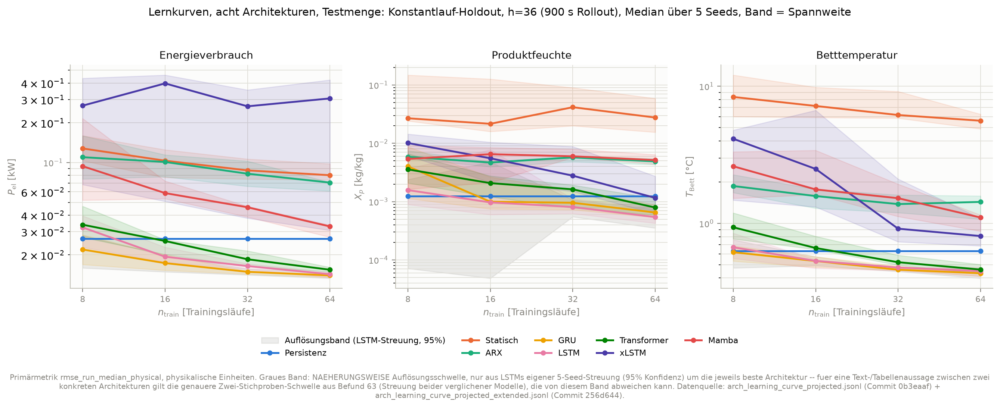
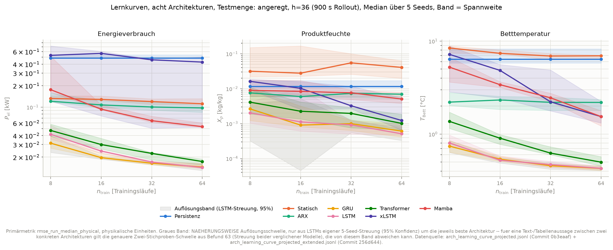
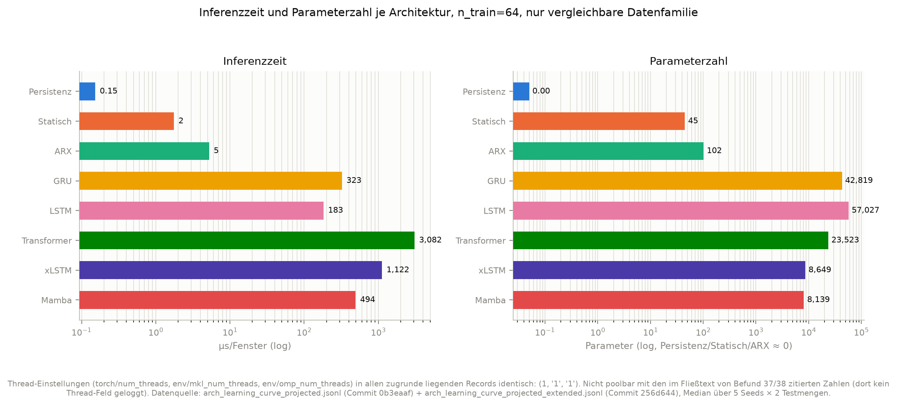
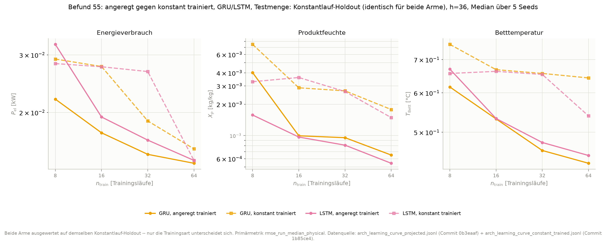

# Synthese AP1 für M2: Methodik der Simulations- und ML-Modellierung

> Meilenstein M2 (TUHH-B, AP1): "Methodik der Simulations- und ML-Modellierung dokumentiert
> (Vorgehensweisen, Werkzeuge, Vorlagen; Reduzierung des Trainingsdatenbedarfs)"
> (`docs/01_projektsteckbrief.md`). Entwurf, Stand 2026-09-25, **3. Fassung nach Durchsicht**
> -- **noch nicht final**, siehe Konsistenzprüfung (SY4) und Rückverfolgungstabelle im Anhang.
> Jede Zahl in diesem Dokument ist auf einen Befund in `docs/04_stand_ap1.md` und ein
> committetes Artefakt zurückgeführt.

## 1. Fragestellung und Rahmen

TwinLink baut einen digitalen Zwilling für die Wirbelschichtsprühgranulation. Der Prozess
lädt ein Partikelbett mit einer Suspension, die auf der heißen Oberfläche antrocknet;
Zulufttemperatur, Gasgeschwindigkeit, Sprührate und Düsendruck bestimmen, wie viel Wasser
verdampft, wie schnell das Bett wächst und wie feucht das Produkt bleibt. Modelliert wird
kontinuierlicher Betrieb mit geregeltem Füllstand (Sollwert-Feststoffmasse, Zeitkonstante
600 s) und laufendem Produktabzug, nicht eine Folge einzelner Chargen -- die genaue
Betriebsart der Zielanlage ist ein offener Klärungspunkt für AP2. Ein schwacher, indirekter
Hinweis aus den Anlagendaten: die 24-Stunden-Aufzeichnungen zeigen eine über den Tag
nahezu konstante Sprührate (Variationskoeffizient 0,12-2,01 %, Befund 56a), vereinbar mit
kontinuierlichem Betrieb, aber kein Beleg dafür. Der für die
Verfahrensführung entscheidende Zustand -- Bettmasse, Wassergehalt, Partikelzahl,
Betttemperatur -- ist an der realen Anlage nur teilweise messbar: Betttemperatur ist
inline verfügbar, die Produktfeuchte im Allgemeinen nicht (Abschnitt 5). Ein Regler, der
nur auf gemessenen Größen operiert, braucht deshalb ein Modell, das aus der Historie der
Stellgrößen auf den unbeobachteten Zustand schließt -- einen Soft Sensor. AP1 baut und
vergleicht die dafür infrage kommenden Modellklassen, mit dem Ziel, den
Trainingsdatenbedarf jeder Klasse zu quantifizieren, nicht nur ihre Bestgüte.

Bis ein physikalisch vollständiges Populationsbilanzmodell (Dyssol) für die Granulation
verfügbar ist -- laut Terminplanung erst ab Monat 21 (`docs/01_projektsteckbrief.md`,
Kritische Terminlage) --, trägt ein reduziertes Grey-Box-Modell mit vier Zuständen
(Feststoffmasse, Wassermasse, Partikelzahl, Betttemperatur) die gesamte
Methodikentwicklung (`docs/02_prozess_setup.md`); dieses Grey-Box-Modell ist selbst bereits
ein physikalisches Modell, kein Datensatz. Die in diesem Dokument verglichenen
ML-Architekturen werden nicht gebraucht, weil kein physikalisches Modell existierte,
sondern weil der reale Anlagenzustand nicht vollständig messbar ist (Abschnitt 5) -- ein
Soft Sensor überbrückt genau diese Lücke, unabhängig davon, welches Prozessmodell im
Hintergrund steht. Die in diesem Dokument berichteten Zahlen sind Aussagen **über das
Grey-Box-Modell**, nicht über die reale Anlage -- Abschnitt 6 macht diese Grenze explizit.

## 2. Methode

**Lernkurven als primäres Ergebnisformat.** Statt eines einzelnen Gütewerts wird für jede
Architektur die Fehlerentwicklung über die Anzahl Simulationsläufe $n_{\mathrm{train}} \in
\{8, 16, 32, 64\}$ berichtet, mit Median und Spannweite über 5 Seeds je Stützstelle. Ein
Modell, das bei kleinem $n_{\mathrm{train}}$ führt, aber nicht weiter besser wird, hat einen
anderen Trainingsdatenbedarf als eines, dessen Kurve bei $n_{\mathrm{train}}=64$ noch fällt.

**Splits auf Laufebene.** Trainings-, Validierungs- und Testmenge werden nach
Simulationsläufen getrennt, nie nach Fenstern oder Zeitpunkten. Ein fenster-/punktweiser
Split, wie in Teilen der Literatur verbreitet, berichtet auf demselben Datensatz einen um
29 bis 68 % niedrigeren Fehler, je nach Zielgröße (Befund 39) -- die laufweise Konvention
verhindert nachweislich genau diese Größenordnung an optimistischer Verzerrung.

**Zwei Testmengen, zwei Fragen.** Die *angeregte* Testmenge (Sprünge/PRBS/Rampen innerhalb
jedes Laufs) misst Identifikationsgüte; der *Konstantlauf-Holdout* (Stellgrößen je Lauf
konstant, Läufe untereinander verschieden) misst Betriebsrelevanz -- reale
Anlagenaufzeichnungen ähneln eher Letzterem. Beide werden durchgehend getrennt berichtet:
eine Verwechslung hat im Projekt bereits einmal zu einer falschen Zahl geführt (Befund 51,
Anhang Zeile K5) -- Persistenz ist auf der angeregten Menge strukturell schwach und auf dem
Konstantlauf trivial stark, ein Faktor gegen sie ist deshalb nur mit Testmenge zitierbar.

**Baselines vor jedem Architekturvergleich.** Persistenz (letzte Messung fortschreiben),
statische quadratische Regression (kennt nur die aktuellen Stellgrößen) und linearer ARX(4,2)
laufen vor jedem neuronalen Modell. Die statische Regression ist die testmengenrobustere
Referenz: ihr absoluter Fehler ändert sich zwischen den Testmengen nur um Faktor ~1,4, während
Persistenz auf `product_moisture_kg_per_kg` um Faktor 6,3 schwankt (Befund 58 OA5a) -- ein
Vergleich nur gegen Persistenz kann deshalb eine Architektur besser aussehen lassen, als sie
gegenüber der eigentlich bindenden Referenz ist (Abschnitt 4).

**Auflösungsvermögen -- eine Rangaussage ist keine Rangaussage ohne sie.** Mit $n$ Seeds ist
die kleinste nachweisbare relative Differenz zweier Modelle

$$
\Delta_{\min} = z_{1-\alpha/2}\,\sqrt{\frac{\hat\sigma_{\mathrm{Kandidat}}^2+
\hat\sigma_{\mathrm{Referenz}}^2}{n}}, \qquad
\hat\sigma = \frac{\text{Spannweite über die Seeds}}{d_2(n)}
$$

mit den Hartley-Konstanten $d_2$ aus der Prozessregelung (`evaluation/resolution.py`) --
eine Zwei-Stichproben-Schwelle, die die Streuung *beider* verglichener Modelle nutzt, nicht
nur einer Referenz (Befund 63g). Die Schwelle hängt deshalb vom jeweils geprüften Kandidaten
ab: für die Vergleiche zwischen GRU, LSTM und Transformer liegt sie mit den gefahrenen 5
Seeds bei `energy_target` (3,9-10,5 %) und `bed_temperature_celsius` (5,5-11,1 %) in der
Größenordnung, die die M2-Definition für drei Seeds nennt (10 bis 15 %) -- **für diese drei
Architekturen ist die M2-Auflösung erreicht.** Für xLSTM und Mamba liegt sie auf denselben
beiden Kanälen wegen ihrer eigenen, deutlich größeren Streuung dagegen bei 17,2 bis
1189,7 % (Tabelle 1) -- **für diese beiden nicht erreicht.** Auf
`product_moisture_kg_per_kg` ist die Schwelle für alle vier Architekturen zu groß (34,8 bis
357,3 % je nach Kandidat) -- dort ist die M2-Auflösung mit 5 Seeds für keinen Vergleich
erreicht. Das heißt nicht, dass auf diesem Kanal keine Rangaussage möglich ist: eine
verfehlte Auflösung bedeutet, dass *kleine* Unterschiede nicht nachweisbar sind -- *große*
bleiben es, wie die weiterhin auflösbaren Rückstände von Transformer, xLSTM und Mamba in
Abschnitt 3 zeigen. Um eine *kleine* Differenz von 12,5 % zwischen GRU/LSTM/Transformer
wären überschlägig **40 bis 41 Seeds** nötig (`SeedSpread.required_replicates`, Skalierung
mit $1/\sqrt{n}$, Befund 63h) -- eine Abschätzung, keine exakte Zahl. **Jede Rangaussage in
Abschnitt 3 ist gegen die tatsächlich erreichte Schwelle geprüft**, nicht nur berichtet.

*Tabelle 1 -- Auflösungsschwelle (relativ, 95 % Konfidenz, $n=5$, Zwei-Stichproben gegen
LSTM als Referenz, Befund 63g/h):*

| Kanal | Testmenge | GRU/Transformer | xLSTM/Mamba |
|---|---|---|---|
| `energy_target` | angeregt | 8,7-10,5 % | 23,3-1189,7 % |
| `energy_target` | Konstantlauf | 3,9-4,7 % | 17,2-1034,9 % |
| `product_moisture_kg_per_kg` | angeregt | 50,0-91,0 % | 298,6-357,3 % |
| `product_moisture_kg_per_kg` | Konstantlauf | 34,8-45,5 % | 142,0-147,8 % |
| `bed_temperature_celsius` | angeregt | 5,5-11,1 % | 49,4-82,0 % |
| `bed_temperature_celsius` | Konstantlauf | 6,2-8,3 % | 23,7-34,3 % |

**Metriken.** Ein-Schritt-Fehler ($h=1$) und Mehrschritt-Rollout-Fehler ($h=36$, 900 s) werden
getrennt berichtet -- ein Modell, das nur einschrittig gut ist, akkumuliert Fehler im Rollout
anders als eines mit trainiertem Mehrschrittverhalten. Inferenzzeit (µs/Fenster) ist die
dritte Pflichtmetrik (Abschnitt 3.2).

**Reproduzierbarkeit.** Jeder Trainingslauf trägt einen Fingerprint der vollständigen
Konfiguration, den Git-Commit und dessen Dirty-Status, sowie deterministische, aus Lauf-IDs
berechnete Splits. Die beiden für den Achtervergleich zentralen Datensätze
(`arch_learning_curve_projected.jsonl`, Commit `0b3eaaf`, und
`arch_learning_curve_projected_extended.jsonl`, Commit `256d644`) sind **protokollgleich**:
gleicher Fingerprint, je `master_seed` identische Splits und Seeds (Befund 58, OA5) -- beide
sind deshalb gemeinsam auswertbar, nicht nur nebeneinander zitierbar. Alle in diesem Dokument
berichteten Inferenzzeiten (Abschnitt 3.2) sind zusätzlich auf identische
Thread-Einstellungen geprüft (`torch/num_threads`, `env/mkl_num_threads`,
`env/omp_num_threads`, alle `1`) -- ohne diese Prüfung wären zwei Datenfamilien mit
unterschiedlicher Parallelisierung vermischt worden (Abschnitt 3.2).

## 3. Ergebnis: Architekturvergleich

Acht Architekturen -- Persistenz, statische Regression, linearer ARX, GRU, LSTM,
Transformer, xLSTM, Mamba -- unter identischem Protokoll (Befund 51+58), drei Zielkanäle
(`energy_target`, `product_moisture_kg_per_kg`, `bed_temperature_celsius`), zwei
Testmengen, $n_{\mathrm{train}} \in \{8,16,32,64\}$, 5 Seeds. Lernkurven: Abbildung 1
(Konstantlauf-Holdout) und Abbildung 2 (angeregt).

**Kernaussage.** GRU und LSTM sind die besten der acht verglichenen Architekturen und
untereinander nicht unterscheidbar; der Transformer erreicht auf der Betttemperatur
(Konstantlauf) Gleichstand und liegt auf dem Energieverbrauch klar auflösbar zurück. Auf
der Produktfeuchte gilt der Rückstand klar nur auf der angeregten Testmenge -- auf dem
Konstantlauf liegt er nur knapp über der Auflösungsschwelle (−45,9 % gegen 45,5 %). Das
Ganze bei rund zehnfachem Rechenaufwand; xLSTM und Mamba liegen zurück. Im Detail:

**GRU und LSTM sind gegeneinander mit fünf Seeds nicht unterscheidbar.** An keiner der sechs
geprüften Kombinationen (3 Kanäle × 2 Testmengen, $n_{\mathrm{train}}=64$) liegt der
Unterschied über der Auflösungsschwelle: die gemessenen Differenzen liegen zwischen
$-19{,}9\,\%$ und $+3{,}5\,\%$, die zugehörigen Schwellen zwischen $3{,}9\,\%$ und
$50{,}0\,\%$ (Befund 63c). **Die belastbare Empfehlung lautet "GRU oder LSTM", nicht eines
von beiden.**

**Gegen den Transformer ist der Vorsprung kanalabhängig -- auf der Betttemperatur
(Konstantlauf) besteht keiner.** Bei `bed_temperature_celsius` (Konstantlauf) liegt der
Faktor bei 1,026 (200 Trainingsepochen) und 1,000 (600 Epochen) -- **beide Werte unterhalb
der Auflösungsschwelle** ($-2{,}6\,\%$ gegen $8{,}3\,\%$ bzw. $+0{,}0\,\%$ gegen $7{,}5\,\%$):
der Unterschied ist zu keinem Zeitpunkt nachweisbar, unabhängig vom Epochenbudget. Auf allen
übrigen geprüften Kombinationen ist der Transformer-Rückstand dagegen
auflösbar: `energy_target` (Konstantlauf) in beiden Konfigurationen ($-8{,}2\,\%$ gegen
$4{,}7\,\%$ bei 200 Epochen, $-15{,}8\,\%$ gegen $9{,}8\,\%$ bei 600 Epochen, wachsend statt
gleichbleibend), `bed_temperature_celsius` auf der angeregten Testmenge ($-16{,}5\,\%$
gegen $11{,}1\,\%$) und `product_moisture_kg_per_kg` auf beiden Testmengen (angeregt
$-98{,}6\,\%$ gegen $91{,}0\,\%$; Konstantlauf $-45{,}9\,\%$ gegen $45{,}5\,\%$ -- dort nur
knapp). Kostenseitig ist der Transformer, unabhängig vom Ergebnis, in dieser
Implementierung 9,5- bis 16,9-fach teurer bei Inferenz (Tabelle 2) und 9,6- bis 11,4-fach
teurer beim Training (`training/elapsed_s`, dieselbe Datenfamilie, $n_{\mathrm{train}}=64$)
als GRU/LSTM -- ein Effekt, der auch bei aufgelöster Güte gegen ihn spricht. Ursache ist das
Fehlen von KV-Caching im Decoder-Loop dieser konkreten Implementierung (Befund 37c), keine
zwingende Eigenschaft der Transformer-Architektur an sich.

**xLSTM und Mamba bleiben zurück -- in 10 von 12 geprüften Zellen auflösbar belegt, mit
einer benannten Ausnahme.** Über 3 Kanäle × 2 Testmengen ist Mamba durchgehend (6/6),
xLSTM auf `energy_target` und `bed_temperature_celsius` (4/4) nachweisbar schlechter als
LSTM. Auf `product_moisture_kg_per_kg` ist xLSTMs Rückstand dagegen -- trotz großer
Medianunterschiede (Faktor > 2 in beiden Testmengen) -- **nicht statistisch belastbar**:
die Architektur zeigt auf diesem Kanal bereits in Befund 58 eine divergierende
Optimierung (der Fehler steigt dort streckenweise mit wachsendem $n_{\mathrm{train}}$
statt zu fallen), und genau diese Instabilität erzeugt eine so große eigene
Seed-zu-Seed-Streuung, dass die Auflösungsschwelle den Medianunterschied nicht mehr
unterschreitet. Das ist als Optimierungsversagen unter dem hier gefahrenen festen
Protokoll zu lesen, nicht als belastbare Kapazitätsaussage über die Architektur auf diesem
einen Kanal (Befund 63 Nachtrag).

**Baselines: der lineare ARX sättigt sanft, nicht scharf, und überholt sein nichtlineares
Gegenstück nie.** Unter der aktuellen Konfiguration (GAB-Isotherme, Δt=25 s/900 s-Horizont,
Befund 44) fällt der ARX-Fehler auf `product_moisture_kg_per_kg` noch messbar bis
$n_{\mathrm{train}}=64$ ($-7{,}8\,\%$ Δ zur vorigen Stützstelle), erst ab $n=128$ wird der
Zugewinn klein. Das nichtlineare `RandomFeatureNARX` (identische Ridge-Regression, einzige
Änderung: nichtlineare statt lineare Basisfunktion) schließt die relative Lücke zum ARX
drastisch (69 % → 12 % über $n=8$ bis $256$), überholt ihn aber an keiner Stützstelle --
reine Nichtlinearität ohne gelernten Zustand oder Rollout-Training hilft auf dieser Aufgabe
nicht. Ein direkter Vergleich dieser ARX/NARX-Kurve mit GRU/LSTM ist nicht zulässig (andere
Konfiguration, Befund 43e/44c).

### 3.1 Statische Regression und `energy_target`: R² täuscht über die verbleibende Lücke

`energy_target` ist zu R² = 0,972 statisch erklärbar (Befund 59b) -- eine Zahl, die
verdeckt, wie groß die verbleibende Lücke in physikalischen Einheiten ist: bei
$n_{\mathrm{train}}=64$, h=36, liegen die trainierten Modelle bei R² ≥ 0,999 (angeregt) bzw.
≥ 0,9989 (Konstantlauf) -- eine Verschiebung, die in R²-Einheiten in der
dritten/vierten Nachkommastelle verschwindet, aber **Faktor 5,2 bis 7,8 im RMSE** bedeutet
(Befund 59a). Ein zweites, unabhängiges Protokoll (Befund 50, 3 Seeds, nur GRU, eigener
Kanal `bed_temperature_celsius` als Anwendungsgröße, nicht Teil des Achtervergleichs oben)
zeigt dasselbe Muster deutlicher: R²$_{\mathrm{stat}}$ = 0,768 sieht nach einer schwachen
Baseline aus, aber der physikalische Restfehler der besten linearen Regression (FIR, k=43:
3,62 K) gegenüber GRU (0,18 K) ist dort **Faktor 20** (Befund 50j). Die praktische
Konsequenz: R² ist zur Einordnung eines Architekturvergleichs ungeeignet, sobald die
Zielgröße eine große Varianz gegenüber ihrem Restfehler hat.

### 3.2 Inferenzzeit

*Tabelle 2 -- Inferenzzeit und Parameterzahl, $n_{\mathrm{train}}=64$, nur die untereinander
thread-geprüfte, protokollgleiche Datenfamilie (Befund 51+58), nach Inferenzzeit sortiert:*

| Architektur | µs/Fenster | Parameter |
|---|---|---|
| Persistenz | 0,15 | 0 |
| Statisch | 1,76 | 45 |
| ARX | 5,25 | 102 |
| LSTM | 182,8 | 57.027 |
| GRU | 323,1 | 42.819 |
| Mamba | 494,1 | 8.139 |
| xLSTM | 1.121,9 | 8.649 |
| Transformer | 3.081,6 | 23.523 |

**Unerwartet und unerklärt: LSTM ist bei gleicher Kapazitätsstufe schneller als GRU, nicht
langsamer.** Beide Architekturen laufen mit identischer `hidden_size` (64), LSTM hat dabei
33 % mehr Parameter als GRU (57.027 gegen 42.819 -- der zusätzliche Zellzustand, konsistent
mit der bereits in Befund 30 notierten Beobachtung). Mehr Parameter bei gleicher
Kapazitätsstufe legt eine langsamere, nicht schnellere Inferenz nahe -- gemessen ist das
Gegenteil (182,8 gegen 323,1 µs/Fenster, Faktor 1,77). **Die Modellgröße erklärt den
Unterschied nicht** (Befund 63a); er bleibt als offene, unerklärte Beobachtung stehen, kein
CPU-Kernel-Profiling wurde durchgeführt.

**Vorbehalt.** Andernorts im Laborbuch zitierte Einzelwerte für GRU/Transformer/Mamba
stammen aus Datensätzen ohne geloggte Thread-Einstellungen und sind mit Tabelle 2 **nicht
poolbar** -- eine Abweichung zum hier berichteten GRU-Wert (323,1 µs) ist damit erklärt,
nicht widersprüchlich.

## 4. Methodische Befunde (Zusammenfassung)

- **Testmengenwahl ändert die berichtete Zahl, nicht nur ihre Größe.** Der Faktor gegen die
  Persistenz-Baseline auf `product_moisture_kg_per_kg` hängt stark von der Testmenge ab:
  1,31 (GRU)/1,70 (LSTM) auf dem Konstantlauf-Holdout, 4,4 bis 24 auf der angeregten
  Testmenge -- beide Zahlen sind gültig, aber nur mit Testmenge zitierbar, nicht
  austauschbar (Befund 51, K5).
- **Laufweise Splits verhindern nachweislich optimistische Verzerrung** (Abschnitt 2).
- **Betriebsdaten genügen für die Feuchte im getesteten Budgetbereich nicht.** Ein
  ausschließlich auf rein konstanten Läufen trainiertes Modell bleibt bei
  `product_moisture_kg_per_kg` über den gesamten Budgetbereich ($n_{\mathrm{train}} \le 64$)
  um Faktor 2,2 bis 3,1 schlechter als das gleiche Modell auf angeregten Daten, ohne
  erkennbares Aufholen (Abbildung 3, Befund 55). Grund, an den Epochenzahlen sichtbar: das
  konstant trainierte Modell erschöpft sein lernbares Signal nach rund einem Achtel der
  Epochen (Early Stopping bei ≈24 statt ≈170) -- eine Messung des Informationsgehalts der
  Daten, keine Recheneffizienz.

## 5. Datenbedarf und Anlagenbezug

Reale Betriebsaufzeichnungen des Anwendungspartners (zwei 24-Stunden-Exporte, zwei
Produkte, Minutentakt) bestätigen das synthetische Ergebnis aus Abschnitt 4 unabhängig:
Stellgrößen variieren innerhalb eines Betriebspunkts kaum (Variationskoeffizient 0,12 bis
2,01 % über Luftmenge, Zulufttemperatur, Sprührate), zwischen den zwei beobachteten
Produkten dagegen stark (Befund 56, 56a) -- exakt das Muster, das Befund 55 aus dem
synthetischen Experiment ableitet: Betriebsdaten decken verschiedene Arbeitspunkte ab, aber
innerhalb eines Arbeitspunkts kaum Dynamik.

Eine Validierung der Betttemperatur gegen diese Anlagendaten steht noch aus. Die
Anlagendaten erlauben aber bereits eine prüfbare Vorhersage: bei gemessenem Luftstrom und
gemessener Zulufttemperatur legt die Betttemperatur im Beharrungszustand im Wesentlichen
den Wassergehalt der Sprühsuspension fest, unabhängig von der im Export nicht enthaltenen
Bettmasse. Je nach Bilanzraum -- mit oder ohne die laut
Befund 56 (NA4) vermutete Verdampfung oberhalb des Betts -- und unbekanntem Wandverlust
sagt das Modell für beide Produkte einen Suspensions-Feststoffanteil zwischen rund 59 und
73 % vorher (Befund 56, NB2) -- deutlich über dem
bisherigen Konfigurations-Nominalwert (30 %), für den keine Anlagenmessung vorlag. Für
eines der beiden Produkte (RID) ist diese Vorhersage mit der im Leitsystem angezeigten
Suspensionsdichte konsistent: über die gesamte vorhergesagte Spanne liegt die implizierte
Feststoffdichte im für eine organische Formulierung plausiblen Bereich -- ein erster
unabhängiger Hinweis, dass "deutlich über 30 %" zutrifft, der aber innerhalb der Spanne
nicht zwischen den Bilanzräumen unterscheiden kann. Werte über etwa 70 % sind für eine
sprühbare Suspension hoch; das obere Ende der Spanne ist entsprechend vorsichtig zu lesen.
Die Produktfeuchte selbst ist an der Anlage F-5 nicht gemessen.

Genau das ist der Grund, warum die in diesem Dokument verglichenen Modelle gebraucht
werden: der Anlagenzustand ist nicht direkt beobachtbar, und die Größe, die ihn am
vollständigsten repräsentiert -- die Produktfeuchte -- bindet an 17 von 25 geprüften
Störgrößenkombinationen als aktive Nebenbedingung am energetischen Optimum (Befund 52c),
ist aber an der Anlage F-5 nicht gemessen (Befund 56). Ein Soft Sensor ist an dieser Stelle
keine Komfortfunktion, sondern die Voraussetzung dafür, dass ein Regler die
Qualitätsgrenze überhaupt kennt.

## 6. Grenzen

- **Vier-Zustandsmodell statt Populationsbilanz.** Das Grey-Box-Modell kennt weder
  Agglomeration noch Bruch noch eine Kopplung des Partikelwachstums an die
  Trocknungsbedingungen; die Partikelgröße ist im stationären Fall eine Konstante des
  Materialsystems (Befund 62a). Alle Architekturvergleiche in Abschnitt 3 sind Aussagen
  **über dieses Modell**.
- **Die Wahrheit ist der Simulator, nicht die Anlage.** Solange Dyssol-Granulationsmodelle
  fehlen (bis Monat 21), gibt es keine unabhängige physikalische Referenz für die
  Produktfeuchte -- jede hier berichtete Modellgüte ist relativ zum Grey-Box-Modell, nicht
  zur Anlage.
- **Sechs unbelegte Platzhalter beeinflussen die Ergebnisse dieses Dokuments direkt** (mit
  Fundstelle, vollständige Liste im Anhang der Bestandsaufnahme,
  `docs/08_synthese_m2_bestand.md`, Tabelle 3): die kritische Gutsfeuchte (0,20 kg/kg, bindet
  an der Regret-Nebenbedingung in Abschnitt 5), die 80-°C-Bettemperaturgrenze (frei gesetzt,
  an Anlage F-5 existiert ein realer, erfragbarer Grenzwert), der Beharrungsdurchmesser
  d50 (≈750 µm, geht in jede Fluidisierungs-Zulässigkeitsprüfung des Modells ein, Befund 46),
  die Kaltseitentemperatur des Wärmeübertragers, der Versatz zwischen Bett- und
  Abluft-Temperatur im Modell (Ursache vermutlich fortlaufende Verdampfung oberhalb des
  Betts, nicht ein Leitungsverlust im engen Sinn -- Befund 56 NA4 widerlegt die frühere
  Lesart als reiner Wärmeverlust) und der Wandverlust der Anlage (im Modell nur als kleiner
  Platzhalterwert hinterlegt, nicht anlagenseitig ermittelt -- geht direkt in die Breite der
  Feststoffanteil-Spanne in Abschnitt 5 ein, Befund 56 NB2).
- **Fehlende Anlagenmessgrößen.** In den bisher verfügbaren Anlagenexporten fehlen
  Gasverbrauch/Heizleistung, die Feuchte der Ansaugluft, Produktfeuchte, Partikelgröße und
  Produktmassenstrom vollständig (Befund 56) -- `energy_target` ist an diesen Daten deshalb
  überhaupt nicht validierbar.
- **Inferenzzeit unvollständig kreuzvalidiert.** Tabelle 2 (Abschnitt 3.2) ist intern
  konsistent, aber nicht mit allen im Laborbuch an anderer Stelle zitierten Einzelwerten
  poolbar (fehlende Thread-Protokollierung in älteren Datensätzen).

## 7. Ausblick

AP1 ist nicht RL ("erst müssen stabile Mehrschritt-Rollouts stehen",
`docs/05_arbeitsplan_ap1.md`) -- die folgenden Punkte sind Kontext für AP3, nicht Ergebnis
dieses Arbeitspakets.

Die Modelle aus Abschnitt 3 werden nachgelagert gebraucht, weil zwei Eigenschaften des
Prozesses zusammenfallen: der Anlagenzustand ist nicht vollständig messbar, und ausgerechnet
die unbeobachtete Größe -- die Produktfeuchte -- bindet an einer Mehrheit der geprüften
Betriebspunkte als aktive Qualitätsgrenze (Abschnitt 5). Eine mögliche künftige
Validierungsoption, im Rahmen dieses Dokuments nicht geprüft: an Anlage KR-1 des
Anwendungspartners existiert bereits eine kapazitive In-situ-Feuchtemessung (Befund 63i) --
nicht an Anlage F-5, um die es in Abschnitt 5 geht. Sie wäre eine mögliche Grundlage, den
Feuchte-Soft-Sensor aus Abschnitt 3 gegen eine reale Messung zu prüfen; nicht geprüft, die
Übertragbarkeit zwischen den beiden Anlagen ist offen. Eine Voruntersuchung zur
RL-Eignung (Befund 52, kein Netztraining, reine Optimierung) zeigt, dass ein fester
Betriebspunkt gegenüber dem instanzoptimalen Wert einen Regret im **Prozentbereich** trägt
(Median 16 %, bis 26 % je nach Störgrößenkombination; Bruttoverbrauch, Labormaßstab --
kein Einsparpotenzial an der realen Anlage F-5, siehe Befund 52 Vorbehalte) -- groß genug,
um eine adaptive Regelung inhaltlich zu rechtfertigen, nicht nur eine feste Fahrweise zu
bestätigen. Ob eine
solche Regelung die vom Feuchte-Soft-Sensor gelieferte Information sicher nutzen kann, hängt
an der Größenordnung des Vorhersagefehlers relativ zu einer gehaltenen Sicherheitsmarge:
eine spätere Nachrechnung (Befund 62, Nachtrag HA1) findet die Marge eines
straf-basierten Regel-Agenten zur Feuchtegrenze **85,7-fach** (empfohlener, angeregt
trainierter Soft Sensor) bzw. **31,3-fach** (aus reinen Betriebsdaten trainierter Soft
Sensor) so groß wie der dreifache Vorhersagefehler -- eine Brücke zwischen der
Modellgüte aus Abschnitt 3 und einer künftigen Regelungsaufgabe, mit dem Vorbehalt, dass
die kritische Gutsfeuchte selbst ein unbelegter Platzhalter ist und die Aussage im Modell
gilt. Der zugrundeliegende Agent lief mit SB3-Standard-Hyperparametern, nicht auf die
Aufgabe abgestimmt (Befund 62, FA2/GA1); die Faktoren 85,7 und 31,3 zeigen damit vor allem,
was ohne gezielte Kopplung der gehaltenen Marge an die Schätzunsicherheit des Soft Sensors
passiert -- sie sind keine Eigenschaft des Prozesses oder des Soft Sensors selbst.

Auf Verbundebene liegt die beste der sechs vom Partner geprüften Wärmeübertrager-
Verschaltungen 2,3 bis 4,2 % über dem thermodynamischen Optimum (Pinch-Analyse, Befund 60,
Daten des Partnermodells) -- die Verschaltungsfrage ist für diesen Datenfall praktisch
gelöst.

## Anhang: Rückverfolgungstabelle

Spalten: Aussage · Zahl(en) · Befund · Artefakt · Commit · **über Auflösungsvermögen
ja/nein**. Letztere Spalte ist nur dort ausgefüllt, wo ein Auflösungsvermögen-Test
durchgeführt wurde (Befund 63) -- "n/g" heißt nicht geprüft, nicht "ja".

| Aussage (Abschnitt) | Zahl(en) | Befund | Artefakt | Commit | Über Auflösung? |
|---|---|---|---|---|---|
| GRU/LSTM gegeneinander nicht unterscheidbar (3) | 6/6 Zellen unter Schwelle | 58, 63c | `arch_learning_curve_projected(_extended).jsonl`, `analyze_m2_resolution_verdicts.json` | 0b3eaaf, 256d644, 47c5292 | **Nein** (alle 6) |
| Transformer/LSTM `bed_temperature_celsius`, 200→600 Epochen (3) | 1,026 → 1,000 | 58-Nachtrag, 63d | `arch_epoch_budget_probe600.jsonl` | 7e3fb1d, 0ed48e5, 47c5292 | **Nein** (beide) |
| Transformer/LSTM `energy_target`, 200→600 Epochen (3) | 1,082 → 1,158 | 58-Nachtrag, 63d | `arch_epoch_budget_probe600.jsonl` | 7e3fb1d, 0ed48e5, 47c5292 | **Ja** (beide) |
| Transformer/LSTM `product_moisture_kg_per_kg` (3) | −98,6 % / −45,9 % | 63d-Nachtrag | `analyze_m2_resolution_verdicts.json` | 47c5292 | **Ja** (Konstantlauf knapp) |
| xLSTM/Mamba "bleiben zurück" (3) | 10/12 Zellen über Schwelle | 63e-Nachtrag | `analyze_m2_resolution_verdicts.json` | 47c5292 | **Teilweise** (xLSTM/Feuchte: nein) |
| Seedbedarf 12,5 % auf Feuchte (2) | ≈40-41 Seeds | 63h | `analyze_m2_resolution_verdicts.json` (Methode), Berechnung Befund 63h | 47c5292 | n/a (Abschätzung) |
| ARX sättigt sanft, NARX überholt ARX nie (3) | ARX −7,8 % (Δ bei n=64); NARX-Lücke 69 %→12 % | 44 | `arx_narx_learning_curve_gab_900s.jsonl` | 9652942 | n/g |
| `energy_target` R²-Kompression (3.1) | R²$_{\mathrm{stat}}$=0,972 vs. Faktor 5,2-7,8 RMSE | 59a/b | `analyze_energy_target_static_factor.py`-Ergebnis | bc6b097 | n/g |
| `bed_temperature_celsius` R²-Kompression, eigenes Protokoll (3.1) | R²$_{\mathrm{stat}}$=0,768 vs. Faktor 20 RMSE | 50j | `outlet_temperature_gru_protocol.jsonl` | f3d9a7a (Skript), b0ae64a (Ergebnis) | n/g |
| Inferenzzeit + Parameterzahl (3.2) | Tabelle 2 | 51, 58, 63a | `arch_learning_curve_projected(_extended).jsonl` | 0b3eaaf, 256d644, 47c5292 | n/a (Kostenmetrik) |
| LSTM schneller als GRU, unerklärt (3.2) | 182,8 vs. 323,1 µs/Fenster, 1,33x mehr Parameter | 63a | `analyze_m2_resolution_verdicts.json` | 47c5292 | n/a |
| Transformer-Kosten Training/Inferenz (3) | 9,6-11,4x Training, 9,5-16,9x Inferenz | 51, 58 | `arch_learning_curve_projected(_extended).jsonl` (`training/elapsed_s`) | 0b3eaaf, 256d644 | n/a |
| K5-Testmengenfalle (4) | 1,31/1,70 (Konstantlauf) vs. 4,4-24 (`excited`) | 51 | `arch_learning_curve_projected.jsonl` | 0b3eaaf | n/g |
| Laufweise vs. punktweise Splits (2) | 29-68 % niedrigerer Fehler punktweise | 39 | `extra_trees_split_comparison.jsonl` | a0bbc19 | n/g |
| Betriebsdaten genügen nicht (4) | Faktor 2,2-3,1, kein Aufholen | 55 | `arch_learning_curve_constant_trained.jsonl` | 1b85ce4 | n/g |
| Anlagendaten: CV Stellgrößen (5) | 0,12-2,01 % | 56a | (Rohdaten nicht im Repo) | e3efc19, 88c0746 | n/a |
| Feuchte bindet an 17/25 Optima (5) | 17/25 | 52c | `bb1_bb3_operating_point_regret.json` | 7103b73 | n/a |
| Regret fester Betriebspunkt (7) | Median 16 %, bis 26 % | 52 | `study_operating_point_regret_win_repro.json` | 7103b73 | n/a |
| Sicherheitsmarge/Vorhersagefehler (7) | 85,7x / 31,3x | 62 (HA1-Nachtrag) | `rl_bandit_ha1_margin_vs_prediction_error.json` | 7e9ff67, f99c7f4 | n/a |
| Verschaltungslücke zum Optimum (7) | 2,3-4,2 % über Pinch-Ziel, Fall 1 beste Verschaltung | 60 (PA3) | `run_pinch_benchmark.json` | 8b41828 (Skript), 16ded7e (Ergebnis) | n/a |
| Feststoffanteil-Vorhersage (5) | Spanne ~59 bis 73 % (ACE 59,1-72,6 %, RID 64,0-71,2 %), je nach Bilanzraum (Bett vs. ganzer Apparat) und Wandverlust | 56 (NB2 + Nachtrag) | `study_plant_solid_fraction_prediction.json` | 6f7262c, 914233a (Skript), e40d49b, ae426f3 (Ergebnis), 7f88680 (Befund-Nachtrag) | n/a |

Vollständige Aussagen-, Korrektur- und Platzhaltertabellen: `docs/08_synthese_m2_bestand.md`.
